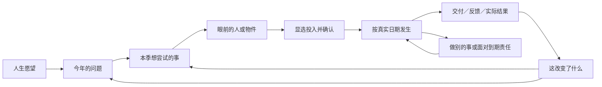
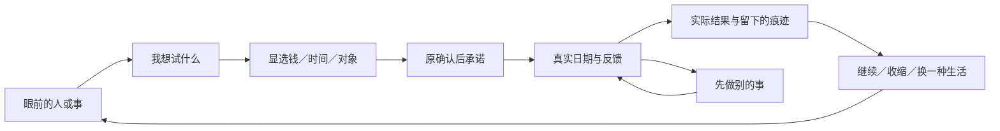

# 36｜主线与系统美术交互重构方案

**2026-10-24再次试玩后的执行依据：见第8节。** 本轮重新打开“主线可理解性”和“系统美术交互”的体验问题；此前S1/S2及业务片的接线与限定验证保留，不能解释成用户已经认可主线或美术。后续按第8节的完整玩家经历安排，旧S4未完内容保留并映射到新顺序。

2026-10-23，D12 设计方案。沿 A「长日重启」，采用 Game Studio 的 Shared → game-ui-frontend / web-game-foundations / game-playtest 路径，继续现有 React / TypeScript / Vite。**S1已接入正式运行时，原实际验证与范围见[S1记录](../goal-1/evidence/t17-acceptance-21/validation.md)；S2已完成下述限定实现与验证，实际范围见[S2记录](../goal-1/evidence/t17-acceptance-22/validation.md)；S3-V1视频一单及S3-C1课程准备已接入并按下述限定范围验证；S3-C2班期教学、支持与退款已完成限定实施和自主验证，见[C2完成记录](../goal-1/evidence/t17-s3-course-teaching-post-commit-01/acceptance-summary.json)；S4—S5仍待实施。** 原独立交互分镜不连接存档，不能替代正式运行时或真人体验验收。经济02、内容15、各业务合同及原子保存仍为规则权威。所有页面兼容开发和测试暂停。

### S2当前实施与验证边界（2026-10-23）

S2已把一组轻HUD、显选且持久的独立UI书签、责任中断/返回和真实季度留页扩至各playing季度；书签按UI版本/run/季度/完整对象身份与游戏存档分离，恢复重新匹配公开对象，失效明确重选。同对象状态刷新及AdvanceTime不重写旧季度标签，偏好失败只说明未记到本机，不改变游戏命令/回执。当前Chrome采用三个独立正常小循环，未要求同一人生全部经营：

- 工作：走完整Q1，Apr1仍保留原Q1工作书签，重进及原册仍为同一工作；本机书签选择预看、取消不改游戏原文。
- 生活：内容背景先完成七天休整，Jan8另行安排工作不抢原书签；Mar28以3000元、1AP改善住处，Mar31仍未完成。Apr1保留同一原job跨季继续，四点新季预算与4000元原生活费分别发生；Apr4实际完成后才改变住处场景。
- 投资：独立选择100股模拟AI02原委托，先冻结2755元；Jan10实际成交额2481元、费用5元。原册、季度留页及重进仍对应原单；没有把持仓或成交说成卖款交收，也未强求卖完或盈利。

DEV另实核写入后中止时旧提交与物理存储仍为第1次提交、只读页也读到物理旧1；原候选存在时禁止换书签，原retry成功后第2次提交与物理读取/重进一致。[本轮完整正常导出原文审计](../goal-1/evidence/t17-acceptance-22/normal-export-audit-r2/result.json)已实退出0，不能由此推断整体体验通过。最终R4实图发现长物件旁签遮住随身册，实际点击随身册误开物件近景；R5已将完整物件和底部入口分离，当前窗口鼠标分别打开正确随身册、物件及日历，工作与生活原档保持。原红图、修缮和当前证据见[S2验证记录](../goal-1/evidence/t17-acceptance-22/validation.md)，准确本地提交身份以主任务完成记录为准。

本S2没有新图或声音，以上不等于新界面下两背景24季度/六年整体体验已验。后续S3课程阶段与S4—S5、原P3 WIP、62关键原文重放（本轮0）/22例行及T17/PNG/真人/M01暂停/T18/goal剩余责任保持；游戏规则不变，全部页面兼容开发测试0。

### S3-V1当前实施与验证边界（2026-10-23）

视频这一个内部任务已接同一账号/作品/合同的持续目标、分步显选与原确认、真实等待和独立回款；专用原创手机/分镜本/素材纸套件承担各阶段，不重画整屏或伪造视频播放。原册、日历、季度来源及取消后的同身份草稿可往返，未知/失效账户不默认切换；账号预看必须另点确认才生效。只在真实保存后发布新作品与结果。

- 正常新局手工链：实际推广产生客户，900元制作/1点/14日，核对并亲手提交，Jan24验收、Jan31余款与150元原费实际结算，个人可花27350元/余2点。客户本次没有要求修改，不借此声称受挫覆盖。
- 合法图像辅助新单：完整Create挣得的2022-08-29前史（86900元/余1点）实际取得并已读资格；本单授权素材在内成本1000元。客户真实要求修改，0AP时保留原单，经原季末屏障到下一季，再付300元/1点返工；范围谈判另耗1点/3日，接受后仍亲手重提同一已核对版本。Oct15验收、Oct22实收，个人可花92450元/余2点。期间原工资和生活费独立记账，不用余额差当本单利润。
- DEV真实保存中止：物理旧4与原候选5分开；只读页读回旧4。原候选重试成功后，保存5/物理5逐字等候选；未来开工仍是预留，开工前退出保留推广成本并释放原预留/退款。未确认预看另一账号后合上，原账号标题与原单仍一致。

最终R8 Chrome重进手工12/AI70均与原导出逐字同，结算主幕直接列预款900、余款2100和费用150；文字/减少动效实际可用并恢复原设置。完整证据与适用回归身份见[S3-V1限定记录](../goal-1/evidence/t17-acceptance-23/validation.md)。新的原子候选测试、真实受挫与原前史重放分别记，不把导入前史算本轮Chrome多年实玩。0AP实际画面来自R6，R8只改该错误的展示文案并有定向回归，未再创造一局当新0AP实测。

本次只完成S3的视频内部任务；课程准备、班期教学/支持/退款及第三片全面检查仍待，不能据此勾整套S3。新图不是旧缺三PNG，没有新声音，真人仍0；道具接触/局部叠盖、长标签和条款密度继续列后续艺术改进，不靠截图声称真人理解或趣味性。全部兼容开发测试0，原P3 WIP/62正式0/22例行和所有T17/M01暂停/T18/goal责任保持。

### S3-C1课程准备的限定实现（2026-10-24）

沿[具体方案](../goal-1/evidence/t17-acceptance-24/plan.md)把同一份教案贯穿原案例、资金、大纲、课程范围与样课。玩家显选的对象留在书签和原册里；普通旁路不抢关注，强制原责任处理后仍能返回。步骤是呈现顺序，已有真实准备可复用，不新增强制前置。

| 眼前问题 | 玩家操作与物件反馈 | 完成边界 |
| --- | --- | --- |
| 哪段亲手做过的事值得教？ | 选实际已付案例，留下同对象纸签。 | 手工经验有效，不冒充既有AI资历；内训形式才需两案例。 |
| 为准备留多少钱？ | 自有资本转入独立课程企业；显选写纲资源和日期，独立启用。 | 转账不是收入，准备/开工/完成分别表达；旧合法大纲不强制重做。 |
| 想让谁学会什么？ | 案例→形式/主题/受众/使用同意→原确认留下方案。 | 定义不是样课；不自动招生。 |
| 材料范围能用于这门课吗？ | 需要时安排原独立课程许可，等待真实完成后回同一教案。 | 视频本单授权不直接继承，许可绑定原企业与案例。 |
| 为样课留真正的日子？ | 显选资源/日期，只列所选形式费用和预计反馈。 | 真实资格、行动与产能逐日核；日期到不冒充任务完成。 |
| 样课做成后先收好吗？ | 同对象纸白完成签与原记录。 | 当前权利/工具/更新条件仍须核，获客、班额、支持和报名另定。 |

美术用同镜头透明低平教案、案例套、空白范围纸与笔；文字/状态仍是DOM。已安排用虚线日期，进行中保实际反馈日，保存后才出现完成痕迹；只读、失败和减少动效保完整路径。完整目标携带run/账户/工作室/课程/原任务，原册往返和取消保留同身份草稿；唯一缺失素材范围可直接进入该案例的许可步骤，不自动授权或提交。

Chrome从原AI70正常存档实际推进：工作室5000元自有资本、大纲100元/1点/Dec1—8、独立启用、定义案例方案、许可300元/1点/Dec9—16，再以2500元/1点安排Jan2—16样课。0AP的当季样课被原预览拒绝；明确选择新季后允许原预留，跨季仍支付77.41元维护和4000元个人生活费。Jan16实际ready，企业可花2022.59元、个人75450元、余3点；课程获客/班期/报名/学费记录均0。定义另一方案只预览取消，原86档在重进/显示切换/原对象返回后逐字相同。

DEV真正写入后中止保物理旧78；原候选79重试后与独立物理79逐字同。最终完整Create审核为同一创建、87条不同后续命令、11份公开原文（4缓冲/1候选/6实存）全字节同，不能把缓冲或分支算额外游戏完成。R5已修实际已安排幕文案互盖，完整保存回响和底部探索鼠标实点验证分列；接触感、局部叠层、底部紧凑和纸页密度继续艺术优化。具体源/分批检查/红档及边界见[S3-C1验证](../goal-1/evidence/t17-acceptance-24/validation.md)。没有新声音，真人仍0；本片不关闭整S3、原P3/62/22、T17或完整goal。

## 1. 诊断：有许多正确步骤，却缺少连续的玩家目的

下表保留D12方案建立时的诊断与来源；当前S1/S2实施现状以上述增量为准，不将旧观察重写为新源结论。

当前画面已有电影氛围，首单、五路线、人物、实际日历和24季度也已有实现。用户试玩反馈指向两处结构问题：玩家难以把这些操作理解成自己在推进的故事；美术没有持续表达选择造成的变化。

| 已核事实 | 对体验的判断 | 本次设计决定 |
| --- | --- | --- |
| Home 保存投资/自由开局，RoomMoment 首次仍优先手工单。当前 Chrome 选择投资后实际复现。 | 刚作的选择没有得到首幕回应。 | 三种开局各自给出眼前对象与第一步，不能统一转回首单。 |
| FirstChapterTrail 已有工作/小单/交付/回款进度，入口位于随身日历。 | 关键路径要先找到记录才能看懂。 | 主场景直接显示当前尝试、当前阶段及下一反馈；日历保留全部记录。 |
| RoomMoment 按风险、生活、市场、首单等优先级换焦点；回款后主要入口转路线总览。 | 普通事项可能抢走刚才的目标；成功之后又变成选系统。 | 保持玩家关注的同一件事，处理中断后回到它；结果接一个具体的后续问题。 |
| 季度四标签可切换；章节文案随季度变化，愿望主要影响回顾。 | 翻页、时间变化和实际进展容易混淆。 | 以实际选择和回响组织季度，章节负责提问；愿望连接眼前取舍，不新增进度分数。 |
| 当前主幕有顶栏、账户选择、两套行动信息、五个随身入口；大号选择行横跨场景。背景多按页面选整图。 | 画面主体仍是操作层，场景/人物较少参与决定。 | 一组状态、一件焦点物件、一组念头；道具状态和人物来往承载进展，复杂原账近景分页。 |

源码依据：[Home](../src/ui/Home.tsx)、[App](../src/ui/App.tsx)、[RoomMoment](../src/ui/RoomMoment.tsx)、[FirstChapterTrail](../src/ui/FirstChapterTrail.tsx)、[SceneJournal](../src/ui/SceneJournal.tsx)、[QuarterPanel](../src/ui/QuarterPanel.tsx)、[scene-season](../src/ui/scene-season.ts)、[ChapterBackdrop](../src/ui/ChapterBackdrop.tsx)。更细的定位见[主线审计](../goal-1/evidence/t17-acceptance-20/mainline-audit.md)和[美术审计](../goal-1/evidence/t17-acceptance-20/art-ui-audit.md)。[本次 Chrome 观察](../goal-1/evidence/t17-acceptance-20/browser-current-r1/observation.json)及[当前主幕](../goal-1/evidence/t17-acceptance-20/browser-current-r1/investment-first-scene.png)支持上述局部判断，不等于全局或真人研究。

## 2. 主线：把日子握在自己手里

玩家幻想是：带着模糊的未来记忆回到2020，用有限的钱和时间，尝试更值得的生活。核心动词是**发现、判断、承诺、安排、交付、等待、回应**。每一幕必须回答“我在意什么—眼前发生什么—能做什么—付出什么—何时知道结果”。

贯穿一局的是玩家自己的愿望。年度提出问题，本季选择一次尝试，场景给出具体一步，结果留下可回访的事实；强制义务打断时保留原关注对象。它是一条可以改变方向的叙事骨架，工作、投资、生活或不采用代理都能成立。五路线是可选择的手段，不是五份必须做完的任务。

### 三种开局必须回应选择

| 开局 | 首幕焦点与实际一步 | 第一次小循环的终点 | 同时可做 |
| --- | --- | --- | --- |
| 工作＋手工第一单 | 电脑里的委托：核对报价/成本/日期，选择接单或婉拒。工作另行确认。 | 实际制作、亲手提交、客户复核、实际回款；失败/拒单也有后续选择。 | 保留工作、准备、生活、查看其他路线。 |
| 工作＋准备投资 | 桌上的模拟市场资料：先理解生活储备与已知信息，再选择研究、委托或暂不买入。 | 委托与撮合结果清楚；交收、现金与持仓分开。持有和不买也可结束本次尝试。 | 工作、手工单、生活；不强迫卖股或实现盈利。 |
| 自由安排 | 今天的日历：工作、生活、研究或暂不新增承诺，由玩家先点一个。 | 所选安排的真实反馈；只查看或暂缓不会被假记为完成。 | 五路线及全部旧事项随时可达。 |

开场十分钟是**设计时段目标，尚未实测**：先在场景内作一次有意义的决定，清楚知道接下来等什么；不要求所有业务十分钟结束。背景和愿望用短场景化选择呈现，选项旁保留真实起始条件；种子/存档放到按需入口。跳过引导只改变展示，不自动工作、买股或接单。

### 首单分镜与真实规则对齐

| 一幕 | 玩家理解与操作 | 道具/画面变化 | 规则边界 |
| --- | --- | --- | --- |
| 发现 · 1月1日 | 这份手工剪辑与资料整理小单值得接吗？ | 桌面来信成为焦点，显示报价、截止日；未知客户不补人名。 | 报价1300、成本500、1点；最迟1月5日答复。 |
| 核对并承诺 | 确认个人主体、500预留、1点及1月5—19日安排。 | 拉近同一张委托纸，返回后保留选择。 | 预留与实付分开；取消无命令，确认沿原预览/提交。 |
| 安排与开工 | 已经接下，1月5日才开工付款；可以先做其他事。 | 约定落在日历，开工后出现制作中的文件。 | 不提前扣作已付或播制作完成；推进仍按中间日期、费用和屏障停下。 |
| 制作完成 · 1月19日 | 作品做好了，需要自己提交。 | 文件变为可提交的作品；“发送”是明确操作。 | 完成不等于提交或收入。 |
| 客户复核 | 已发出，等待客户处理。 | 同一物件留下发送记录、公开反馈日期。 | 复核、验收和付款按原实际回执分别表达；不编造对白。 |
| 实际回款 · 1月20日 | 收到1300，扣本单500后净800。 | 作品留进实际案例，出现独立收款凭证。 | 工资/生活费不算入本单净额；仅真实保存后呈现。 |
| 下一问题 | 继续积累作品，先安顿工作生活，还是了解另一条路？ | 场景保留作品痕迹，后续对象接入同一愿望线。 | 不自动再接同一首单，不保证当季后续业务已开放，不因看图给资格。 |

具体金额和日期来自[手工首单合同](25-manual-first-order-contract.md)与[src/content/first-order.ts](../src/content/first-order.ts)。总现金始终读真实个人账：初始3万元与1月1日生活费后的可花2.6万元不可混写。样稿只展示解释必需的本单条款，不虚构可花余额。

首单满足原交付条件后采用固定教学结果，不额外引入普通视频的随机拒收/返工。1月20日原推进可以在同次原子保存中完成复核、确认收入和收款；分镜可依阅读顺序解释这些事实，不能制造可停留的中间应收状态、额外收款按钮，或先公开半个候选。主场景应以同次完整提交为准。

S1同时映射非成功出口：拒绝/跳过/过期不生成收入或案例，仍可工作、生活、研究或看其他路线；开工前取消按原规则释放预留；开工后中断/取消保留已耗成本和行动；错过提交日进入原取消/保留作品选择，不补发教学款；未保存/冲突仍显示旧物件及原候选恢复入口。确认纸片的“返回调整”与已接合同的“取消”是不同动作，`nextStep=null`也不能画成完成。各出口接原命令和公开状态，不新增补偿规则。

### 一季、六年和人物如何连接

每季采用“眼前处境→我想尝试→行动与反馈→留下什么→下一季的问题”。四个旧标签保留作原记录检索，取消其默认必做流程感。季末回响以真实结果选择性展示2—3个因果节点，另列仍待履行事项；没有利润或没有创业，也能如实回顾。未发生节点不亮成完成。

| 年度 | 沿用的主题与玩家提问 | 有据回响的组织方式 |
| --- | --- | --- |
| 2020 | 把生活重新握在手里：怎样先站稳？ | 第一份安排、实际交付/投资判断或生活选择，回到愿望。 |
| 2021 | 让尝试变成日常：什么值得继续？ | 对比实际投入与得到的生活余地，选择继续、收缩或换方向。 |
| 2022 | 工具之外的判断：什么值得准备？ | 以实际研究、案例和已揭示资格连接未来可能；不提前展示未来结果。 |
| 2023 | 走到时代的路口：怎样参与变化？ | 先前准备如何让眼前某种选择可用；工作或不参与仍是完整选择。 |
| 2024 | 连接与边界：增长会占用什么？ | 服务、旧学员、共同承诺及可选代理控制分别形成问题；不强制危机。 |
| 2025 | 你想留下什么？ | 财富、关系、自由、控制与未结义务并列，进入原有限尾声。 |

上述为组织提问，沿现有 JOURNEY_CONTENT 六主题，不按财富阈值判定“通关”，也不以年度标题替代实际世界节点。24季逐季使用同一撰写模板：**当前公开处境、愿望关联、同对象下一步、公开代价/日期、结果来源、后续钩子、可退出方向**。接不到真实对象的章节只保留环境句，不硬塞任务。

两条跨年写作样例，只有对应记录实际存在才显示：财务独立/投资人生在2020回访自己的研究与实际委托，2023对照已公开行情、当前持仓和生活储备，问“继续持有、调整暴露还是保留现金”；2025回看实际交收、持仓估值与未完事项，不补写假想收益。生活自主/工作人生在2020回看实际在岗和留给自己的时间，2023依据当局真实工作、休整或已接受约定问“熟悉的节奏还值得继续吗”；2025以实际生活和共同经历回应愿望，没有创业也有完整回顾。没有相处/投资记录就不编相应故事。安静季度仍有当前生活、原安排或下个已知日期的合法去向，不只剩年度口号。

四人物以原身份出场：唐萤的相处时间、许澄的作品与署名、陈屿的实际交付、林舟的合作边界。相识、来信、赴约、失约及他方档期均读公开状态。让人物在具体事里出现，肖像和资料只在会面/回看时展开；不凭新插画补出未发生的关系或奖励。依[LIFE_CONTENT](../src/content/life.ts)和[人物合同](34-people-life-year-contract.md)。

## 3. 一屏的交互编排

默认是有前景物件的完整电影场景。左上只留章节/日期和一句本季关注；右上是一组**当前账户可花现金、本人本季共享四AP的可用/预留/已用、保存状态**。四点只画一次，切账户不会重置行动；切主体在查看原账时明确完成。缺口、到期责任和失败状态仍常显，不被“轻HUD”藏起。

场景中心或桌面是一件当前可决定的物件；念头置于留白处，主选择1项、不同旁路最多2项。点物件与键盘聚焦到同一动作，不要求先进入探索模式。支持“显示可互动对象”的短暂提示与文字操作清单，避免像素找物；保留本季关注，即使去看人物/原账也能回到同一对象。

信息按决定深度展开：**场景发现→对象近景→投入/资源/日期→原确认→真实回响**。读资料使用翻阅标记，执行使用明确动词；不把打开菜单写成完成任务。人物、时代记忆、日历和账册通过场景物件/一处随身册进入，同一视口分页，全部原功能有去向。大批账单可按对象和原分页检索，不裁切，不持续缩字，也不删完整原文。

焦点优先级：未保存/冲突/只读状态→真实强制决定、现金缺口及交付屏障→玩家主动关注→普通新机会。强制事项指出“为什么必须先面对”；处理后返回原对象。普通新消息以场景来信进入，不能静默替换进行中的选择。同对象导航携带run/主体/业务/作品或合同身份；对象过期要解释，不能悄悄转到另一账户。

五路线共享阅读和确认语言，各自保留玩法手感：

| 路线 | 场景对象与主要操作 | 必须分清的结果 |
| --- | --- | --- |
| 模拟A股 | 研究笔记、委托票、持仓记录；作判断并显选原订单字段。 | 下单/部分成交/交收，持仓/现金，未知行情。 |
| AI短视频 | 作品画面与制作文件；选受众/形式、制作、应对修改、提交。 | 作品/播放/询价/合同/实际回款。 |
| AI课程 | 真实教案、样课、班级与学员问题；备课、开班、交付与支持。 | 大纲/样课/招生，学费保护/收入，支持与退款。 |
| API中转 | 供应许可、服务约定、原计量账单；选供应和客群、履约、核账。 | 充值负债/供应资产/实际用量/应收应付，停止与旧义务。 |
| DeepSeek生态/架空权益 | 合作提案、交付成果、明确架空股权文件；先确认合作性质再决定。 | 技术资格/服务合同/股份/治理/锁定/到账。机柜不能代替这些含义。 |

## 4. 系统美术、UI与TA

美术基调延续冷青的城市、暖灯、纸白与磨损木材。标题用叙事宋体，规则正文用清楚的系统字体，金额/日期稳定对齐；不添加未核授权字体。金色只强调此刻可决定，朱红带文字/角标表示已发生责任。所有文字、数字和选择保持DOM文本。

场景分**远景城市—房间—可组合前景物件—人物/来往—HUD与近景纸页**。避免每个状态重画整屏：同镜头前景层改变，已完成作品、原约定和实际生活改善留下痕迹。随机天气、画面豪华程度不暗示未来胜负或自动生活升级。人物表情只对应公开遭遇，不能泄露隐藏意愿。

| 状态 | 形状/文字 | 动效和声音职责 |
| --- | --- | --- |
| 可行动 / 聚焦 | 暖金细轮廓、动作名与方向；鼠标和键盘同对象。 | 局部抬起/柔和明暗响应，约120—180ms设计初值；不持续闪烁。 |
| 已选 / 核对 | 内框、明确“待确认”，主体/资金/资源/日期保持可见。 | 纸页近景约180—260ms；确认前不播交付或收入。 |
| 已安排 / 进行中 | 虚线日程+预留 / 实线+公开完成日。 | 仅开始/日期变化时响应，无虚假实时百分比或额外倒计时。 |
| 等待 | 对象、原因、公开反馈日；“先做别的事”可达。 | 时钟翻页/场景呼吸有节制，原AdvanceTime仍处理所有中间事项。 |
| 完成 / 到账 | 同对象完成痕迹 / 独立实收凭证与真实净额。 | 保存成功后才出现约300—500ms回响；纸响/轻提示分配给真实事件，静音仍完整。 |
| 不可用 / 只读 | 灰形+具体原因 / 锁形+仅翻阅。 | 不播放成功反馈，保留查看与恢复方向。 |
| 未保存 / 冲突 / 到期 | 明确文字、朱红角标和原责任。 | 保持旧场景及原候选重试；不以自动淡出掩盖失败。 |

以上时长为待目检调整的设计参数。当前应用没有静音/音效字段；声音是新增呈现能力，须增加独立且可见的静音/音效偏好及保存失败提示，默认静音，玩家选择开启后再遵守浏览器播放约束，不因首次点击自行开启。声音资源随当片核来源，不新增收费音源。减少动效取消位移与长转场，纯文本和静音保留相同对象/状态/完整路径。

资产按同镜头成套制作。先用既有原创房间、五路线与四肖像验证分镜，再补：①委托/制作文件/发送/实收同对象层；②市场、教案、服务账单、合作文件、生活留物共五组前景；③四人物有据会面姿态与来信层；④纸页、焦点轮廓、日期/四点/责任状态；⑤轻环境声、纸页、确认和实际回响。每组先列源状态到图层映射，再制作，不先批量生成无接线插画。

需用 imagegen 时沿同镜头参考图统一透视、灯光、材质及人物身份，透明前景不含文字/UI；保留提示词、原PNG、衍生文件、尺寸、哈希与来源清单。既有图可继续用，缺失旧三PNG仍单列未验，不让新图冒充原件。插画只承载公开事实，文本和状态由真实投影生成。

## 5. 工程接缝与内容工作

新增纯的“玩家叙事线”投影，暂名 `PlayerThreadView`：愿望、开局方向、当年问题、关注对象、当前公开阶段、下一动作/反馈、真实结果引用、未完责任。第一片先从既有 playerProfile 和 committed view 推导；完成标记只来自已有任务/合同/支付/人物记录，不由“看过这一幕”设置。

首片即保留本次导航的run、账户/业务、带种类的对象ID与公开阶段，去看人物/原账及处理中断后仍回同对象；approach只在没有有效关注时给建议。第二片再增加主动调整关注及跨重进偏好。关注是展示偏好，不是新能力或强制任务；单独保存UI版本、run/季度和完整目标身份，不写playerProfile、runSchema、CreateRun回执，也不改rules/contentHash。偏好保存失败只说明“关注未记下”，不能冒充游戏命令保存。恢复及中断返回时重新匹配当前公开对象；过期/失效解释原因并显式重选，不静默换账户。失败候选仍显示旧提交。若未来需要使关注成为业务规则，必须另定命令与旧档策略，不直接改schema13。

`RoomMoment` 从单一优先级推荐变为“责任中断＋玩家叙事线”；`CinematicRoom` 管构图/对象；各路线scene-progress继续提供专用公开下一步。`App.request → 原preview/确认 → submit → RunSession.view → savedSceneResult` 保持原链路。三类状态来源分开：聚焦/选择/近景读本地UI，保存中/失败/只读读Session，业务物件改变和成功回响读已提交记录。动画不能执行规则命令。

结果不能仅由账户余额差或最近20条摘要猜测。S1复用首单实际记录；后续按对象增加只读结果引用，绑定公开事件/回执ID、对象与发生日。多对象同次完成按原公开因果顺序呈现；同次保存的新结果只播放一次，重进显示事实，原重试不重演执行或把重复回执播成新收益。完整原账继续可到达。

先复用现有 Dialog / ScreenBook / CommandDetails。替换层是默认体验、对象近景与选择编排；完整原账、复杂订单、权限、恢复与旧入口逐项映射。避免同时重写整个状态机和所有表单。旧P3源码与证据保留，恢复业务验收时冻结新的实际源身份，不能把旧通过移算为新UI或新源通过。

## 6. 实施顺序：每次交一段能玩的完整经历

| 顺序 | 完整交付与依赖 | 当片完成门槛 |
| --- | --- | --- |
| S1 重来的一天 | 三开局首幕回应＋常驻目标线与最小同对象往返；手工单完整分镜/直接原操作；一套前景、轻HUD、确认与回响同时落地。 | 首单路径实际制作→提交→复核/实收并知下一步；投资独立走显选委托→真实撮合结果→适用交收，持有/未成交/撤单或明确不买仍有去向；自由路径自选工作/生活等一项走到真实反馈，暂缓可继续。非成功出口清楚，不能把首单设为三开局共通关卡。 |
| S2 我选的第一季 | 依S1；可调整/持久的本季关注、普通消息不抢焦点、责任中断/返回、实际季度回响及下一季问题。 | 工资、生活、模拟投资作为独立场景各验一真实循环，不要求一局全部做；跨季保留旧约定，人物/原账来回仍同对象，钱/AP/日期一致。 |
| S3 从作品到生意 | 依S2的阅读/对象接缝；先视频交付全链，再课程准备到教学/支持/退款；各自专用道具与结果表现。 | 作品与表单草稿不丢、能力/案例/收入不混；复杂原册完整可达。完成第3片后做前3片全面检查-debug。 |
| S4 服务、合作与边界 | 依共用接缝；中转、生态、明确架空权益各闭合一次；人物来往随真实事项接入；独立许可/权限/风险表现。 | 充值、实计、应收、股份分开；支持/扩权/停止各自决定，无代理仍可走完。当前P3钱/权限修缮随相关片定向复核。 |
| S5 六年留下什么 | 全程串联24季/六年度、四人物、两背景与原尾声；美术/TA/声音成套收口。 | 正常长局能从准备追溯到结果；非创业人生有回顾；未结责任不清空。真实玩家理解度/乐趣另验，完整T17/T18责任保留。 |

五片均先实现“发现→显选→确认→等待/另做事→实际结果→下一钩子”，同片做美术与交互。每片运行受影响规则/投影/保存检查和当前Chrome窗口实际小循环；避免先穷举全仓矩阵再回头做画面。第3片后、第5片后全面检查，确定缺陷先修再收口。新每片先建立具体input/plan/tasks；本方案不提前勾实施完成。

S3内部按视频一单→课程准备→一个班期教学/支持/退款串行拆成独立可验小任务；S4内部按中转一个服务账期→生态一个合同→架空权益一次有条件实际反馈拆分。每个小任务连本对象的美术、正常/受挫分支和原账去向；每三小任务全面检查-debug。它们复用呈现接缝，课程成果不是中转的新进入门槛，不要求同一人生经营所有业务。

第一片优先级最高。它交付后先看玩家是否知道下一步，再扩大到全局；若仍只能靠旁人解释才能开始，退回目标/动作层修缮，不继续叠加装饰。原5c-P3/62关键/22例行和全部T17后续保留，按新实现影响范围恢复；兼容M01继续暂停，须用户明确恢复后另行排序。

## 7. 验收、风险与回滚

自主检查首先问四句：**我现在想做什么？哪个对象能操作？要付出什么？下一次反馈是什么时候？** 当前窗口按真实命令走小循环，核金额/日期/AP/资格/权限、同对象往返、保存成功/原候选失败重试/只读与重进。静态图、DOM绿色结果、自动回放都不证明玩家理解和乐趣；不做任何窗口/缩放/跨浏览器矩阵。

后续真人试玩以既有8—12人目标为最终安排参考；先做小轮无提示试玩，每轮记录是否自行发现第一步、能否复述代价与等待对象、收到结果后能否继续，以及觉得值得/枯燥的具体时刻。建议初始门槛：首幕阅读后30秒内能指出目标与动作；一轮后能区分安排/交付/到账；能说出一项愿望的得失。它们是待验证设计门槛，不是现有数据；真人目前0，用户暂未安排，不阻塞自主工作。

最主要风险是引导变成强制清单、物件变成猜谜、轻HUD隐藏责任、动画伪造收益，以及专业内容仍要反复找表单。对应保留自由切换/暂缓、文字操作清单、责任常显、保存后反馈、同对象直接选择与完整原册。年度不预泄未来史实；人物不演不存在的关系；五路线不缩减。

样稿和本方案独立保存，不覆盖当前可玩构建和存档。正式分片沿独立提交回滚表现层；若需新数据格式，先明确版本/拒绝或迁移与原档保全，不能靠回退UI改写历史。未经授权不push、不公开部署、不增加付费资源、分析SDK或外部权限。

设计参考边界：沿用[已有一手研究](../goal-1/evidence/t17-acceptance-16/interaction-research.md)中的有限投入、对象时间、具体文本操作及有据长期回响原则；未实机研究竞品，不复制素材，不声称竞品保证本作可玩性。本轮重点依据本作实际试玩反馈、当前源码和Chrome观察。可审阅[交互分镜](../goal-1/evidence/t17-acceptance-20/storyboard/index.html)只演示本设计的阅读和节拍，不能代替正式规则接线和验收。

## 2026-10-24｜S3-C2已落地

同一课程从显选真实受众、班额与支持到明确名单、受保护预款、两段教学、实际学习反馈、付费补支持和原退款窗口结算，现已连接场景、原册、日历与真实保存回响。原记录与主幕共用最晚开工日等待限制；常见名单以明确拟接便笺操作，全部原意向/原价/支持与旧责任保持。当前原子保存失败不先显示报名，原候选重试才发布；跨季长回响的底部遮挡已修。

已实际走完一个正常班期，并独立核三阶段退款/停止、只读与保存恢复；完整原文回放和范围见[C2验证](../goal-1/evidence/t17-acceptance-25/validation.md)。这不等于全新界面下两背景六年体验、真人理解或整体美术完成；原P3/62/22、S4—S5、T17、原PNG/真人、暂停M01与T18保持。下一片按本方案S4先做一个中转服务账期，再生态合同与有条件架空权益反馈，每三片累计检查；本次不开始S4。

## 2026-10-24｜S4-R0设计接续

下一中转片先按[37号实施合同](37-relay-play-and-art-contract.md)完成逐幕设计与同主体/账期接口，再实施。当前S4-R0只交合同和[隔离六态分镜](../goal-1/evidence/t17-acceptance-26/storyboard/index.html)，不接正式游戏、不勾S4。R1必须从合法正常前史走通服务、原支持/复核/更正/收款或有限停止；R2补零前提开站与真实客户承诺；R3完成专用物件六态与逐笔责任，再做三片累计检查。这样每片都有可用终点，不能把只加导航当完整服务体验。

原三片顺序仍是中转账期→生态合同→有条件架空权益，随后S5；新增内部实施轮不删原门槛。整体主线继续愿望/年度问题/本季尝试/同对象回响，所有兼容开发测试暂停。新分镜未证明真人理解或可玩性；原P3 WIP/62正式0/22例行、原PNG/真人、M01/T18及完整goal保持。

## 8. 再次试玩复核：先修体验主干，再扩展路线

### 8.1 这次要解决的实际问题

用户[本轮原话](../goal-1/evidence/t17-mainline-system-review-20261024/input.md)仍是“主线流程不清晰”和“美术交互/TA/UI需要系统性优化”。采用game-studio的Shared路径，联合game-ui-frontend、web-game-foundations与game-playtest。延续React/TypeScript/Vite和A「长日重启」；本轮是方案，不宣称已经完成新一轮运行时优化。

已有方案的方向可以沿用，但此前实施更容易证明“某个业务做完了”，未证明玩家知道“我为什么要做、现在做到哪、接着能干什么”。S1/S2及各业务限定通过继续有效；本次重新打开其体验缺口，不再等所有子系统做完后才串主线。

| 本轮核对到的现象 | 为什么妨碍游戏体验 | 具体修正 |
| --- | --- | --- |
| `player-thread`中的愿望、年度问句、各路线attempt主要按profile/年份/kind取文案；年度问句主要藏在换书签页。 | 有人生主题，却缺少一眼可理解的当前小目标及其终点。 | 将“我想过的生活”与“这次尝试要做到哪”分层；当前目标带真实对象、结束条件、下一动作/日期，年度问题在有据的转折处出现。 |
| 当前Chrome已保存118的服务终态主操作仍为“查看本期结果、旧余额与下一期安排”；主文继续解释账务边界。 | 收到结果之后，最突出的操作又回到记录，不容易看出本次结束、下一次是新的决定。 | 结果先解释这次实际改变，再显选继续、收缩/停止或回生活；待续旧责任单列。记录降为旁路，但缺口与到期责任仍优先。 |
| 已有工作跨季图在Q2继续以Q1历史工资作为主标题和主操作；当前代码对history主要改标签与说明。 | “回顾昨天”与“安排今天”共用舞台，进度感容易停在过去。 | 增加明确的“正在回看”和“回到今天”；保留原书签与记录，不静默换主体或新接工作。回到今天后若没有当前尝试，就显选一件合法的事。 |
| `OpeningObject`常先开复述主幕的`objectOpen`，再由同一主操作打开路线选择；多张阶段图仍是同一房间、左说明、右悬浮物件。 | 点物件像打开菜单；阶段差异主要靠读文字，完成也缺少能留下的画面变化。 | 物件与文字主操作直达同一个实际决策面；用同镜头物件组合、公开人物来往、日期和已保存痕迹表达阶段。去掉仅重复说明的中间层。 |

证据：[主线审查](../goal-1/evidence/t17-mainline-system-review-20261024/mainline-review.md)、[美术审查](../goal-1/evidence/t17-mainline-system-review-20261024/art-review.md)、[顺序审查](../goal-1/evidence/t17-mainline-system-review-20261024/sequence-review.md)；[本轮当前Chrome主幕](../goal-1/evidence/t17-mainline-system-review-20261024/current-saved118-room.png)与[状态](../goal-1/evidence/t17-mainline-system-review-20261024/current-browser-state.json)。历史工作图是旧S2版本证据，不能冒充本轮重演；物件多一层来自当前源码。以上支持设计判断，不是对所有玩家的统计结论。

### 8.2 主线要成为可玩的经历

全局主线仍是**回到2020，亲自决定钱和时间怎样换成想要的生活**。不设置五路线全做、盈利阈值或强制创业的通关清单。用三个层次让玩家知道自己在经历什么：

- **人生方向**：开局愿望，决定哪些已发生的事实值得回访，不发属性加成，不暗示未来收益。
- **本章处境**：当前时代已公开的变化、自己已经作出的承诺，以及一个具体问题。例如“这份工作留好了，余下的时间想给谁？”；不能只换年度口号。
- **眼前尝试**：一个当前对象、一处明确的可停留终点、一个此刻动作或等待对象。已经结束、仍需收款、历史回看、强制打断分别呈现。

首局先打磨一段完整经历，再展开经营深度。十分钟仍只是设计时段目标，不是已测时长：

| 时刻 | 玩家看到与亲手做的事 | 必须能回答 |
| --- | --- | --- |
| 醒来 | 简短处境与真实起始钱/四点；回应已选开局。手工方向见委托，投资方向见资料，自由方向见今天的日历。 | 我是谁，为什么在这里，第一件可以做什么？ |
| 第一次决定 | 对一个具体对象作有代价的取舍：接单/暂缓，研究/显选委托/保留现金，工作/休整。 | 选择会占多少钱、几点、多久；不选又怎样？ |
| 已答应 | 同一物件留下约定，日期明确，提供“等这件事”与“先做别的事”。 | 我已承诺什么；为什么现在还没完成？ |
| 反馈到来 | 需要提交就亲手提交，需要回应就看具体问题；已收款才出现收据，投资只发生撮合就只表现成交/持仓。 | 什么真的发生了，什么还没有？ |
| 这一轮之后 | 留下作品/笔记/生活痕迹；提供当前合法的下一选择，不回到无差别系统目录。 | 我完成了哪一轮，接下来愿意继续什么？ |

三开局共用阅读与输入语言，各自保留原命令、不同终点和合法退出。首单不能变成投资/自由开局的隐形必做任务；不买股、拒单、停止或安静生活也能继续本局。

**本季与跨季**提前进入这条体验：季度结算后先看“本次选择→实际得到/失去→仍答应什么”，再决定今天要继续旧约定还是另选尝试。旧事项未完以“从上季留下”表现；已完成历史以回看呈现，不能占据“今天正在做”的名义。愿望回访引用真实工资、作品、研究、关系或自由时间，不新增假想结局分数。

**趣味来自取舍与后果。** 五路线分别突出研究与资金暴露、作品与客户修改、教学与支持能力、现金周转与服务边界、合作交付与架空治理取舍。把已有真实可选字段组织成可比较的决定，先展示确定成本和公开约束，未知结果保持未知。人物在实际请求/会面/后果里出现；不添加无关小游戏、免费奖励或假对白来掩盖循环问题。

### 8.3 同一屏的美术与操作系统

目标画面是可以作决定的生活场景。常态只保留一组状态、一件主要物件、一个主要决定和最多两个不同旁路；全内容经场景/随身册/分页可达。下面是信息层级设计，不是新的窗口尺寸或几何验收任务。

| 层 | 具体设计 | 应有的互动 |
| --- | --- | --- |
| 常驻状态 | 日期/章节；当前主体可花现金；共享四点的可用/预留/已用；保存状态。强制责任以文字和形状常显。 | 核账时明确切主体；查看不执行、切账户不重置行动。 |
| 眼前问题 | 一句具体处境、当前小目标/阶段；仅列本次决定必要的钱、点和日期。 | 主操作用“接下/提交/回应/等待”等真实动词；详情用“查看/翻阅”。 |
| 场景物件 | 委托、作品、教案、服务单、合作文件、生活留物各有辨识；放在有支撑的桌面/近景中，统一镜头、光向、接触阴影和遮挡。 | 点物件与点主操作进入同一决策面；明确轮廓与动作提示，提供文字清单，避免找像素。 |
| 决策近景 | 一次围绕一个问题选对象、投入、资源和日期；比较确定取舍。 | 必填项全部保留，分步/返回保草稿；原确认独立存在，不能为减少点击绕过费用、权限或合同确认。 |
| 结果与留痕 | 先写本次实际改变，再显示未完责任和下一次独立选择；账目按来源展开。 | 收据、作品完成痕迹与人物结果仅在原子保存后出现；重进呈现事实，不能重复赚钱或重播执行。 |

首层文案改成玩家能理解的叙事与决定。面向开发验收的“原候选/来源哈希/不会重记”等重复泛化说明移入适当的细账/恢复说明；具体金额、预留/实付/应收、已到期责任、真实风险和失败提示仍在相应决策层明确出现。**课程报名、客户充值当下仍须首层并列实收预款、受保护金额和已确认收入，不能把预款不是利润的具体事实藏到细账。** 不是删规则，而是按这次选择组织规则。

**业务阶段与保护状态**都要同时设计图形、文字和动作。原六态分镜可复用，但已安排/进行中、实际完成/实收及停止责任须各有可辨的图形子态；只换文案或钟标不算状态美术完成：

| 状态 | 物件与UI表达 | TA职责与触发依据 |
| --- | --- | --- |
| 可决定 | 暖金轮廓、动作提示；只点亮此刻合法可操作对象。 | 鼠标/键盘同一对象局部响应；不持续闪烁。 |
| 已选择，待确认 | 所选卡/纸条有内框，主体、投入、日期集中。 | 轻近景切换；只改变UI草稿，不呈现已完成。 |
| 已安排 | 虚线日期条、合起的约定，写清开工日与预留。 | 保存后才落下约定；原任务未实际开工不得画成运行，付款/占点各按真实记录，零成本任务仍可实际运行。 |
| 进行中 | 实线日期条与正在制作的文件/工具组合，区别于未开工。 | 原任务真实开始才切态，无假百分比。 |
| 等待反馈 | 发出文件/来信/待复核单，写清等谁、等什么、等到哪天。 | 日期推进沿原屏障；可先做其他事，原对象不丢。 |
| 需要回应 | 可提交作品/具体修改/差额或支持问题成为焦点。 | 暖金表示可选择；朱红加责任文字表示已发生风险，不预告隐藏结果。 |
| 实际完成 | 完成页/收好的作品/已发生生活留物；待提交、待支持或待收款继续单列。 | 保存成功后才出现完成痕迹，不因任务完成加收据。 |
| 真实到账 | 同对象独立收据与实际金额；持仓/未收应收不用收据表现。 | 对应实收记录保存后才局部回响，之后直接可继续下一选择。 |
| 停止/退出 | 收起的工作物件与仍留在桌上的责任折签，列已耗费用、支持/退款/旧账。 | 停止新工作不演成责任结清，不播完成收益。 |
| 未保存/冲突 | 保留旧物件和旧资源显示，说明原候选可恢复。 | 不播成功、不替换物件，原重试后才发布。 |
| 只读/不可用 | 锁形或灰形，具体原因，保留翻阅与恢复去向。 | 不以颜色单独区分，不用假点击动画暗示已执行。 |

沿用冷青城市、暖灯、纸白/木材、叙事宋体标题与清楚正文。先用已有授权/原创资产搭U1的完整状态：按相同镜头重布层、明确接触与焦点，再补真正缺失的透明前景。允许复用PNG，通过纸页组合、实/虚日期条、完成页、独立收据和责任折签形成原生图形层；不要求每态重画整屏。**U1首组接触、状态与真实回响随首片验收，不延期到U9**；U9只做跨路线成套收口。资产清单按“状态→公开来源→显示层→实际操作→失败回退”登记，不能仅以生成多少张图验收。人物会面姿态、来信与留物和实际关系事件绑定；普通/改善房间只读已保存生活状态，不按财富装饰升级。

后续用imagegen补图时只生产已确定接线的缺口，统一视角/光色/比例，不把金额、文字、按钮或状态灯烘焙进图片。保留原PNG、提示词、尺寸、哈希与来源；新资产不替代缺失的旧三PNG。音效最后增加默认静音的环境/纸页/确认/实际结果四类，玩家明确开启，失败不播成功；减少动效、纯文本与静音保留全部信息。

### 8.4 工程边界与具体改动落点

不换引擎，不重写账务或世界规则。复用`playerThread`、各路线`scene-progress`及已有对象身份，在呈现层补齐三项信息：**当前尝试的公开终点、此刻真实动作类型、结束后的合法去向**。它们均从已提交公开投影推导，未来建议不展示结果、不授予资格；书签与游戏存档仍分离。

- `OpeningMoment / RoomMoment`：统一当前/等待/中断/结果/回看呈现，减少按路线散落的同义入口；主操作与物件接同一意图。
- `OpeningObject / CinematicRoom`：从同图贴标签推进到状态物件组合、焦点及接触层；探索只作补充，当前物件不再要求先打开探索模式。
- `SeasonRecollection / season-thread`：结果精选与“回到今天”分别组织；季度问题接当前愿望和真实待续对象，取消泛问占据主操作的情况。
- 各路线选择面与原册：共用阶段、确认、取消返回和同对象导航语言，保持专用取舍与全部原字段；同一决策不先弹重复说明页。
- TA资产映射：业务状态读committed view，草稿/聚焦读UI，保存/失败/只读读Session；动效和图片加载都不能执行命令或改变随机、钱、日期与权限。

### 8.5 执行顺序与任务门槛

当前S4-R1保持未完成：正常118原账期已关闭，但原生候选/独立物理旧新/原重试、有限停止、合并原文审核及最终收口仍有待办。先完成这一个在途任务剩余的必要正确性检查与独立提交；不得把它报成完整服务体验或在此继续扩张R2/R3。其后优先U1，不再等S5才核主线。全部兼容开发测试仍暂停。

| 任务 | 用户能实际看到的交付 | 独立验收与旧任务映射 |
| --- | --- | --- |
| U1 今天究竟要做什么 | 改首幕目标、阶段、主操作与物件直达；首单一轮六态及结果下一选择同时落地。投资/自由首幕回应自己的方向。 | 三开局无强制共通首单；接/拒/暂缓都有去向；首单真实结果后能继续。重开S1体验缺口，保留旧正确性证据。 |
| U2 结果之后，回到今天 | 只改共用history→today呈现及既有工作/生活/模拟投资三类适配；已结束、仍待续、责任打断后返回区分。 | 各验一个原有合法小循环和跨季返回，不扩新工作/生活/交易规则；旧工作不自动续约、不重算收入/AP；0AP仍有合法等待/处置。对应S2体验修缮。 |
| U3-V 一份视频之后 | 既有视频小循环采用统一决策面和六态，具体客户修改/交付问题代替“打开系统”，结果后可继续/收缩/回生活。 | 同对象草稿/往返、制作/验收/收入分清，客户受挫与保存恢复可用；保留S3-V1原责任。 |
| C-UX03 全面检查-debug | 连续检查首幕→决定→等待→结果→跨季，修复主线、画面、操作、钱/日期/AP/保存问题。 | 实际前三任务U1/U2/U3-V全部复核，保留失败证据；未通过不扩大路线。无真人时只报告自主检查。 |
| U3-C1 准备一堂课 | 现有案例/大纲/许可/样课用同一教案的决定与状态表现，样课完成后明确下一步仍需另定。 | 同稿/同对象往返，真实资源/日期/资格及原保存恢复有效；样课不冒充招生或收入。 |
| U3-C2 面对这一班学员 | 现有班期采用统一决策面和六态，具体学员问题、教学/支持/退款、结果续接清楚。 | 受保护预款与收入、教学与实际学习结果分清；支持/停止/退款、只读/失败/重试的原验收不减。 |
| U4-A 一笔服务的完整经历 | 将开站理由、供应/客群取舍、现R1履约、支持/核账、结果下一步连成完整服务经历，专用物件最小六态同步。 | 承接原S4-R2前段＋R1中段＋R3最小视觉/续接；逐项映射核验后才关闭对应原子项，未核的R2/R3/C-S4-R仍待办，不因本片通过整项勾完。 |
| C-UX06 全面检查-debug | 检查教学准备→真实学生承诺，以及服务首次完整经历是否确有目的与去向。 | 实际第4—6任务U3-C1/U3-C2/U4-A累计复核，费用/日期/AP/权限与保存继续核；不抹去原C-S4-R。 |
| U4-B 服务的深度状态与责任 | 完整补齐原R2/R3剩余专用状态、预付/后付、停止/支持中断、退款/供应贷项及逐笔责任可达。 | 原所有字段、33命令能力、各未验分支保留；完成相应映射后方可关闭原R2/R3并做C-S4-R累计，不能只补首循环。 |
| U5 一次生态合作 | 合作对象与交付/支持/边界清楚，实际回响留下对应物件。 | S4生态合同独立闭合，资格/合同/服务收益分开；无代理也可完成。 |
| U6 一次明确架空权益选择 | 提案、持股、治理/锁定和有条件结果各有阶段与可操作对象。 | S4权益独立闭合；持续标架空，股份不当现金，不编造现实申购或退出承诺。 |
| C-UX09 全面检查-debug | 复核服务/合作/权益及其返回人生主干。 | 实际第7—9任务U4-B/U5/U6正常/受挫/退出、独立权限与旧义务、原子保存累计检查；原P3/62/22按实际源恢复。 |
| U7 生活与人物的回访 | 四人物在具体事情、约定与后果里出现；工作/不创业人生有连续反馈。 | 已知关系/已发生会面才出场，不编对白奖励；两背景各有合法非创业路径。 |
| U8 六年留下什么 | 24季/6年度的愿望回访、跨年准备与真实结果相连，接原有限尾声。 | 新界面下两背景长局与原结局；未完责任不消失，历史/模拟/架空边界保持。对应S5主干。 |
| U9 美术/TA与声音成套收口 | 统一已接线资产、人物/物件状态、排版和交互反馈；按需补声音与缺图。 | 当前Chrome逐状态实际图与动作；纯文本/减少动效/静音完整；无新兼容专项。对应S5视听与T17资产责任。 |
| C-UX12 全面检查-debug | 实际第10—12任务U7/U8/U9及整条体验累计复核，再进入原T17后续。 | 原资产、真人、性能/平衡和整体业务未验项逐项保留；M01仍待用户恢复，T18仍最后。 |

每次只执行一项；每项开始前建立自己的input/plan/tasks与源码身份，结束按独立提交、真实记录交回。**按实际小任务计数**：U1/U2/U3-V后C-UX03；U3-C1/U3-C2/U4-A后C-UX06；U4-B/U5/U6后C-UX09；U7/U8/U9后C-UX12，不以U3/U4父编号逃过每三项全面检查。首批体验门槛先成立，再扩展路线。这里是依赖顺序，不承诺未经实测的人日或时长。

### 8.6 如何判断方案真的奏效

自主检查逐状态核验“当前目的/阶段、可操作对象、确定代价、下一反馈、结果后的去向”五项，物件和主操作直达同一决定，不要求读重复说明才能进入；必要字段和原确认仍完整。当前Chrome自然窗口实际点按/键盘、查看画面与AX、核账、跨季和重进；不切尺寸、不测试缩放或跨浏览器。

之后的无提示真人试玩才判断理解与趣味：能否自行指出第一步，复述钱/行动/等待对象；是否分清安排/完成/到账；收到结果后能否自行继续；哪些取舍愿意再试、哪些时刻像填表。记录具体卡点与玩家原话，不以点击通过代替理解。首幕30秒与首段约十分钟继续作为待验证目标，正式样本目前0，不把本次用户反馈擅自计入已完成的8—12人研究。

本轮[任务记录](../goal-1/evidence/t17-mainline-system-review-20261024/tasks.md)只记录方案产出。新体验、资产、真人或整个goal均不提前勾完成。方案回滚仅撤回本轮独立文档增量；运行时分任务用新提交回退，不改旧存档与封存证据。
