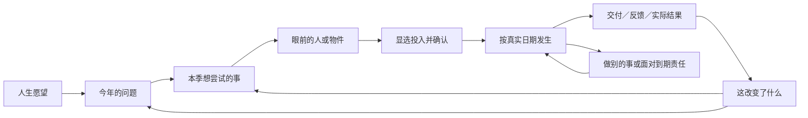

# 36｜主线与系统美术交互重构方案

2026-10-23，D12 设计方案。沿 A「长日重启」，采用 Game Studio 的 Shared → game-ui-frontend / web-game-foundations / game-playtest 路径，继续现有 React / TypeScript / Vite。**S1已接入正式运行时，原实际验证与范围见[S1记录](../goal-1/evidence/t17-acceptance-21/validation.md)；S2已完成下述限定实现与验证，实际范围见[S2记录](../goal-1/evidence/t17-acceptance-22/validation.md)；S3—S5仍待实施。** 原独立交互分镜不连接存档，不能替代正式运行时或真人体验验收。经济02、内容15、各业务合同及原子保存仍为规则权威。所有页面兼容开发和测试暂停。

### S2当前实施与验证边界（2026-10-23）

S2已把一组轻HUD、显选且持久的独立UI书签、责任中断/返回和真实季度留页扩至各playing季度；书签按UI版本/run/季度/完整对象身份与游戏存档分离，恢复重新匹配公开对象，失效明确重选。同对象状态刷新及AdvanceTime不重写旧季度标签，偏好失败只说明未记到本机，不改变游戏命令/回执。当前Chrome采用三个独立正常小循环，未要求同一人生全部经营：

- 工作：走完整Q1，Apr1仍保留原Q1工作书签，重进及原册仍为同一工作；本机书签选择预看、取消不改游戏原文。
- 生活：内容背景先完成七天休整，Jan8另行安排工作不抢原书签；Mar28以3000元、1AP改善住处，Mar31仍未完成。Apr1保留同一原job跨季继续，四点新季预算与4000元原生活费分别发生；Apr4实际完成后才改变住处场景。
- 投资：独立选择100股模拟AI02原委托，先冻结2755元；Jan10实际成交额2481元、费用5元。原册、季度留页及重进仍对应原单；没有把持仓或成交说成卖款交收，也未强求卖完或盈利。

DEV另实核写入后中止时旧提交与物理存储仍为第1次提交、只读页也读到物理旧1；原候选存在时禁止换书签，原retry成功后第2次提交与物理读取/重进一致。[本轮完整正常导出原文审计](../goal-1/evidence/t17-acceptance-22/normal-export-audit-r2/result.json)已实退出0，不能由此推断整体体验通过。最终R4实图发现长物件旁签遮住随身册，实际点击随身册误开物件近景；R5已将完整物件和底部入口分离，当前窗口鼠标分别打开正确随身册、物件及日历，工作与生活原档保持。原红图、修缮和当前证据见[S2验证记录](../goal-1/evidence/t17-acceptance-22/validation.md)，准确本地提交身份以主任务完成记录为准。

本S2没有新图或声音，以上不等于新界面下两背景24季度/六年整体体验已验。S3—S5、原P3 WIP、62关键原文重放（本轮0）/22例行及T17/PNG/真人/M01暂停/T18/goal剩余责任保持；游戏规则不变，全部页面兼容开发测试0。

## 1. 诊断：有许多正确步骤，却缺少连续的玩家目的

下表保留D12方案建立时的诊断与来源；当前S1/S2实施现状以上述增量为准，不将旧观察重写为新源结论。

当前画面已有电影氛围，首单、五路线、人物、实际日历和24季度也已有实现。用户试玩反馈指向两处结构问题：玩家难以把这些操作理解成自己在推进的故事；美术没有持续表达选择造成的变化。

| 已核事实 | 对体验的判断 | 本次设计决定 |
| --- | --- | --- |
| Home 保存投资/自由开局，RoomMoment 首次仍优先手工单。当前 Chrome 选择投资后实际复现。 | 刚作的选择没有得到首幕回应。 | 三种开局各自给出眼前对象与第一步，不能统一转回首单。 |
| FirstChapterTrail 已有工作/小单/交付/回款进度，入口位于随身日历。 | 关键路径要先找到记录才能看懂。 | 主场景直接显示当前尝试、当前阶段及下一反馈；日历保留全部记录。 |
| RoomMoment 按风险、生活、市场、首单等优先级换焦点；回款后主要入口转路线总览。 | 普通事项可能抢走刚才的目标；成功之后又变成选系统。 | 保持玩家关注的同一件事，处理中断后回到它；结果接一个具体的后续问题。 |
| 季度四标签可切换；章节文案随季度变化，愿望主要影响回顾。 | 翻页、时间变化和实际进展容易混淆。 | 以实际选择和回响组织季度，章节负责提问；愿望连接眼前取舍，不新增进度分数。 |
| 当前主幕有顶栏、账户选择、两套行动信息、五个随身入口；大号选择行横跨场景。背景多按页面选整图。 | 画面主体仍是操作层，场景/人物较少参与决定。 | 一组状态、一件焦点物件、一组念头；道具状态和人物来往承载进展，复杂原账近景分页。 |

源码依据：[Home](../src/ui/Home.tsx)、[App](../src/ui/App.tsx)、[RoomMoment](../src/ui/RoomMoment.tsx)、[FirstChapterTrail](../src/ui/FirstChapterTrail.tsx)、[SceneJournal](../src/ui/SceneJournal.tsx)、[QuarterPanel](../src/ui/QuarterPanel.tsx)、[scene-season](../src/ui/scene-season.ts)、[ChapterBackdrop](../src/ui/ChapterBackdrop.tsx)。更细的定位见[主线审计](../goal-1/evidence/t17-acceptance-20/mainline-audit.md)和[美术审计](../goal-1/evidence/t17-acceptance-20/art-ui-audit.md)。[本次 Chrome 观察](../goal-1/evidence/t17-acceptance-20/browser-current-r1/observation.json)及[当前主幕](../goal-1/evidence/t17-acceptance-20/browser-current-r1/investment-first-scene.png)支持上述局部判断，不等于全局或真人研究。

## 2. 主线：把日子握在自己手里

玩家幻想是：带着模糊的未来记忆回到2020，用有限的钱和时间，尝试更值得的生活。核心动词是**发现、判断、承诺、安排、交付、等待、回应**。每一幕必须回答“我在意什么—眼前发生什么—能做什么—付出什么—何时知道结果”。

贯穿一局的是玩家自己的愿望。年度提出问题，本季选择一次尝试，场景给出具体一步，结果留下可回访的事实；强制义务打断时保留原关注对象。它是一条可以改变方向的叙事骨架，工作、投资、生活或不采用代理都能成立。五路线是可选择的手段，不是五份必须做完的任务。

### 三种开局必须回应选择

| 开局 | 首幕焦点与实际一步 | 第一次小循环的终点 | 同时可做 |
| --- | --- | --- | --- |
| 工作＋手工第一单 | 电脑里的委托：核对报价/成本/日期，选择接单或婉拒。工作另行确认。 | 实际制作、亲手提交、客户复核、实际回款；失败/拒单也有后续选择。 | 保留工作、准备、生活、查看其他路线。 |
| 工作＋准备投资 | 桌上的模拟市场资料：先理解生活储备与已知信息，再选择研究、委托或暂不买入。 | 委托与撮合结果清楚；交收、现金与持仓分开。持有和不买也可结束本次尝试。 | 工作、手工单、生活；不强迫卖股或实现盈利。 |
| 自由安排 | 今天的日历：工作、生活、研究或暂不新增承诺，由玩家先点一个。 | 所选安排的真实反馈；只查看或暂缓不会被假记为完成。 | 五路线及全部旧事项随时可达。 |

开场十分钟是**设计时段目标，尚未实测**：先在场景内作一次有意义的决定，清楚知道接下来等什么；不要求所有业务十分钟结束。背景和愿望用短场景化选择呈现，选项旁保留真实起始条件；种子/存档放到按需入口。跳过引导只改变展示，不自动工作、买股或接单。

### 首单分镜与真实规则对齐

| 一幕 | 玩家理解与操作 | 道具/画面变化 | 规则边界 |
| --- | --- | --- | --- |
| 发现 · 1月1日 | 这份手工剪辑与资料整理小单值得接吗？ | 桌面来信成为焦点，显示报价、截止日；未知客户不补人名。 | 报价1300、成本500、1点；最迟1月5日答复。 |
| 核对并承诺 | 确认个人主体、500预留、1点及1月5—19日安排。 | 拉近同一张委托纸，返回后保留选择。 | 预留与实付分开；取消无命令，确认沿原预览/提交。 |
| 安排与开工 | 已经接下，1月5日才开工付款；可以先做其他事。 | 约定落在日历，开工后出现制作中的文件。 | 不提前扣作已付或播制作完成；推进仍按中间日期、费用和屏障停下。 |
| 制作完成 · 1月19日 | 作品做好了，需要自己提交。 | 文件变为可提交的作品；“发送”是明确操作。 | 完成不等于提交或收入。 |
| 客户复核 | 已发出，等待客户处理。 | 同一物件留下发送记录、公开反馈日期。 | 复核、验收和付款按原实际回执分别表达；不编造对白。 |
| 实际回款 · 1月20日 | 收到1300，扣本单500后净800。 | 作品留进实际案例，出现独立收款凭证。 | 工资/生活费不算入本单净额；仅真实保存后呈现。 |
| 下一问题 | 继续积累作品，先安顿工作生活，还是了解另一条路？ | 场景保留作品痕迹，后续对象接入同一愿望线。 | 不自动再接同一首单，不保证当季后续业务已开放，不因看图给资格。 |

具体金额和日期来自[手工首单合同](25-manual-first-order-contract.md)与[src/content/first-order.ts](../src/content/first-order.ts)。总现金始终读真实个人账：初始3万元与1月1日生活费后的可花2.6万元不可混写。样稿只展示解释必需的本单条款，不虚构可花余额。

首单满足原交付条件后采用固定教学结果，不额外引入普通视频的随机拒收/返工。1月20日原推进可以在同次原子保存中完成复核、确认收入和收款；分镜可依阅读顺序解释这些事实，不能制造可停留的中间应收状态、额外收款按钮，或先公开半个候选。主场景应以同次完整提交为准。

S1同时映射非成功出口：拒绝/跳过/过期不生成收入或案例，仍可工作、生活、研究或看其他路线；开工前取消按原规则释放预留；开工后中断/取消保留已耗成本和行动；错过提交日进入原取消/保留作品选择，不补发教学款；未保存/冲突仍显示旧物件及原候选恢复入口。确认纸片的“返回调整”与已接合同的“取消”是不同动作，`nextStep=null`也不能画成完成。各出口接原命令和公开状态，不新增补偿规则。

### 一季、六年和人物如何连接

每季采用“眼前处境→我想尝试→行动与反馈→留下什么→下一季的问题”。四个旧标签保留作原记录检索，取消其默认必做流程感。季末回响以真实结果选择性展示2—3个因果节点，另列仍待履行事项；没有利润或没有创业，也能如实回顾。未发生节点不亮成完成。

| 年度 | 沿用的主题与玩家提问 | 有据回响的组织方式 |
| --- | --- | --- |
| 2020 | 把生活重新握在手里：怎样先站稳？ | 第一份安排、实际交付/投资判断或生活选择，回到愿望。 |
| 2021 | 让尝试变成日常：什么值得继续？ | 对比实际投入与得到的生活余地，选择继续、收缩或换方向。 |
| 2022 | 工具之外的判断：什么值得准备？ | 以实际研究、案例和已揭示资格连接未来可能；不提前展示未来结果。 |
| 2023 | 走到时代的路口：怎样参与变化？ | 先前准备如何让眼前某种选择可用；工作或不参与仍是完整选择。 |
| 2024 | 连接与边界：增长会占用什么？ | 服务、旧学员、共同承诺及可选代理控制分别形成问题；不强制危机。 |
| 2025 | 你想留下什么？ | 财富、关系、自由、控制与未结义务并列，进入原有限尾声。 |

上述为组织提问，沿现有 JOURNEY_CONTENT 六主题，不按财富阈值判定“通关”，也不以年度标题替代实际世界节点。24季逐季使用同一撰写模板：**当前公开处境、愿望关联、同对象下一步、公开代价/日期、结果来源、后续钩子、可退出方向**。接不到真实对象的章节只保留环境句，不硬塞任务。

两条跨年写作样例，只有对应记录实际存在才显示：财务独立/投资人生在2020回访自己的研究与实际委托，2023对照已公开行情、当前持仓和生活储备，问“继续持有、调整暴露还是保留现金”；2025回看实际交收、持仓估值与未完事项，不补写假想收益。生活自主/工作人生在2020回看实际在岗和留给自己的时间，2023依据当局真实工作、休整或已接受约定问“熟悉的节奏还值得继续吗”；2025以实际生活和共同经历回应愿望，没有创业也有完整回顾。没有相处/投资记录就不编相应故事。安静季度仍有当前生活、原安排或下个已知日期的合法去向，不只剩年度口号。

四人物以原身份出场：唐萤的相处时间、许澄的作品与署名、陈屿的实际交付、林舟的合作边界。相识、来信、赴约、失约及他方档期均读公开状态。让人物在具体事里出现，肖像和资料只在会面/回看时展开；不凭新插画补出未发生的关系或奖励。依[LIFE_CONTENT](../src/content/life.ts)和[人物合同](34-people-life-year-contract.md)。

## 3. 一屏的交互编排

默认是有前景物件的完整电影场景。左上只留章节/日期和一句本季关注；右上是一组**当前账户可花现金、本人本季共享四AP的可用/预留/已用、保存状态**。四点只画一次，切账户不会重置行动；切主体在查看原账时明确完成。缺口、到期责任和失败状态仍常显，不被“轻HUD”藏起。

场景中心或桌面是一件当前可决定的物件；念头置于留白处，主选择1项、不同旁路最多2项。点物件与键盘聚焦到同一动作，不要求先进入探索模式。支持“显示可互动对象”的短暂提示与文字操作清单，避免像素找物；保留本季关注，即使去看人物/原账也能回到同一对象。

信息按决定深度展开：**场景发现→对象近景→投入/资源/日期→原确认→真实回响**。读资料使用翻阅标记，执行使用明确动词；不把打开菜单写成完成任务。人物、时代记忆、日历和账册通过场景物件/一处随身册进入，同一视口分页，全部原功能有去向。大批账单可按对象和原分页检索，不裁切，不持续缩字，也不删完整原文。

焦点优先级：未保存/冲突/只读状态→真实强制决定、现金缺口及交付屏障→玩家主动关注→普通新机会。强制事项指出“为什么必须先面对”；处理后返回原对象。普通新消息以场景来信进入，不能静默替换进行中的选择。同对象导航携带run/主体/业务/作品或合同身份；对象过期要解释，不能悄悄转到另一账户。

五路线共享阅读和确认语言，各自保留玩法手感：

| 路线 | 场景对象与主要操作 | 必须分清的结果 |
| --- | --- | --- |
| 模拟A股 | 研究笔记、委托票、持仓记录；作判断并显选原订单字段。 | 下单/部分成交/交收，持仓/现金，未知行情。 |
| AI短视频 | 作品画面与制作文件；选受众/形式、制作、应对修改、提交。 | 作品/播放/询价/合同/实际回款。 |
| AI课程 | 真实教案、样课、班级与学员问题；备课、开班、交付与支持。 | 大纲/样课/招生，学费保护/收入，支持与退款。 |
| API中转 | 供应许可、服务约定、原计量账单；选供应和客群、履约、核账。 | 充值负债/供应资产/实际用量/应收应付，停止与旧义务。 |
| DeepSeek生态/架空权益 | 合作提案、交付成果、明确架空股权文件；先确认合作性质再决定。 | 技术资格/服务合同/股份/治理/锁定/到账。机柜不能代替这些含义。 |

## 4. 系统美术、UI与TA

美术基调延续冷青的城市、暖灯、纸白与磨损木材。标题用叙事宋体，规则正文用清楚的系统字体，金额/日期稳定对齐；不添加未核授权字体。金色只强调此刻可决定，朱红带文字/角标表示已发生责任。所有文字、数字和选择保持DOM文本。

场景分**远景城市—房间—可组合前景物件—人物/来往—HUD与近景纸页**。避免每个状态重画整屏：同镜头前景层改变，已完成作品、原约定和实际生活改善留下痕迹。随机天气、画面豪华程度不暗示未来胜负或自动生活升级。人物表情只对应公开遭遇，不能泄露隐藏意愿。

| 状态 | 形状/文字 | 动效和声音职责 |
| --- | --- | --- |
| 可行动 / 聚焦 | 暖金细轮廓、动作名与方向；鼠标和键盘同对象。 | 局部抬起/柔和明暗响应，约120—180ms设计初值；不持续闪烁。 |
| 已选 / 核对 | 内框、明确“待确认”，主体/资金/资源/日期保持可见。 | 纸页近景约180—260ms；确认前不播交付或收入。 |
| 已安排 / 进行中 | 虚线日程+预留 / 实线+公开完成日。 | 仅开始/日期变化时响应，无虚假实时百分比或额外倒计时。 |
| 等待 | 对象、原因、公开反馈日；“先做别的事”可达。 | 时钟翻页/场景呼吸有节制，原AdvanceTime仍处理所有中间事项。 |
| 完成 / 到账 | 同对象完成痕迹 / 独立实收凭证与真实净额。 | 保存成功后才出现约300—500ms回响；纸响/轻提示分配给真实事件，静音仍完整。 |
| 不可用 / 只读 | 灰形+具体原因 / 锁形+仅翻阅。 | 不播放成功反馈，保留查看与恢复方向。 |
| 未保存 / 冲突 / 到期 | 明确文字、朱红角标和原责任。 | 保持旧场景及原候选重试；不以自动淡出掩盖失败。 |

以上时长为待目检调整的设计参数。当前应用没有静音/音效字段；声音是新增呈现能力，须增加独立且可见的静音/音效偏好及保存失败提示，默认静音，玩家选择开启后再遵守浏览器播放约束，不因首次点击自行开启。声音资源随当片核来源，不新增收费音源。减少动效取消位移与长转场，纯文本和静音保留相同对象/状态/完整路径。

资产按同镜头成套制作。先用既有原创房间、五路线与四肖像验证分镜，再补：①委托/制作文件/发送/实收同对象层；②市场、教案、服务账单、合作文件、生活留物共五组前景；③四人物有据会面姿态与来信层；④纸页、焦点轮廓、日期/四点/责任状态；⑤轻环境声、纸页、确认和实际回响。每组先列源状态到图层映射，再制作，不先批量生成无接线插画。

需用 imagegen 时沿同镜头参考图统一透视、灯光、材质及人物身份，透明前景不含文字/UI；保留提示词、原PNG、衍生文件、尺寸、哈希与来源清单。既有图可继续用，缺失旧三PNG仍单列未验，不让新图冒充原件。插画只承载公开事实，文本和状态由真实投影生成。

## 5. 工程接缝与内容工作

新增纯的“玩家叙事线”投影，暂名 `PlayerThreadView`：愿望、开局方向、当年问题、关注对象、当前公开阶段、下一动作/反馈、真实结果引用、未完责任。第一片先从既有 playerProfile 和 committed view 推导；完成标记只来自已有任务/合同/支付/人物记录，不由“看过这一幕”设置。

首片即保留本次导航的run、账户/业务、带种类的对象ID与公开阶段，去看人物/原账及处理中断后仍回同对象；approach只在没有有效关注时给建议。第二片再增加主动调整关注及跨重进偏好。关注是展示偏好，不是新能力或强制任务；单独保存UI版本、run/季度和完整目标身份，不写playerProfile、runSchema、CreateRun回执，也不改rules/contentHash。偏好保存失败只说明“关注未记下”，不能冒充游戏命令保存。恢复及中断返回时重新匹配当前公开对象；过期/失效解释原因并显式重选，不静默换账户。失败候选仍显示旧提交。若未来需要使关注成为业务规则，必须另定命令与旧档策略，不直接改schema13。

`RoomMoment` 从单一优先级推荐变为“责任中断＋玩家叙事线”；`CinematicRoom` 管构图/对象；各路线scene-progress继续提供专用公开下一步。`App.request → 原preview/确认 → submit → RunSession.view → savedSceneResult` 保持原链路。三类状态来源分开：聚焦/选择/近景读本地UI，保存中/失败/只读读Session，业务物件改变和成功回响读已提交记录。动画不能执行规则命令。

结果不能仅由账户余额差或最近20条摘要猜测。S1复用首单实际记录；后续按对象增加只读结果引用，绑定公开事件/回执ID、对象与发生日。多对象同次完成按原公开因果顺序呈现；同次保存的新结果只播放一次，重进显示事实，原重试不重演执行或把重复回执播成新收益。完整原账继续可到达。

先复用现有 Dialog / ScreenBook / CommandDetails。替换层是默认体验、对象近景与选择编排；完整原账、复杂订单、权限、恢复与旧入口逐项映射。避免同时重写整个状态机和所有表单。旧P3源码与证据保留，恢复业务验收时冻结新的实际源身份，不能把旧通过移算为新UI或新源通过。

## 6. 实施顺序：每次交一段能玩的完整经历

| 顺序 | 完整交付与依赖 | 当片完成门槛 |
| --- | --- | --- |
| S1 重来的一天 | 三开局首幕回应＋常驻目标线与最小同对象往返；手工单完整分镜/直接原操作；一套前景、轻HUD、确认与回响同时落地。 | 首单路径实际制作→提交→复核/实收并知下一步；投资独立走显选委托→真实撮合结果→适用交收，持有/未成交/撤单或明确不买仍有去向；自由路径自选工作/生活等一项走到真实反馈，暂缓可继续。非成功出口清楚，不能把首单设为三开局共通关卡。 |
| S2 我选的第一季 | 依S1；可调整/持久的本季关注、普通消息不抢焦点、责任中断/返回、实际季度回响及下一季问题。 | 工资、生活、模拟投资作为独立场景各验一真实循环，不要求一局全部做；跨季保留旧约定，人物/原账来回仍同对象，钱/AP/日期一致。 |
| S3 从作品到生意 | 依S2的阅读/对象接缝；先视频交付全链，再课程准备到教学/支持/退款；各自专用道具与结果表现。 | 作品与表单草稿不丢、能力/案例/收入不混；复杂原册完整可达。完成第3片后做前3片全面检查-debug。 |
| S4 服务、合作与边界 | 依共用接缝；中转、生态、明确架空权益各闭合一次；人物来往随真实事项接入；独立许可/权限/风险表现。 | 充值、实计、应收、股份分开；支持/扩权/停止各自决定，无代理仍可走完。当前P3钱/权限修缮随相关片定向复核。 |
| S5 六年留下什么 | 全程串联24季/六年度、四人物、两背景与原尾声；美术/TA/声音成套收口。 | 正常长局能从准备追溯到结果；非创业人生有回顾；未结责任不清空。真实玩家理解度/乐趣另验，完整T17/T18责任保留。 |

五片均先实现“发现→显选→确认→等待/另做事→实际结果→下一钩子”，同片做美术与交互。每片运行受影响规则/投影/保存检查和当前Chrome窗口实际小循环；避免先穷举全仓矩阵再回头做画面。第3片后、第5片后全面检查，确定缺陷先修再收口。新每片先建立具体input/plan/tasks；本方案不提前勾实施完成。

S3内部按视频一单→课程准备→一个班期教学/支持/退款串行拆成独立可验小任务；S4内部按中转一个服务账期→生态一个合同→架空权益一次有条件实际反馈拆分。每个小任务连本对象的美术、正常/受挫分支和原账去向；每三小任务全面检查-debug。它们复用呈现接缝，课程成果不是中转的新进入门槛，不要求同一人生经营所有业务。

第一片优先级最高。它交付后先看玩家是否知道下一步，再扩大到全局；若仍只能靠旁人解释才能开始，退回目标/动作层修缮，不继续叠加装饰。原5c-P3/62关键/22例行和全部T17后续保留，按新实现影响范围恢复；兼容M01继续暂停，须用户明确恢复后另行排序。

## 7. 验收、风险与回滚

自主检查首先问四句：**我现在想做什么？哪个对象能操作？要付出什么？下一次反馈是什么时候？** 当前窗口按真实命令走小循环，核金额/日期/AP/资格/权限、同对象往返、保存成功/原候选失败重试/只读与重进。静态图、DOM绿色结果、自动回放都不证明玩家理解和乐趣；不做任何窗口/缩放/跨浏览器矩阵。

后续真人试玩以既有8—12人目标为最终安排参考；先做小轮无提示试玩，每轮记录是否自行发现第一步、能否复述代价与等待对象、收到结果后能否继续，以及觉得值得/枯燥的具体时刻。建议初始门槛：首幕阅读后30秒内能指出目标与动作；一轮后能区分安排/交付/到账；能说出一项愿望的得失。它们是待验证设计门槛，不是现有数据；真人目前0，用户暂未安排，不阻塞自主工作。

最主要风险是引导变成强制清单、物件变成猜谜、轻HUD隐藏责任、动画伪造收益，以及专业内容仍要反复找表单。对应保留自由切换/暂缓、文字操作清单、责任常显、保存后反馈、同对象直接选择与完整原册。年度不预泄未来史实；人物不演不存在的关系；五路线不缩减。

样稿和本方案独立保存，不覆盖当前可玩构建和存档。正式分片沿独立提交回滚表现层；若需新数据格式，先明确版本/拒绝或迁移与原档保全，不能靠回退UI改写历史。未经授权不push、不公开部署、不增加付费资源、分析SDK或外部权限。

设计参考边界：沿用[已有一手研究](../goal-1/evidence/t17-acceptance-16/interaction-research.md)中的有限投入、对象时间、具体文本操作及有据长期回响原则；未实机研究竞品，不复制素材，不声称竞品保证本作可玩性。本轮重点依据本作实际试玩反馈、当前源码和Chrome观察。可审阅[交互分镜](../goal-1/evidence/t17-acceptance-20/storyboard/index.html)只演示本设计的阅读和节拍，不能代替正式规则接线和验收。
