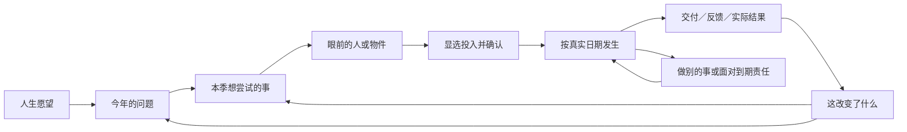
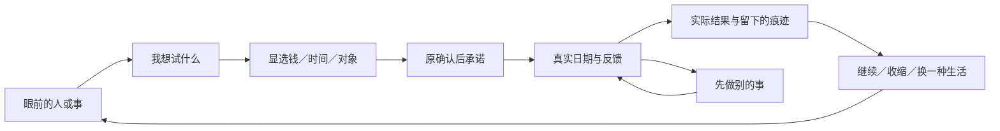
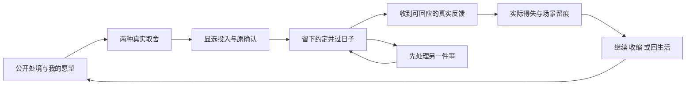

# 36｜主线与系统美术交互重构方案

**最新复核与下一执行依据：第10节（2026-10-25）。** C-UX06已限定完成并本地提交 `1cc971ba/65882ffb`；下方第8—9节“尚在收口/当前执行C-UX06”保留其历史身份。最新试玩反馈要求先重审体验，现将 **U0-R整幕主干** 前置于U4-B，先把目的、可比较的决定和整幕视听做成一段可玩的经历。U4-B全部R2/R3与C-S4-R责任保留，已有未接线记录模型暂停；本轮只交方案，未实现U0-R，也不重新宣称主线或美术已获认可。

**2026-10-24再次试玩后的执行依据：见第8节。** 本轮重新打开“主线可理解性”和“系统美术交互”的体验问题；此前S1/S2及业务片的接线与限定验证保留，不能解释成用户已经认可主线或美术。后续按第8节的完整玩家经历安排，旧S4未完内容保留并映射到新顺序。

2026-10-23，D12 设计方案。沿 A「长日重启」，采用 Game Studio 的 Shared → game-ui-frontend / web-game-foundations / game-playtest 路径，继续现有 React / TypeScript / Vite。**S1已接入正式运行时，原实际验证与范围见[S1记录](../goal-1/evidence/t17-acceptance-21/validation.md)；S2已完成下述限定实现与验证，实际范围见[S2记录](../goal-1/evidence/t17-acceptance-22/validation.md)；S3-V1视频一单及S3-C1课程准备已接入并按下述限定范围验证；S3-C2班期教学、支持与退款已完成限定实施和自主验证，见[C2完成记录](../goal-1/evidence/t17-s3-course-teaching-post-commit-01/acceptance-summary.json)；S4—S5仍待实施。** 原独立交互分镜不连接存档，不能替代正式运行时或真人体验验收。经济02、内容15、各业务合同及原子保存仍为规则权威。所有页面兼容开发和测试暂停。

### S2当前实施与验证边界（2026-10-23）

S2已把一组轻HUD、显选且持久的独立UI书签、责任中断/返回和真实季度留页扩至各playing季度；书签按UI版本/run/季度/完整对象身份与游戏存档分离，恢复重新匹配公开对象，失效明确重选。同对象状态刷新及AdvanceTime不重写旧季度标签，偏好失败只说明未记到本机，不改变游戏命令/回执。当前Chrome采用三个独立正常小循环，未要求同一人生全部经营：

- 工作：走完整Q1，Apr1仍保留原Q1工作书签，重进及原册仍为同一工作；本机书签选择预看、取消不改游戏原文。
- 生活：内容背景先完成七天休整，Jan8另行安排工作不抢原书签；Mar28以3000元、1AP改善住处，Mar31仍未完成。Apr1保留同一原job跨季继续，四点新季预算与4000元原生活费分别发生；Apr4实际完成后才改变住处场景。
- 投资：独立选择100股模拟AI02原委托，先冻结2755元；Jan10实际成交额2481元、费用5元。原册、季度留页及重进仍对应原单；没有把持仓或成交说成卖款交收，也未强求卖完或盈利。

DEV另实核写入后中止时旧提交与物理存储仍为第1次提交、只读页也读到物理旧1；原候选存在时禁止换书签，原retry成功后第2次提交与物理读取/重进一致。[本轮完整正常导出原文审计](../goal-1/evidence/t17-acceptance-22/normal-export-audit-r2/result.json)已实退出0，不能由此推断整体体验通过。最终R4实图发现长物件旁签遮住随身册，实际点击随身册误开物件近景；R5已将完整物件和底部入口分离，当前窗口鼠标分别打开正确随身册、物件及日历，工作与生活原档保持。原红图、修缮和当前证据见[S2验证记录](../goal-1/evidence/t17-acceptance-22/validation.md)，准确本地提交身份以主任务完成记录为准。

本S2没有新图或声音，以上不等于新界面下两背景24季度/六年整体体验已验。后续S3课程阶段与S4—S5、原P3 WIP、62关键原文重放（本轮0）/22例行及T17/PNG/真人/M01暂停/T18/goal剩余责任保持；游戏规则不变，全部页面兼容开发测试0。

### S3-V1当前实施与验证边界（2026-10-23）

视频这一个内部任务已接同一账号/作品/合同的持续目标、分步显选与原确认、真实等待和独立回款；专用原创手机/分镜本/素材纸套件承担各阶段，不重画整屏或伪造视频播放。原册、日历、季度来源及取消后的同身份草稿可往返，未知/失效账户不默认切换；账号预看必须另点确认才生效。只在真实保存后发布新作品与结果。

- 正常新局手工链：实际推广产生客户，900元制作/1点/14日，核对并亲手提交，Jan24验收、Jan31余款与150元原费实际结算，个人可花27350元/余2点。客户本次没有要求修改，不借此声称受挫覆盖。
- 合法图像辅助新单：完整Create挣得的2022-08-29前史（86900元/余1点）实际取得并已读资格；本单授权素材在内成本1000元。客户真实要求修改，0AP时保留原单，经原季末屏障到下一季，再付300元/1点返工；范围谈判另耗1点/3日，接受后仍亲手重提同一已核对版本。Oct15验收、Oct22实收，个人可花92450元/余2点。期间原工资和生活费独立记账，不用余额差当本单利润。
- DEV真实保存中止：物理旧4与原候选5分开；只读页读回旧4。原候选重试成功后，保存5/物理5逐字等候选；未来开工仍是预留，开工前退出保留推广成本并释放原预留/退款。未确认预看另一账号后合上，原账号标题与原单仍一致。

最终R8 Chrome重进手工12/AI70均与原导出逐字同，结算主幕直接列预款900、余款2100和费用150；文字/减少动效实际可用并恢复原设置。完整证据与适用回归身份见[S3-V1限定记录](../goal-1/evidence/t17-acceptance-23/validation.md)。新的原子候选测试、真实受挫与原前史重放分别记，不把导入前史算本轮Chrome多年实玩。0AP实际画面来自R6，R8只改该错误的展示文案并有定向回归，未再创造一局当新0AP实测。

本次只完成S3的视频内部任务；课程准备、班期教学/支持/退款及第三片全面检查仍待，不能据此勾整套S3。新图不是旧缺三PNG，没有新声音，真人仍0；道具接触/局部叠盖、长标签和条款密度继续列后续艺术改进，不靠截图声称真人理解或趣味性。全部兼容开发测试0，原P3 WIP/62正式0/22例行和所有T17/M01暂停/T18/goal责任保持。

### S3-C1课程准备的限定实现（2026-10-24）

沿[具体方案](../goal-1/evidence/t17-acceptance-24/plan.md)把同一份教案贯穿原案例、资金、大纲、课程范围与样课。玩家显选的对象留在书签和原册里；普通旁路不抢关注，强制原责任处理后仍能返回。步骤是呈现顺序，已有真实准备可复用，不新增强制前置。

| 眼前问题 | 玩家操作与物件反馈 | 完成边界 |
| --- | --- | --- |
| 哪段亲手做过的事值得教？ | 选实际已付案例，留下同对象纸签。 | 手工经验有效，不冒充既有AI资历；内训形式才需两案例。 |
| 为准备留多少钱？ | 自有资本转入独立课程企业；显选写纲资源和日期，独立启用。 | 转账不是收入，准备/开工/完成分别表达；旧合法大纲不强制重做。 |
| 想让谁学会什么？ | 案例→形式/主题/受众/使用同意→原确认留下方案。 | 定义不是样课；不自动招生。 |
| 材料范围能用于这门课吗？ | 需要时安排原独立课程许可，等待真实完成后回同一教案。 | 视频本单授权不直接继承，许可绑定原企业与案例。 |
| 为样课留真正的日子？ | 显选资源/日期，只列所选形式费用和预计反馈。 | 真实资格、行动与产能逐日核；日期到不冒充任务完成。 |
| 样课做成后先收好吗？ | 同对象纸白完成签与原记录。 | 当前权利/工具/更新条件仍须核，获客、班额、支持和报名另定。 |

美术用同镜头透明低平教案、案例套、空白范围纸与笔；文字/状态仍是DOM。已安排用虚线日期，进行中保实际反馈日，保存后才出现完成痕迹；只读、失败和减少动效保完整路径。完整目标携带run/账户/工作室/课程/原任务，原册往返和取消保留同身份草稿；唯一缺失素材范围可直接进入该案例的许可步骤，不自动授权或提交。

Chrome从原AI70正常存档实际推进：工作室5000元自有资本、大纲100元/1点/Dec1—8、独立启用、定义案例方案、许可300元/1点/Dec9—16，再以2500元/1点安排Jan2—16样课。0AP的当季样课被原预览拒绝；明确选择新季后允许原预留，跨季仍支付77.41元维护和4000元个人生活费。Jan16实际ready，企业可花2022.59元、个人75450元、余3点；课程获客/班期/报名/学费记录均0。定义另一方案只预览取消，原86档在重进/显示切换/原对象返回后逐字相同。

DEV真正写入后中止保物理旧78；原候选79重试后与独立物理79逐字同。最终完整Create审核为同一创建、87条不同后续命令、11份公开原文（4缓冲/1候选/6实存）全字节同，不能把缓冲或分支算额外游戏完成。R5已修实际已安排幕文案互盖，完整保存回响和底部探索鼠标实点验证分列；接触感、局部叠层、底部紧凑和纸页密度继续艺术优化。具体源/分批检查/红档及边界见[S3-C1验证](../goal-1/evidence/t17-acceptance-24/validation.md)。没有新声音，真人仍0；本片不关闭整S3、原P3/62/22、T17或完整goal。

## 1. 诊断：有许多正确步骤，却缺少连续的玩家目的

下表保留D12方案建立时的诊断与来源；当前S1/S2实施现状以上述增量为准，不将旧观察重写为新源结论。

当前画面已有电影氛围，首单、五路线、人物、实际日历和24季度也已有实现。用户试玩反馈指向两处结构问题：玩家难以把这些操作理解成自己在推进的故事；美术没有持续表达选择造成的变化。

| 已核事实 | 对体验的判断 | 本次设计决定 |
| --- | --- | --- |
| Home 保存投资/自由开局，RoomMoment 首次仍优先手工单。当前 Chrome 选择投资后实际复现。 | 刚作的选择没有得到首幕回应。 | 三种开局各自给出眼前对象与第一步，不能统一转回首单。 |
| FirstChapterTrail 已有工作/小单/交付/回款进度，入口位于随身日历。 | 关键路径要先找到记录才能看懂。 | 主场景直接显示当前尝试、当前阶段及下一反馈；日历保留全部记录。 |
| RoomMoment 按风险、生活、市场、首单等优先级换焦点；回款后主要入口转路线总览。 | 普通事项可能抢走刚才的目标；成功之后又变成选系统。 | 保持玩家关注的同一件事，处理中断后回到它；结果接一个具体的后续问题。 |
| 季度四标签可切换；章节文案随季度变化，愿望主要影响回顾。 | 翻页、时间变化和实际进展容易混淆。 | 以实际选择和回响组织季度，章节负责提问；愿望连接眼前取舍，不新增进度分数。 |
| 当前主幕有顶栏、账户选择、两套行动信息、五个随身入口；大号选择行横跨场景。背景多按页面选整图。 | 画面主体仍是操作层，场景/人物较少参与决定。 | 一组状态、一件焦点物件、一组念头；道具状态和人物来往承载进展，复杂原账近景分页。 |

源码依据：[Home](../src/ui/Home.tsx)、[App](../src/ui/App.tsx)、[RoomMoment](../src/ui/RoomMoment.tsx)、[FirstChapterTrail](../src/ui/FirstChapterTrail.tsx)、[SceneJournal](../src/ui/SceneJournal.tsx)、[QuarterPanel](../src/ui/QuarterPanel.tsx)、[scene-season](../src/ui/scene-season.ts)、[ChapterBackdrop](../src/ui/ChapterBackdrop.tsx)。更细的定位见[主线审计](../goal-1/evidence/t17-acceptance-20/mainline-audit.md)和[美术审计](../goal-1/evidence/t17-acceptance-20/art-ui-audit.md)。[本次 Chrome 观察](../goal-1/evidence/t17-acceptance-20/browser-current-r1/observation.json)及[当前主幕](../goal-1/evidence/t17-acceptance-20/browser-current-r1/investment-first-scene.png)支持上述局部判断，不等于全局或真人研究。

## 2. 主线：把日子握在自己手里

玩家幻想是：带着模糊的未来记忆回到2020，用有限的钱和时间，尝试更值得的生活。核心动词是**发现、判断、承诺、安排、交付、等待、回应**。每一幕必须回答“我在意什么—眼前发生什么—能做什么—付出什么—何时知道结果”。

贯穿一局的是玩家自己的愿望。年度提出问题，本季选择一次尝试，场景给出具体一步，结果留下可回访的事实；强制义务打断时保留原关注对象。它是一条可以改变方向的叙事骨架，工作、投资、生活或不采用代理都能成立。五路线是可选择的手段，不是五份必须做完的任务。

### 三种开局必须回应选择

| 开局 | 首幕焦点与实际一步 | 第一次小循环的终点 | 同时可做 |
| --- | --- | --- | --- |
| 工作＋手工第一单 | 电脑里的委托：核对报价/成本/日期，选择接单或婉拒。工作另行确认。 | 实际制作、亲手提交、客户复核、实际回款；失败/拒单也有后续选择。 | 保留工作、准备、生活、查看其他路线。 |
| 工作＋准备投资 | 桌上的模拟市场资料：先理解生活储备与已知信息，再选择研究、委托或暂不买入。 | 委托与撮合结果清楚；交收、现金与持仓分开。持有和不买也可结束本次尝试。 | 工作、手工单、生活；不强迫卖股或实现盈利。 |
| 自由安排 | 今天的日历：工作、生活、研究或暂不新增承诺，由玩家先点一个。 | 所选安排的真实反馈；只查看或暂缓不会被假记为完成。 | 五路线及全部旧事项随时可达。 |

开场十分钟是**设计时段目标，尚未实测**：先在场景内作一次有意义的决定，清楚知道接下来等什么；不要求所有业务十分钟结束。背景和愿望用短场景化选择呈现，选项旁保留真实起始条件；种子/存档放到按需入口。跳过引导只改变展示，不自动工作、买股或接单。

### 首单分镜与真实规则对齐

| 一幕 | 玩家理解与操作 | 道具/画面变化 | 规则边界 |
| --- | --- | --- | --- |
| 发现 · 1月1日 | 这份手工剪辑与资料整理小单值得接吗？ | 桌面来信成为焦点，显示报价、截止日；未知客户不补人名。 | 报价1300、成本500、1点；最迟1月5日答复。 |
| 核对并承诺 | 确认个人主体、500预留、1点及1月5—19日安排。 | 拉近同一张委托纸，返回后保留选择。 | 预留与实付分开；取消无命令，确认沿原预览/提交。 |
| 安排与开工 | 已经接下，1月5日才开工付款；可以先做其他事。 | 约定落在日历，开工后出现制作中的文件。 | 不提前扣作已付或播制作完成；推进仍按中间日期、费用和屏障停下。 |
| 制作完成 · 1月19日 | 作品做好了，需要自己提交。 | 文件变为可提交的作品；“发送”是明确操作。 | 完成不等于提交或收入。 |
| 客户复核 | 已发出，等待客户处理。 | 同一物件留下发送记录、公开反馈日期。 | 复核、验收和付款按原实际回执分别表达；不编造对白。 |
| 实际回款 · 1月20日 | 收到1300，扣本单500后净800。 | 作品留进实际案例，出现独立收款凭证。 | 工资/生活费不算入本单净额；仅真实保存后呈现。 |
| 下一问题 | 继续积累作品，先安顿工作生活，还是了解另一条路？ | 场景保留作品痕迹，后续对象接入同一愿望线。 | 不自动再接同一首单，不保证当季后续业务已开放，不因看图给资格。 |

具体金额和日期来自[手工首单合同](25-manual-first-order-contract.md)与[src/content/first-order.ts](../src/content/first-order.ts)。总现金始终读真实个人账：初始3万元与1月1日生活费后的可花2.6万元不可混写。样稿只展示解释必需的本单条款，不虚构可花余额。

首单满足原交付条件后采用固定教学结果，不额外引入普通视频的随机拒收/返工。1月20日原推进可以在同次原子保存中完成复核、确认收入和收款；分镜可依阅读顺序解释这些事实，不能制造可停留的中间应收状态、额外收款按钮，或先公开半个候选。主场景应以同次完整提交为准。

S1同时映射非成功出口：拒绝/跳过/过期不生成收入或案例，仍可工作、生活、研究或看其他路线；开工前取消按原规则释放预留；开工后中断/取消保留已耗成本和行动；错过提交日进入原取消/保留作品选择，不补发教学款；未保存/冲突仍显示旧物件及原候选恢复入口。确认纸片的“返回调整”与已接合同的“取消”是不同动作，`nextStep=null`也不能画成完成。各出口接原命令和公开状态，不新增补偿规则。

### 一季、六年和人物如何连接

每季采用“眼前处境→我想尝试→行动与反馈→留下什么→下一季的问题”。四个旧标签保留作原记录检索，取消其默认必做流程感。季末回响以真实结果选择性展示2—3个因果节点，另列仍待履行事项；没有利润或没有创业，也能如实回顾。未发生节点不亮成完成。

| 年度 | 沿用的主题与玩家提问 | 有据回响的组织方式 |
| --- | --- | --- |
| 2020 | 把生活重新握在手里：怎样先站稳？ | 第一份安排、实际交付/投资判断或生活选择，回到愿望。 |
| 2021 | 让尝试变成日常：什么值得继续？ | 对比实际投入与得到的生活余地，选择继续、收缩或换方向。 |
| 2022 | 工具之外的判断：什么值得准备？ | 以实际研究、案例和已揭示资格连接未来可能；不提前展示未来结果。 |
| 2023 | 走到时代的路口：怎样参与变化？ | 先前准备如何让眼前某种选择可用；工作或不参与仍是完整选择。 |
| 2024 | 连接与边界：增长会占用什么？ | 服务、旧学员、共同承诺及可选代理控制分别形成问题；不强制危机。 |
| 2025 | 你想留下什么？ | 财富、关系、自由、控制与未结义务并列，进入原有限尾声。 |

上述为组织提问，沿现有 JOURNEY_CONTENT 六主题，不按财富阈值判定“通关”，也不以年度标题替代实际世界节点。24季逐季使用同一撰写模板：**当前公开处境、愿望关联、同对象下一步、公开代价/日期、结果来源、后续钩子、可退出方向**。接不到真实对象的章节只保留环境句，不硬塞任务。

两条跨年写作样例，只有对应记录实际存在才显示：财务独立/投资人生在2020回访自己的研究与实际委托，2023对照已公开行情、当前持仓和生活储备，问“继续持有、调整暴露还是保留现金”；2025回看实际交收、持仓估值与未完事项，不补写假想收益。生活自主/工作人生在2020回看实际在岗和留给自己的时间，2023依据当局真实工作、休整或已接受约定问“熟悉的节奏还值得继续吗”；2025以实际生活和共同经历回应愿望，没有创业也有完整回顾。没有相处/投资记录就不编相应故事。安静季度仍有当前生活、原安排或下个已知日期的合法去向，不只剩年度口号。

四人物以原身份出场：唐萤的相处时间、许澄的作品与署名、陈屿的实际交付、林舟的合作边界。相识、来信、赴约、失约及他方档期均读公开状态。让人物在具体事里出现，肖像和资料只在会面/回看时展开；不凭新插画补出未发生的关系或奖励。依[LIFE_CONTENT](../src/content/life.ts)和[人物合同](34-people-life-year-contract.md)。

## 3. 一屏的交互编排

默认是有前景物件的完整电影场景。左上只留章节/日期和一句本季关注；右上是一组**当前账户可花现金、本人本季共享四AP的可用/预留/已用、保存状态**。四点只画一次，切账户不会重置行动；切主体在查看原账时明确完成。缺口、到期责任和失败状态仍常显，不被“轻HUD”藏起。

场景中心或桌面是一件当前可决定的物件；念头置于留白处，主选择1项、不同旁路最多2项。点物件与键盘聚焦到同一动作，不要求先进入探索模式。支持“显示可互动对象”的短暂提示与文字操作清单，避免像素找物；保留本季关注，即使去看人物/原账也能回到同一对象。

信息按决定深度展开：**场景发现→对象近景→投入/资源/日期→原确认→真实回响**。读资料使用翻阅标记，执行使用明确动词；不把打开菜单写成完成任务。人物、时代记忆、日历和账册通过场景物件/一处随身册进入，同一视口分页，全部原功能有去向。大批账单可按对象和原分页检索，不裁切，不持续缩字，也不删完整原文。

焦点优先级：未保存/冲突/只读状态→真实强制决定、现金缺口及交付屏障→玩家主动关注→普通新机会。强制事项指出“为什么必须先面对”；处理后返回原对象。普通新消息以场景来信进入，不能静默替换进行中的选择。同对象导航携带run/主体/业务/作品或合同身份；对象过期要解释，不能悄悄转到另一账户。

五路线共享阅读和确认语言，各自保留玩法手感：

| 路线 | 场景对象与主要操作 | 必须分清的结果 |
| --- | --- | --- |
| 模拟A股 | 研究笔记、委托票、持仓记录；作判断并显选原订单字段。 | 下单/部分成交/交收，持仓/现金，未知行情。 |
| AI短视频 | 作品画面与制作文件；选受众/形式、制作、应对修改、提交。 | 作品/播放/询价/合同/实际回款。 |
| AI课程 | 真实教案、样课、班级与学员问题；备课、开班、交付与支持。 | 大纲/样课/招生，学费保护/收入，支持与退款。 |
| API中转 | 供应许可、服务约定、原计量账单；选供应和客群、履约、核账。 | 充值负债/供应资产/实际用量/应收应付，停止与旧义务。 |
| DeepSeek生态/架空权益 | 合作提案、交付成果、明确架空股权文件；先确认合作性质再决定。 | 技术资格/服务合同/股份/治理/锁定/到账。机柜不能代替这些含义。 |

## 4. 系统美术、UI与TA

美术基调延续冷青的城市、暖灯、纸白与磨损木材。标题用叙事宋体，规则正文用清楚的系统字体，金额/日期稳定对齐；不添加未核授权字体。金色只强调此刻可决定，朱红带文字/角标表示已发生责任。所有文字、数字和选择保持DOM文本。

场景分**远景城市—房间—可组合前景物件—人物/来往—HUD与近景纸页**。避免每个状态重画整屏：同镜头前景层改变，已完成作品、原约定和实际生活改善留下痕迹。随机天气、画面豪华程度不暗示未来胜负或自动生活升级。人物表情只对应公开遭遇，不能泄露隐藏意愿。

| 状态 | 形状/文字 | 动效和声音职责 |
| --- | --- | --- |
| 可行动 / 聚焦 | 暖金细轮廓、动作名与方向；鼠标和键盘同对象。 | 局部抬起/柔和明暗响应，约120—180ms设计初值；不持续闪烁。 |
| 已选 / 核对 | 内框、明确“待确认”，主体/资金/资源/日期保持可见。 | 纸页近景约180—260ms；确认前不播交付或收入。 |
| 已安排 / 进行中 | 虚线日程+预留 / 实线+公开完成日。 | 仅开始/日期变化时响应，无虚假实时百分比或额外倒计时。 |
| 等待 | 对象、原因、公开反馈日；“先做别的事”可达。 | 时钟翻页/场景呼吸有节制，原AdvanceTime仍处理所有中间事项。 |
| 完成 / 到账 | 同对象完成痕迹 / 独立实收凭证与真实净额。 | 保存成功后才出现约300—500ms回响；纸响/轻提示分配给真实事件，静音仍完整。 |
| 不可用 / 只读 | 灰形+具体原因 / 锁形+仅翻阅。 | 不播放成功反馈，保留查看与恢复方向。 |
| 未保存 / 冲突 / 到期 | 明确文字、朱红角标和原责任。 | 保持旧场景及原候选重试；不以自动淡出掩盖失败。 |

以上时长为待目检调整的设计参数。当前应用没有静音/音效字段；声音是新增呈现能力，须增加独立且可见的静音/音效偏好及保存失败提示，默认静音，玩家选择开启后再遵守浏览器播放约束，不因首次点击自行开启。声音资源随当片核来源，不新增收费音源。减少动效取消位移与长转场，纯文本和静音保留相同对象/状态/完整路径。

资产按同镜头成套制作。先用既有原创房间、五路线与四肖像验证分镜，再补：①委托/制作文件/发送/实收同对象层；②市场、教案、服务账单、合作文件、生活留物共五组前景；③四人物有据会面姿态与来信层；④纸页、焦点轮廓、日期/四点/责任状态；⑤轻环境声、纸页、确认和实际回响。每组先列源状态到图层映射，再制作，不先批量生成无接线插画。

需用 imagegen 时沿同镜头参考图统一透视、灯光、材质及人物身份，透明前景不含文字/UI；保留提示词、原PNG、衍生文件、尺寸、哈希与来源清单。既有图可继续用，缺失旧三PNG仍单列未验，不让新图冒充原件。插画只承载公开事实，文本和状态由真实投影生成。

## 5. 工程接缝与内容工作

新增纯的“玩家叙事线”投影，暂名 `PlayerThreadView`：愿望、开局方向、当年问题、关注对象、当前公开阶段、下一动作/反馈、真实结果引用、未完责任。第一片先从既有 playerProfile 和 committed view 推导；完成标记只来自已有任务/合同/支付/人物记录，不由“看过这一幕”设置。

首片即保留本次导航的run、账户/业务、带种类的对象ID与公开阶段，去看人物/原账及处理中断后仍回同对象；approach只在没有有效关注时给建议。第二片再增加主动调整关注及跨重进偏好。关注是展示偏好，不是新能力或强制任务；单独保存UI版本、run/季度和完整目标身份，不写playerProfile、runSchema、CreateRun回执，也不改rules/contentHash。偏好保存失败只说明“关注未记下”，不能冒充游戏命令保存。恢复及中断返回时重新匹配当前公开对象；过期/失效解释原因并显式重选，不静默换账户。失败候选仍显示旧提交。若未来需要使关注成为业务规则，必须另定命令与旧档策略，不直接改schema13。

`RoomMoment` 从单一优先级推荐变为“责任中断＋玩家叙事线”；`CinematicRoom` 管构图/对象；各路线scene-progress继续提供专用公开下一步。`App.request → 原preview/确认 → submit → RunSession.view → savedSceneResult` 保持原链路。三类状态来源分开：聚焦/选择/近景读本地UI，保存中/失败/只读读Session，业务物件改变和成功回响读已提交记录。动画不能执行规则命令。

结果不能仅由账户余额差或最近20条摘要猜测。S1复用首单实际记录；后续按对象增加只读结果引用，绑定公开事件/回执ID、对象与发生日。多对象同次完成按原公开因果顺序呈现；同次保存的新结果只播放一次，重进显示事实，原重试不重演执行或把重复回执播成新收益。完整原账继续可到达。

先复用现有 Dialog / ScreenBook / CommandDetails。替换层是默认体验、对象近景与选择编排；完整原账、复杂订单、权限、恢复与旧入口逐项映射。避免同时重写整个状态机和所有表单。旧P3源码与证据保留，恢复业务验收时冻结新的实际源身份，不能把旧通过移算为新UI或新源通过。

## 6. 实施顺序：每次交一段能玩的完整经历

| 顺序 | 完整交付与依赖 | 当片完成门槛 |
| --- | --- | --- |
| S1 重来的一天 | 三开局首幕回应＋常驻目标线与最小同对象往返；手工单完整分镜/直接原操作；一套前景、轻HUD、确认与回响同时落地。 | 首单路径实际制作→提交→复核/实收并知下一步；投资独立走显选委托→真实撮合结果→适用交收，持有/未成交/撤单或明确不买仍有去向；自由路径自选工作/生活等一项走到真实反馈，暂缓可继续。非成功出口清楚，不能把首单设为三开局共通关卡。 |
| S2 我选的第一季 | 依S1；可调整/持久的本季关注、普通消息不抢焦点、责任中断/返回、实际季度回响及下一季问题。 | 工资、生活、模拟投资作为独立场景各验一真实循环，不要求一局全部做；跨季保留旧约定，人物/原账来回仍同对象，钱/AP/日期一致。 |
| S3 从作品到生意 | 依S2的阅读/对象接缝；先视频交付全链，再课程准备到教学/支持/退款；各自专用道具与结果表现。 | 作品与表单草稿不丢、能力/案例/收入不混；复杂原册完整可达。完成第3片后做前3片全面检查-debug。 |
| S4 服务、合作与边界 | 依共用接缝；中转、生态、明确架空权益各闭合一次；人物来往随真实事项接入；独立许可/权限/风险表现。 | 充值、实计、应收、股份分开；支持/扩权/停止各自决定，无代理仍可走完。当前P3钱/权限修缮随相关片定向复核。 |
| S5 六年留下什么 | 全程串联24季/六年度、四人物、两背景与原尾声；美术/TA/声音成套收口。 | 正常长局能从准备追溯到结果；非创业人生有回顾；未结责任不清空。真实玩家理解度/乐趣另验，完整T17/T18责任保留。 |

五片均先实现“发现→显选→确认→等待/另做事→实际结果→下一钩子”，同片做美术与交互。每片运行受影响规则/投影/保存检查和当前Chrome窗口实际小循环；避免先穷举全仓矩阵再回头做画面。第3片后、第5片后全面检查，确定缺陷先修再收口。新每片先建立具体input/plan/tasks；本方案不提前勾实施完成。

S3内部按视频一单→课程准备→一个班期教学/支持/退款串行拆成独立可验小任务；S4内部按中转一个服务账期→生态一个合同→架空权益一次有条件实际反馈拆分。每个小任务连本对象的美术、正常/受挫分支和原账去向；每三小任务全面检查-debug。它们复用呈现接缝，课程成果不是中转的新进入门槛，不要求同一人生经营所有业务。

第一片优先级最高。它交付后先看玩家是否知道下一步，再扩大到全局；若仍只能靠旁人解释才能开始，退回目标/动作层修缮，不继续叠加装饰。原5c-P3/62关键/22例行和全部T17后续保留，按新实现影响范围恢复；兼容M01继续暂停，须用户明确恢复后另行排序。

## 7. 验收、风险与回滚

自主检查首先问四句：**我现在想做什么？哪个对象能操作？要付出什么？下一次反馈是什么时候？** 当前窗口按真实命令走小循环，核金额/日期/AP/资格/权限、同对象往返、保存成功/原候选失败重试/只读与重进。静态图、DOM绿色结果、自动回放都不证明玩家理解和乐趣；不做任何窗口/缩放/跨浏览器矩阵。

后续真人试玩以既有8—12人目标为最终安排参考；先做小轮无提示试玩，每轮记录是否自行发现第一步、能否复述代价与等待对象、收到结果后能否继续，以及觉得值得/枯燥的具体时刻。建议初始门槛：首幕阅读后30秒内能指出目标与动作；一轮后能区分安排/交付/到账；能说出一项愿望的得失。它们是待验证设计门槛，不是现有数据；真人目前0，用户暂未安排，不阻塞自主工作。

最主要风险是引导变成强制清单、物件变成猜谜、轻HUD隐藏责任、动画伪造收益，以及专业内容仍要反复找表单。对应保留自由切换/暂缓、文字操作清单、责任常显、保存后反馈、同对象直接选择与完整原册。年度不预泄未来史实；人物不演不存在的关系；五路线不缩减。

样稿和本方案独立保存，不覆盖当前可玩构建和存档。正式分片沿独立提交回滚表现层；若需新数据格式，先明确版本/拒绝或迁移与原档保全，不能靠回退UI改写历史。未经授权不push、不公开部署、不增加付费资源、分析SDK或外部权限。

设计参考边界：沿用[已有一手研究](../goal-1/evidence/t17-acceptance-16/interaction-research.md)中的有限投入、对象时间、具体文本操作及有据长期回响原则；未实机研究竞品，不复制素材，不声称竞品保证本作可玩性。本轮重点依据本作实际试玩反馈、当前源码和Chrome观察。可审阅[交互分镜](../goal-1/evidence/t17-acceptance-20/storyboard/index.html)只演示本设计的阅读和节拍，不能代替正式规则接线和验收。

## 2026-10-24｜S3-C2已落地

同一课程从显选真实受众、班额与支持到明确名单、受保护预款、两段教学、实际学习反馈、付费补支持和原退款窗口结算，现已连接场景、原册、日历与真实保存回响。原记录与主幕共用最晚开工日等待限制；常见名单以明确拟接便笺操作，全部原意向/原价/支持与旧责任保持。当前原子保存失败不先显示报名，原候选重试才发布；跨季长回响的底部遮挡已修。

已实际走完一个正常班期，并独立核三阶段退款/停止、只读与保存恢复；完整原文回放和范围见[C2验证](../goal-1/evidence/t17-acceptance-25/validation.md)。这不等于全新界面下两背景六年体验、真人理解或整体美术完成；原P3/62/22、S4—S5、T17、原PNG/真人、暂停M01与T18保持。下一片按本方案S4先做一个中转服务账期，再生态合同与有条件架空权益反馈，每三片累计检查；本次不开始S4。

## 2026-10-24｜S4-R0设计接续

下一中转片先按[37号实施合同](37-relay-play-and-art-contract.md)完成逐幕设计与同主体/账期接口，再实施。当前S4-R0只交合同和[隔离六态分镜](../goal-1/evidence/t17-acceptance-26/storyboard/index.html)，不接正式游戏、不勾S4。R1必须从合法正常前史走通服务、原支持/复核/更正/收款或有限停止；R2补零前提开站与真实客户承诺；R3完成专用物件六态与逐笔责任，再做三片累计检查。这样每片都有可用终点，不能把只加导航当完整服务体验。

原三片顺序仍是中转账期→生态合同→有条件架空权益，随后S5；新增内部实施轮不删原门槛。整体主线继续愿望/年度问题/本季尝试/同对象回响，所有兼容开发测试暂停。新分镜未证明真人理解或可玩性；原P3 WIP/62正式0/22例行、原PNG/真人、M01/T18及完整goal保持。

## 8. 再次试玩复核：先修体验主干，再扩展路线

### 8.1 这次要解决的实际问题

用户[本轮原话](../goal-1/evidence/t17-mainline-system-review-20261024/input.md)仍是“主线流程不清晰”和“美术交互/TA/UI需要系统性优化”。采用game-studio的Shared路径，联合game-ui-frontend、web-game-foundations与game-playtest。延续React/TypeScript/Vite和A「长日重启」；本轮是方案，不宣称已经完成新一轮运行时优化。

已有方案的方向可以沿用，但此前实施更容易证明“某个业务做完了”，未证明玩家知道“我为什么要做、现在做到哪、接着能干什么”。S1/S2及各业务限定通过继续有效；本次重新打开其体验缺口，不再等所有子系统做完后才串主线。

| 本轮核对到的现象 | 为什么妨碍游戏体验 | 具体修正 |
| --- | --- | --- |
| `player-thread`中的愿望、年度问句、各路线attempt主要按profile/年份/kind取文案；年度问句主要藏在换书签页。 | 有人生主题，却缺少一眼可理解的当前小目标及其终点。 | 将“我想过的生活”与“这次尝试要做到哪”分层；当前目标带真实对象、结束条件、下一动作/日期，年度问题在有据的转折处出现。 |
| 当前Chrome已保存118的服务终态主操作仍为“查看本期结果、旧余额与下一期安排”；主文继续解释账务边界。 | 收到结果之后，最突出的操作又回到记录，不容易看出本次结束、下一次是新的决定。 | 结果先解释这次实际改变，再显选继续、收缩/停止或回生活；待续旧责任单列。记录降为旁路，但缺口与到期责任仍优先。 |
| 已有工作跨季图在Q2继续以Q1历史工资作为主标题和主操作；当前代码对history主要改标签与说明。 | “回顾昨天”与“安排今天”共用舞台，进度感容易停在过去。 | 增加明确的“正在回看”和“回到今天”；保留原书签与记录，不静默换主体或新接工作。回到今天后若没有当前尝试，就显选一件合法的事。 |
| `OpeningObject`常先开复述主幕的`objectOpen`，再由同一主操作打开路线选择；多张阶段图仍是同一房间、左说明、右悬浮物件。 | 点物件像打开菜单；阶段差异主要靠读文字，完成也缺少能留下的画面变化。 | 物件与文字主操作直达同一个实际决策面；用同镜头物件组合、公开人物来往、日期和已保存痕迹表达阶段。去掉仅重复说明的中间层。 |

证据：[主线审查](../goal-1/evidence/t17-mainline-system-review-20261024/mainline-review.md)、[美术审查](../goal-1/evidence/t17-mainline-system-review-20261024/art-review.md)、[顺序审查](../goal-1/evidence/t17-mainline-system-review-20261024/sequence-review.md)；[本轮当前Chrome主幕](../goal-1/evidence/t17-mainline-system-review-20261024/current-saved118-room.png)与[状态](../goal-1/evidence/t17-mainline-system-review-20261024/current-browser-state.json)。历史工作图是旧S2版本证据，不能冒充本轮重演；物件多一层来自当前源码。以上支持设计判断，不是对所有玩家的统计结论。

### 8.2 主线要成为可玩的经历

全局主线仍是**回到2020，亲自决定钱和时间怎样换成想要的生活**。不设置五路线全做、盈利阈值或强制创业的通关清单。用三个层次让玩家知道自己在经历什么：

- **人生方向**：开局愿望，决定哪些已发生的事实值得回访，不发属性加成，不暗示未来收益。
- **本章处境**：当前时代已公开的变化、自己已经作出的承诺，以及一个具体问题。例如“这份工作留好了，余下的时间想给谁？”；不能只换年度口号。
- **眼前尝试**：一个当前对象、一处明确的可停留终点、一个此刻动作或等待对象。已经结束、仍需收款、历史回看、强制打断分别呈现。

首局先打磨一段完整经历，再展开经营深度。十分钟仍只是设计时段目标，不是已测时长：

| 时刻 | 玩家看到与亲手做的事 | 必须能回答 |
| --- | --- | --- |
| 醒来 | 简短处境与真实起始钱/四点；回应已选开局。手工方向见委托，投资方向见资料，自由方向见今天的日历。 | 我是谁，为什么在这里，第一件可以做什么？ |
| 第一次决定 | 对一个具体对象作有代价的取舍：接单/暂缓，研究/显选委托/保留现金，工作/休整。 | 选择会占多少钱、几点、多久；不选又怎样？ |
| 已答应 | 同一物件留下约定，日期明确，提供“等这件事”与“先做别的事”。 | 我已承诺什么；为什么现在还没完成？ |
| 反馈到来 | 需要提交就亲手提交，需要回应就看具体问题；已收款才出现收据，投资只发生撮合就只表现成交/持仓。 | 什么真的发生了，什么还没有？ |
| 这一轮之后 | 留下作品/笔记/生活痕迹；提供当前合法的下一选择，不回到无差别系统目录。 | 我完成了哪一轮，接下来愿意继续什么？ |

三开局共用阅读与输入语言，各自保留原命令、不同终点和合法退出。首单不能变成投资/自由开局的隐形必做任务；不买股、拒单、停止或安静生活也能继续本局。

**本季与跨季**提前进入这条体验：季度结算后先看“本次选择→实际得到/失去→仍答应什么”，再决定今天要继续旧约定还是另选尝试。旧事项未完以“从上季留下”表现；已完成历史以回看呈现，不能占据“今天正在做”的名义。愿望回访引用真实工资、作品、研究、关系或自由时间，不新增假想结局分数。

**趣味来自取舍与后果。** 五路线分别突出研究与资金暴露、作品与客户修改、教学与支持能力、现金周转与服务边界、合作交付与架空治理取舍。把已有真实可选字段组织成可比较的决定，先展示确定成本和公开约束，未知结果保持未知。人物在实际请求/会面/后果里出现；不添加无关小游戏、免费奖励或假对白来掩盖循环问题。

### 8.3 同一屏的美术与操作系统

目标画面是可以作决定的生活场景。常态只保留一组状态、一件主要物件、一个主要决定和最多两个不同旁路；全内容经场景/随身册/分页可达。下面是信息层级设计，不是新的窗口尺寸或几何验收任务。

| 层 | 具体设计 | 应有的互动 |
| --- | --- | --- |
| 常驻状态 | 日期/章节；当前主体可花现金；共享四点的可用/预留/已用；保存状态。强制责任以文字和形状常显。 | 核账时明确切主体；查看不执行、切账户不重置行动。 |
| 眼前问题 | 一句具体处境、当前小目标/阶段；仅列本次决定必要的钱、点和日期。 | 主操作用“接下/提交/回应/等待”等真实动词；详情用“查看/翻阅”。 |
| 场景物件 | 委托、作品、教案、服务单、合作文件、生活留物各有辨识；放在有支撑的桌面/近景中，统一镜头、光向、接触阴影和遮挡。 | 点物件与点主操作进入同一决策面；明确轮廓与动作提示，提供文字清单，避免找像素。 |
| 决策近景 | 一次围绕一个问题选对象、投入、资源和日期；比较确定取舍。 | 必填项全部保留，分步/返回保草稿；原确认独立存在，不能为减少点击绕过费用、权限或合同确认。 |
| 结果与留痕 | 先写本次实际改变，再显示未完责任和下一次独立选择；账目按来源展开。 | 收据、作品完成痕迹与人物结果仅在原子保存后出现；重进呈现事实，不能重复赚钱或重播执行。 |

首层文案改成玩家能理解的叙事与决定。面向开发验收的“原候选/来源哈希/不会重记”等重复泛化说明移入适当的细账/恢复说明；具体金额、预留/实付/应收、已到期责任、真实风险和失败提示仍在相应决策层明确出现。**课程报名、客户充值当下仍须首层并列实收预款、受保护金额和已确认收入，不能把预款不是利润的具体事实藏到细账。** 不是删规则，而是按这次选择组织规则。

**业务阶段与保护状态**都要同时设计图形、文字和动作。原六态分镜可复用，但已安排/进行中、实际完成/实收及停止责任须各有可辨的图形子态；只换文案或钟标不算状态美术完成：

| 状态 | 物件与UI表达 | TA职责与触发依据 |
| --- | --- | --- |
| 可决定 | 暖金轮廓、动作提示；只点亮此刻合法可操作对象。 | 鼠标/键盘同一对象局部响应；不持续闪烁。 |
| 已选择，待确认 | 所选卡/纸条有内框，主体、投入、日期集中。 | 轻近景切换；只改变UI草稿，不呈现已完成。 |
| 已安排 | 虚线日期条、合起的约定，写清开工日与预留。 | 保存后才落下约定；原任务未实际开工不得画成运行，付款/占点各按真实记录，零成本任务仍可实际运行。 |
| 进行中 | 实线日期条与正在制作的文件/工具组合，区别于未开工。 | 原任务真实开始才切态，无假百分比。 |
| 等待反馈 | 发出文件/来信/待复核单，写清等谁、等什么、等到哪天。 | 日期推进沿原屏障；可先做其他事，原对象不丢。 |
| 需要回应 | 可提交作品/具体修改/差额或支持问题成为焦点。 | 暖金表示可选择；朱红加责任文字表示已发生风险，不预告隐藏结果。 |
| 实际完成 | 完成页/收好的作品/已发生生活留物；待提交、待支持或待收款继续单列。 | 保存成功后才出现完成痕迹，不因任务完成加收据。 |
| 真实到账 | 同对象独立收据与实际金额；持仓/未收应收不用收据表现。 | 对应实收记录保存后才局部回响，之后直接可继续下一选择。 |
| 停止/退出 | 收起的工作物件与仍留在桌上的责任折签，列已耗费用、支持/退款/旧账。 | 停止新工作不演成责任结清，不播完成收益。 |
| 未保存/冲突 | 保留旧物件和旧资源显示，说明原候选可恢复。 | 不播成功、不替换物件，原重试后才发布。 |
| 只读/不可用 | 锁形或灰形，具体原因，保留翻阅与恢复去向。 | 不以颜色单独区分，不用假点击动画暗示已执行。 |

沿用冷青城市、暖灯、纸白/木材、叙事宋体标题与清楚正文。先用已有授权/原创资产搭U1的完整状态：按相同镜头重布层、明确接触与焦点，再补真正缺失的透明前景。允许复用PNG，通过纸页组合、实/虚日期条、完成页、独立收据和责任折签形成原生图形层；不要求每态重画整屏。**U1首组接触、状态与真实回响随首片验收，不延期到U9**；U9只做跨路线成套收口。资产清单按“状态→公开来源→显示层→实际操作→失败回退”登记，不能仅以生成多少张图验收。人物会面姿态、来信与留物和实际关系事件绑定；普通/改善房间只读已保存生活状态，不按财富装饰升级。

后续用imagegen补图时只生产已确定接线的缺口，统一视角/光色/比例，不把金额、文字、按钮或状态灯烘焙进图片。保留原PNG、提示词、尺寸、哈希与来源；新资产不替代缺失的旧三PNG。音效最后增加默认静音的环境/纸页/确认/实际结果四类，玩家明确开启，失败不播成功；减少动效、纯文本与静音保留全部信息。

### 8.4 工程边界与具体改动落点

不换引擎，不重写账务或世界规则。复用`playerThread`、各路线`scene-progress`及已有对象身份，在呈现层补齐三项信息：**当前尝试的公开终点、此刻真实动作类型、结束后的合法去向**。它们均从已提交公开投影推导，未来建议不展示结果、不授予资格；书签与游戏存档仍分离。

- `OpeningMoment / RoomMoment`：统一当前/等待/中断/结果/回看呈现，减少按路线散落的同义入口；主操作与物件接同一意图。
- `OpeningObject / CinematicRoom`：从同图贴标签推进到状态物件组合、焦点及接触层；探索只作补充，当前物件不再要求先打开探索模式。
- `SeasonRecollection / season-thread`：结果精选与“回到今天”分别组织；季度问题接当前愿望和真实待续对象，取消泛问占据主操作的情况。
- 各路线选择面与原册：共用阶段、确认、取消返回和同对象导航语言，保持专用取舍与全部原字段；同一决策不先弹重复说明页。
- TA资产映射：业务状态读committed view，草稿/聚焦读UI，保存/失败/只读读Session；动效和图片加载都不能执行命令或改变随机、钱、日期与权限。

### 8.5 执行顺序与任务门槛

S4-R1现已限定完成并独立本地提交4623a15/记录64f97ac：[原证据](../goal-1/evidence/t17-acceptance-27/validation.md)包括正常118同一期closed、有限停止、真正候选中止/独立物理旧新/原retry及完整原文审核。它只关闭该在途任务的合同范围，不代表完整服务体验或原R2/R3通过；后续仍映射U4-A/U4-B。

U1已完成首幕限定自主检查，[实际验证](../goal-1/evidence/t17-acceptance-28/validation.md)与提交状态以主任务完成记录为准。U2已限定完成历史/结果之后回到今天，以及既有工作、生活、模拟投资的跨季续接，实际范围见8.8。U3-V与U1/U2/U3-V的C-UX03已限定完成并本地提交5f625cf，见8.9；U3-C1已限定完成并本地提交30cad66/记录56923404，见8.10。U3-C2已限定完成并本地提交daf555df，见8.12；U4-A已限定完成并本地提交676702e7/记录0c7e3c7c，见[实际验证](../goal-1/evidence/t17-acceptance-33/validation.md)。当前执行U3-C1/U3-C2/U4-A的C-UX06，确定缺陷修复并复验后才进入U4-B；原R2/R3深状态与C-S4-R继续保留。全部兼容开发测试继续暂停。

| 任务 | 用户能实际看到的交付 | 独立验收与旧任务映射 |
| --- | --- | --- |
| U1 今天究竟要做什么 | 改首幕目标、阶段、主操作与物件直达；首单一轮六态及结果下一选择同时落地。投资/自由首幕回应自己的方向。 | 三开局无强制共通首单；接/拒/暂缓都有去向；首单真实结果后能继续。重开S1体验缺口，保留旧正确性证据。 |
| U2 结果之后，回到今天 | 只改共用history→today呈现及既有工作/生活/模拟投资三类适配；已结束、仍待续、责任打断后返回区分。 | 各验一个原有合法小循环和跨季返回，不扩新工作/生活/交易规则；旧工作不自动续约、不重算收入/AP；0AP仍有合法等待/处置。对应S2体验修缮。 |
| U3-V 一份视频之后 | 既有视频小循环采用统一决策面和六态，具体客户修改/交付问题代替“打开系统”，结果后可继续/收缩/回生活。 | 同对象草稿/往返、制作/验收/收入分清，客户受挫与保存恢复可用；保留S3-V1原责任。 |
| C-UX03 全面检查-debug | 连续检查首幕→决定→等待→结果→跨季，修复主线、画面、操作、钱/日期/AP/保存问题。 | 实际前三任务U1/U2/U3-V全部复核，保留失败证据；未通过不扩大路线。无真人时只报告自主检查。 |
| U3-C1 准备一堂课 | 现有案例/大纲/许可/样课用同一教案的决定与状态表现，样课完成后明确下一步仍需另定。 | 同稿/同对象往返，真实资源/日期/资格及原保存恢复有效；样课不冒充招生或收入。 |
| U3-C2 面对这一班学员 | 现有班期采用统一决策面和六态，具体学员问题、教学/支持/退款、结果续接清楚。 | 受保护预款与收入、教学与实际学习结果分清；支持/停止/退款、只读/失败/重试的原验收不减。 |
| U4-A 一笔服务的完整经历 | 将开站理由、供应/客群取舍、现R1履约、支持/核账、结果下一步连成完整服务经历，专用物件最小六态同步。 | 承接原S4-R2前段＋R1中段＋R3最小视觉/续接；逐项映射核验后才关闭对应原子项，未核的R2/R3/C-S4-R仍待办，不因本片通过整项勾完。 |
| C-UX06 全面检查-debug | 检查教学准备→真实学生承诺，以及服务首次完整经历是否确有目的与去向。 | 实际第4—6任务U3-C1/U3-C2/U4-A累计复核，费用/日期/AP/权限与保存继续核；不抹去原C-S4-R。 |
| U4-B 服务的深度状态与责任 | 完整补齐原R2/R3剩余专用状态、预付/后付、停止/支持中断、退款/供应贷项及逐笔责任可达。 | 原所有字段、33命令能力、各未验分支保留；完成相应映射后方可关闭原R2/R3并做C-S4-R累计，不能只补首循环。 |
| U5 一次生态合作 | 合作对象与交付/支持/边界清楚，实际回响留下对应物件。 | S4生态合同独立闭合，资格/合同/服务收益分开；无代理也可完成。 |
| U6 一次明确架空权益选择 | 提案、持股、治理/锁定和有条件结果各有阶段与可操作对象。 | S4权益独立闭合；持续标架空，股份不当现金，不编造现实申购或退出承诺。 |
| C-UX09 全面检查-debug | 复核服务/合作/权益及其返回人生主干。 | 实际第7—9任务U4-B/U5/U6正常/受挫/退出、独立权限与旧义务、原子保存累计检查；原P3/62/22按实际源恢复。 |
| U7 生活与人物的回访 | 四人物在具体事情、约定与后果里出现；工作/不创业人生有连续反馈。 | 已知关系/已发生会面才出场，不编对白奖励；两背景各有合法非创业路径。 |
| U8 六年留下什么 | 24季/6年度的愿望回访、跨年准备与真实结果相连，接原有限尾声。 | 新界面下两背景长局与原结局；未完责任不消失，历史/模拟/架空边界保持。对应S5主干。 |
| U9 美术/TA与声音成套收口 | 统一已接线资产、人物/物件状态、排版和交互反馈；按需补声音与缺图。 | 当前Chrome逐状态实际图与动作；纯文本/减少动效/静音完整；无新兼容专项。对应S5视听与T17资产责任。 |
| C-UX12 全面检查-debug | 实际第10—12任务U7/U8/U9及整条体验累计复核，再进入原T17后续。 | 原资产、真人、性能/平衡和整体业务未验项逐项保留；M01仍待用户恢复，T18仍最后。 |

每次只执行一项；每项开始前建立自己的input/plan/tasks与源码身份，结束按独立提交、真实记录交回。**按实际小任务计数**：U1/U2/U3-V后C-UX03；U3-C1/U3-C2/U4-A后C-UX06；U4-B/U5/U6后C-UX09；U7/U8/U9后C-UX12，不以U3/U4父编号逃过每三项全面检查。首批体验门槛先成立，再扩展路线。这里是依赖顺序，不承诺未经实测的人日或时长。

### 8.6 如何判断方案真的奏效

自主检查逐状态核验“当前目的/阶段、可操作对象、确定代价、下一反馈、结果后的去向”五项，物件和主操作直达同一决定，不要求读重复说明才能进入；必要字段和原确认仍完整。当前Chrome自然窗口实际点按/键盘、查看画面与AX、核账、跨季和重进；不切尺寸、不测试缩放或跨浏览器。

之后的无提示真人试玩才判断理解与趣味：能否自行指出第一步，复述钱/行动/等待对象；是否分清安排/完成/到账；收到结果后能否自行继续；哪些取舍愿意再试、哪些时刻像填表。记录具体卡点与玩家原话，不以点击通过代替理解。首幕30秒与首段约十分钟继续作为待验证目标，正式样本目前0，不把本次用户反馈擅自计入已完成的8—12人研究。

原[方案任务记录](../goal-1/evidence/t17-mainline-system-review-20261024/tasks.md)保留当时仅方案的身份；实施结果按各新证据根与主任务实际提交分别登记，不回写旧封存。方案回滚仅撤回独立文档增量；运行时分任务用新提交回退，不改旧存档与封存证据。

### 8.7 U1首轮落地与保留问题

首单采用同一原命令/时间动作连接主念头和桌面纸页，接下、婉拒、略过保留原确认。来信、约定、开工、可提交作品、已发作品、真实收据及非成功收起各有原生图形组合；投资/自由入口分别改为资料和空日历，沿用原背景与电影光色。保存失败保持旧物件，成功重试后才出现新结果；无新位图、声音或规则。

当前Chrome实际走正常1→6首单：预留与开工成本¥500分开，1月19日亲手提交，1月20日实际收¥1,300/本单净¥800；之后显选工作生活，独立安排休整，经1月22日原屏障到1月27日完成，未自动发工资或退行动。拒绝和略过均保实际零成本/零占点，原报价明确标历史。投资研究/原委托选择及自由工作预览取消后，存档仍等原1；显示偏好和关注选择也不改变原档。真正income事务abort保旧5，原候选retry后才发布6，独立只读物理原档分列。

限定自主验证为17原文从6个正常Create完整重放16条不同后续，全字节同；组件、原动作/保存保护和类型/构建分批核验，旧红与版本身份保留。六态主链图为R2，投资/自由入口图为R3，非成功/文本/只读去重/最终重进图为R5，不能都称R5重跑。详见[U1验证](../goal-1/evidence/t17-acceptance-28/validation.md)。

本片解决首幕直达、结果后强制视频和错误报价表达；人物接触、纸签质感、少量重复文案，以及U2历史/今天与跨季主干、后续专用路线/成套视听仍待。自主操作不能证明无提示真人理解或趣味性改善。原PNG0/3、正式招募试玩0、P3正式62=0/22例行、原T17后续、M01暂停须人类明确恢复、T18与整个goal均保留；不是系统美术或完整主线已完成。

### 8.8 U2历史、结果与今天的限定成果

本节续记U1交回后的当前实施，8.7保留U1当时快照。U2已限定完成共用今天视角、历史/本季结果/仍待续对象与责任返回，本地feature为22fd113af42dc8ff6c137facde0e027b2cb9779a。回到今天只改变UI视角，不改原书签、原季度、游戏原文或随机；真正跨季未完的工作、生活和投资仍沿同身份原动作/日期继续。玩家明确选择新尝试，才进入原确认并在实际保存后关联新对象；所有原受控投资账户仍可显选，不把企业单解释为个人单。

工作已领一笔工资仍可继续在岗；生活安排先付出成本，实际完成后才改变场景。原订单用同账户、同fill来源等待自己的交收，部分成交仍可撤余，不换到最新单、不提前收款。旧季留页保留原工资/作品/交易的实际来源，综合安排/账目入口明确转看今天；强制交付、资金缺口、风险和原责任继续优先。新纸件用原生图形区分今天、历史、结果及待续，不新增位图、声音、规则或存档状态。

| 本轮当前Chrome正常经历 | 已实际发生的边界 |
| --- | --- |
| 工作Q1→历史→今天 | 三笔原工资合计24000元；Apr1旧10回到今天后，游戏原档逐字不变，Q2没有自动续约。玩家另行确认原WorkQuarter为11，Apr30实际工资12后仍显示工作继续。 |
| 生活改善跨季 | Jun25原17付3000元/1点；Jul1原19仍是同一个运行中的job，不能提前画成改善完成。Jul2原20实际完成才换住处场景，完成不返还行动或产生收入。 |
| 模拟研究与原买单 | 原21安排公开研究、原22实际完成，没有代玩家买股。原24买入100股，实际成交额2548元、费5元；持有与现金分别记录，不要求为教学卖完。 |
| 显选卖出与交收 | 原27卖出成交100股，净交收2528元须等Aug1，成交时仍不可花。Aug1原28才实际交收，同时原生活费4000元照付；现金42975元、余3点。这是原款交收，不按余额差宣称利润。 |
| R4旧季综合入口 | 在当前Q3翻Q1留页，综合入口实际进入今天的Q3安排/原账；具体旧对象仍按原身份定位。早期工作/生活帧与R4重进、交收和入口复核分版保留，不统称R4重新跑了所有步骤。 |

[工程终态](../goal-1/evidence/t17-acceptance-29/final-build-r4/review.md)为最新typecheck-r5及R4构建实际0、530源和两项工具身份初末同；[当前R4交付](../goal-1/evidence/t17-acceptance-29/http-r4-final-r2/review.md)已核47产物/根入口HTTP逐字节同、2个本轮正常runId与33个DEV故障marker无命中。原R1只扫描当时既有1个人生，后来新建的第二人生由独立R2补验。最终UI归属23份（13份既有修改、10份新增），507份原项与309份非UI保持；早期R1的22份不改写为最终归属。原R3取证和helper元数据/版本桥接错误保留，不把旧图或旧响应称最新验证。

[分层用例盘点R2](../goal-1/evidence/t17-acceptance-29/checks-case-inventory-r2.json)是当前18文件静态展开的131个独立case身份，包含原C129之后新增的“研究完成后0AP模拟市场仍可等待”和“旧季综合入口标签”两项，不是expect调用数或新跑131；原R1对新增case的误标保留并另据原源哈希补正。首轮C为116通过/13红；9项原5秒超时逐例按原门槛通过，其余4项经修后定向覆盖。7文件29、后续3文件16、最终标签8及模型25/企业11等轮次互有重叠，不相加，也不称一次全绿。实际检查与原红按各自源身份保留。

自主Native、完整Create原文审核与C-U2-B自主检查已齐，候选、物理只读与原保存的角色分列；2个正常Create、33条不同完整后续与12份原文全字节同，具体范围见[U2验证](../goal-1/evidence/t17-acceptance-29/validation.md)。任务6的本地feature与封存后保护已核，准确完成范围以goal-1三文件最新增量和同级post为准；下一具体任务是U3-V，之后C-UX03。原P3工作树及正式62=0/22例行、全部后续T17/旧PNG0/3/正式招募试玩0/M01暂停须用户恢复/T18/完整goal保持；当前自主操作和工程证据不证明真人理解或趣味认可。所有页面兼容开发和测试仍为0。

### 8.9 U3-V：一份视频之后的去向与限定验证

本节承接8.8，保留前两轮当时快照。视频这一片把玩家的目的放回眼前的账号、作品和合同：决定怎么做，确认真实投入，等到原日期，亲手核对与提交，再面对客户实际回信。房间与机遇进入的视频场景共用同一动作和物件；翻原册、取消确认、返回调整仍保留这份作品的草稿，不能悄悄换账号或再接一单。

制作安排、实际开工、作品完成、客户验收、预款、尾款和已付费用分别表达。客户要求修改时，玩家能按原范围选择返工、谈判或退出；已完成的旧任务按原身份回看，原合同款、待交收平台款与未付费用仍待续，不因跨季或有一笔收入就收成历史。平台观察只在原资格与实际受众均有据时出现，零受众或未获资格不虚报订单窗口、未来佣金或补发收益。

结果之后，玩家可以明确选择继续同账号尝试、暂停接新业务并保留旧约定，或回今天、安排生活。这些去向先改变观看或准备方向，不替玩家接单、停业、付费或消耗行动；保留原书签，真正承诺仍走原确认。强制交付、退款、资金缺口和旧责任优先，回今天不能把它们藏掉。纸件随真实安排、制作、客户反馈、实收或非成功结果变化；退出用收起的原信件表达，不把它画成收款庆祝。纯文本、减少动效及只读/候选状态仍可辨认。

| 当前Chrome已实际发生的经历 | 玩家看到的原账边界 |
| --- | --- |
| 正常手工作品，原1→12，Jan31 | 制作900元/1点、推广600元/1点；原合同价3000元，预款900元与余款2100元分开，原费用150元；最终现金27350元、余2点。余额不代替这笔合同的收付说明。 |
| 正常挣得的AI前史53，经可见导入后原54→70 | 显选图像辅助和本单授权，原投入1000元/1点，0点时沿原日期等待；Oct1原修改300元/1点，Oct10原范围谈判0元/1点后重交原版本。Oct22原余款2100元与费用150元有据，现金92450元、余2点。不会把人工返工、范围谈判或等待改成免费自动完成。 |
| DEV真实保存失败与恢复，角色分列 | 原已保存4、head.put真实中止后的未保存候选5、独立fresh物理旧4、原重试保存5和独立fresh物理新5已按各自角色逐字核同。候选不是已保存结果，回看或重试不生成第二笔业务。 |

本片已限定完成并本地实现提交5f625cf3ed5b7286f115d051ce658633eaa538c3，准确交回范围见[本片验证](../goal-1/evidence/t17-acceptance-30/validation.md)。DEV Jan9原6开工后，退出专属确认从捕获的原账列退款900元/已耗成本与行动不退，再实际原Exit7；不能把新增费用0元读成免费撤销。R8最终类型/构建0，547源初末同，39份UI差异保原规则不动；完整2Create/83不同后续/19原文全字节同，候选/物理只读/缓冲与已保存角色分列。最终只读回响不冒真人理解或趣味认可。

C-UX03分层保留真实结果：原171文件/1080项为1076通过、4项UI逻辑红，原红不覆盖；修缮后的84个适用UI文件/522项实际通过，非UI87文件沿原全套通过身份保留，不拼成一次新全171绿。五项collector、77工具用例、内容/计划/竞争设计检查实际0，各自只证明其限定范围；最新退出确认的必要检查另据新身份交回，不能外推旧绿。当前原生操作和图也不证明真人理解或趣味认可。

下一具体任务是U3-C1课程准备：沿同一明确目的、原对象与真实结果，把课程准备的下一步接清楚；不在本片提前开启招生、教学或下一路线。原五路线、两背景、24季及四点保持。P3原26路径/root19及正式62=0/22例行、旧PNG0/3、正式招募试玩0、后续T17/T18与整个goal仍开放；全部兼容开发和测试仍为0，M01须用户明确恢复。

后续专项保持分层：退出说明5项、同级React key修缮后的原草稿3+4项分文件通过；fresh DEV实际显选原合同并挂载原册，控制台只有3条连接/开发提示、0警告/错误。R7/R8去除侧签重复对象与泛述，完整身份留在主幕与AX；提前时间屏障下仍保留任务真实反馈日，未裁切、缩字或移走操作。原19份导出与完整Create输入保持，工程/图/人类体验证据不混用。

最终资料检查实际exit1，仅原23条错误与旧3PNG提示，逐项多重集合相同、新增错误0；原红保留。没有据此关闭旧资产或整仓资料责任。

### 8.10 U3-C1：把一堂课认真准备出来

课程准备现在沿同一份教案推进：选真实已付案例、写大纲、核课程素材范围、亲手准备样课，最后决定是否继续承担学生的承诺。房间与课程场景的主操作、前景物件共用原动作；取消确认、翻页、原册和日历保留同一账户、课程与样课尝试。具体课名和原季度直接显示，不让玩家只面对抽象系统标题。

大纲、素材许可、样课和收入各有自己的真实状态。样课完成后先给出下一选择，可看开班前条件、另备教案、收好结果、回到今天或生活；查看不会推广、招生、收款或扩权。暂停和收尾仍能回到结果去向；原全部经营、班期与责任入口继续可到达，本片没有执行下一片的班期业务。

当前Chrome从已赚得的正常70前史走到86：明确转入10000元自有资本，大纲100元/1点/7日，独立课程素材300元/1点/7日；零行动等待和跨季保留原教案。第一份样课投入2000元/1点后主动停止，成本和行动不退；再独立确认第二份2000元/1点样课，1月15日实际完成。企业可花5519.36元、余2点，仍无受众、班期或学费收入。前史不是本轮新做的70步，正式理解与趣味性仍待真人试玩。

原课程插画完整复用，新增原生纸件状态。实际图审还发现完成后的长侧签被原分页保护禁用点击；R6精简重复文字，保留完整主决定与原账。用原UI只读取得实际备份85，在独立存储重走真实完成回响后，鼠标点击物件已能直接打开Next；没有改分页保护、裁切内容或缩小文字。落桌接触感和条款密度继续留给后续美术收口。

[本片限定验证](../goal-1/evidence/t17-acceptance-31/validation.md)分别记录分批用例、真实事务中止/原候选重试、独立物理旧新档、完整Create重放、最终构建与实际图；绿色检查和截图不等于人类理解或整体验收。本地提交身份以goal三文件最新完成记录及独立post为准。下一项仍为U3-C2“面对这一班学员”，再按8.5实施；P3正式62/22、原PNG、T17剩余、暂停的M01、T18和完整goal保持开放，全部页面兼容开发与测试继续暂停。

### 8.11 当前U3-C2：让同一班学员的承诺留在眼前

现有班期规则已能执行，体验仍有断点：准备样课之后，房间物件与主决定退回不同入口；教学、支持和退款散在完整记录的同级按钮中；一段任务完成与整个班期结束混用“翻记录”，缺少继续或回到今天的明确去向。本片沿既有React/TS共享交互实施，完整目标、内容和原S3-C2责任不缩减。

| 玩家经历 | 眼前决定与状态 | 仍独立保留的取舍 |
| --- | --- | --- |
| 这堂课会遇见谁 | 实际受众与报价的纸页，主动作和物件进入同一选择；推广已安排/进行/实际需求可辨。 | 付费推广的自有资金/行动/日期与已有同受众视频来源分别显选；没有真实意向就不画成报名。 |
| 要答应怎样的一班 | 明确期限、班额、范围与真实支持；确认后留下班期约定。 | 支持资源/已有权限/容量与日历预留；承诺激进程度由玩家决定，不自动扩权。 |
| 真正有人报名 | 同班名单与保护折签，实收预款/仍受保护/已确认收入并列。 | 全部名单仍可逐位核对；不自动收款，预款不能冒利润。 |
| 把课讲完与照顾学员 | 两段教学纸页与实际日期；已预留支持、实际学习反馈与补支持分别可见。 | 一段完成后显选回同班当前安排；保旧尝试/已耗成本，不重排已预留支持。 |
| 面对退款与收尾 | 原退款阶段/应退/实际已退/欠付与窗口费分开；实际closed才收好本班。 | 停止不清责任；结果后继续同班、另备受众、回今天或生活都须明确选择。 |

每个记录/结果近景保一个当前主决定；完整记录与其他原操作按页到达，不靠滚动或裁切隐藏，未付退款/已到期责任持续显示。取消确认保同班草稿，回调按run/账户/完整target/槽位/原册实例核对。画面只从已保存公开状态派生，候选失败保旧物件，只读可翻阅。新纸页组合复用原创课程素材与原生SVG；纯文本/减少动效保留全部信息。

当前正常起点是2023-01-15样课实际ready的86：企业可花5519.36、个人70450、本季行动2，受众与班期尚为0。6000推广不能直接支付；必须显选合法已有来源或追加个人自有资本，不用未来学费填现在缺口。当前任务的正常循环、原能力/候选重试/只读/重进与实际图审分层记录到[t17-acceptance-32](../goal-1/evidence/t17-acceptance-32/plan.md)，未验证前不标通过。下一实际task为U4-A，随后做U3-C1/C2/U4-A的C-UX06；整套美术、人类理解与趣味性、原T17/P3/PNG/真人/M01/T18及完整goal保持开放。

R8实际游玩暴露了默认等待的主线缺口：原97在1月31日确认“先到下一反馈3月31日”，原98确实到3月31日才呈现3月14日已发生、3月21日到期的H004课程更新，原默认暂停已经发生。原时间队列处理了中间事件与费用，但玩家没有及时面对这次新变化；只限制到季度末，不能保证“下一反馈”仍留有回应机会。该98原文及失败画面保留，不删除或倒写成尚未错过窗口。

这个98分支已不能按原约定补完第二段：原教学期限是4月8日，3月31日开始七日更新最快4月7日完成，之后七日教学最快4月14日完成。取消预留、晚更新、恢复招生或补支持都不能改原期限、缩短工期或代替第二段。仍可沿原命令明确停止未开工安排、核对原学员退款与应付，并按原窗口收尾；已交付历史、成本和未清责任保持，不能把有限退款结算称为原班教学成功。

R9据此修订UI便捷等待：在原安全日期与当前公开的`progression.nextDate`之间取较早停点，主念头、物件和近景使用同一实际日期生成操作、预览与确认；不在提交时暗换已确认日期。遇到原生活扣款等中间停点也照常处理，再由玩家继续。此修订只复用已有公开日历，不提前预报未来事件、不推演隐藏结果，不改变原`AdvanceTime`、课程期限、钱/AP或保存规则，原126官方重放依赖与P3保持原身份。

已通过原可见备份界面只读导出[原97](../goal-1/evidence/t17-acceptance-32/chrome-main-r8/r8-saved97-original-backup.json)，供R9另标修后分支验证；它不抹去[原98的晚更新失败](../goal-1/evidence/t17-acceptance-32/chrome-main-r8/r8-saved98-late-update-observed.json)，也不算新人生或已验证成功链。修后及时停读新变化、原更新、后续教学/支持与结算，以及原候选/只读/重进仍待实际核定，本片当前未完成、未提交，不以旧教学后台或绿色检查替代这次经历。

R9修后分支已在实际3月14日及时呈现更新，并于3月21日完成原2000元/1点更新；4月8日两段教学完成，4月22日公开反馈为3人已获帮助、1人待补。玩家再独立选择3000元/1点/七日集中支持，4月29日补足，4月30日支付原结算费39.80元与维护100元后实际闭班，企业可花875.56元、余0点。此链保留原98迟到失败，不把修后经历覆盖旧分支。

R10将实际闭班后的重复叙述收拢：只有同班已closed、原账无应付，且本次完整回响逐字仅含该班结清事实时，首层才缩为实际结清日期；留存、实际已付结算费与累计预款、实退、保护、教学收入继续并列。其他结果、附加事实、历史尝试和失败候选保留原呈现，原“细看回响”仍携完整text/frame与日期、钱款、行动变化。实际Chrome从原119到120已核未收起回响时主决定、旁路和原Clock完整可见；Next、今天、生活、回书签及保存退出后继续都仍是同一原120，完整原文SHA91688fa4a1ba5bc70502ff657928b67e976cc080463d6bf2dae9ba4a5db780bf，没有为结果后的选择新增业务命令。

独立R10图审另在今天页发现日历物件悬停的纸材与字色冲突。R11仅修该物件hover/focus-visible/active的局部材质：外层透明、旁签暖纸与深字并保原焦点轮廓，R10功能代码保持。当前R11构建与修后实际图审尚待终态，不以已完成的R10功能验证替代纸件可读性复核；本片仍未提交，完整Create审核与最终收口待完成，未加入兼容或几何验收结论。

### 8.12 U3-C2限定完成与下一步

同一班期已从受众、明确承诺、报名保护款、两段教学、支持与补帮助、退款及原窗口结清接成完整自主经历；主念头与物件同动作，Next能回同班/今天/生活，完整原册按分页可达。原98晚更新失败保留，修后公开停点及时接住Mar14窗口，未改核心时间、钱数或旧AdvanceTime。R10闭班去重保原text/frame且原操作常显，R11Today纸材交互P2有新图实证闭合。

实现本地提交daf555df8d3216b79aea98c23946ded6d5acaafc，[限定验证](../goal-1/evidence/t17-acceptance-32/validation.md)与[提交读回](../goal-1/evidence/t17-u3c2-class-post-commit-01/feature-commit-readback.json)区分分批检查、真实Chrome、候选/只读原身份及1Create/122唯一命令/31原文全字节审核。整体美术、无提示人类理解与趣味性没有被本片通过；原PNG/真人/P3/M01/T18/完整goal保持。下一U4-A首次完整服务经历，保R2/R3全部深状态与C-S4-R，再做第4—6实际任务的C-UX06。全部页面兼容开发和测试仍暂停。

## 9. 系统复核增量：让整幅画面讲同一件事（2026-10-25）

本轮继续按 game-studio 的 Shared/UI 路径复核两项试玩反馈，详细设计、源码依据和任务映射见[本轮方案](../goal-1/evidence/t17-mainline-system-review-20261025/refinement.md)。沿用第8节与既有React/TS、A长日重启；这是方案增量，本轮没有实施U4-A或修改运行时代码。

### 9.1 根因与优先级

[当前Chrome原120主幕](../goal-1/evidence/t17-mainline-system-review-20261025/current-room.jpg)已经于2023-04-30闭班，上方目的仍是“从真实案例准备同一堂课，样课完成后再决定是否承担学生的承诺”。这与`player-thread`按路线固定的attempt相符。今天Q2、来源Q1和班期日期并列，结果主按钮仍是泛称“这一次的结果之后，怎样继续”。这些是当前可见缺口，说明局部班期闭环与全屏阶段理解仍须分别验收；旧限定实现结果不因此被倒写。

| 优先级 | 系统改动 | 必须成立的体验 |
| --- | --- | --- |
| P0 | 当前问题、阶段、公开终点、主操作、物件和结果从同一已提交对象派生；人生愿望独立保留。 | 已结清不继续显示准备期目的；安排/完成/到账不互相暗示，候选失败保旧画面。 |
| P0 | 结果后的按钮写出实际去向；今天与来源时间分层。 | 玩家知道这轮得到什么、哪件责任未完，能直接选择回今天、生活或核对下一次条件；跨季未完不被误标历史，新业务仍独立确认。 |
| P1 | Today、同身份草稿、物件直达和保存保护成为路线接入合同。 | 房间、路线、近景和原册共用动作语言；新增路线不能只加导航入口，完整原字段及责任继续可达。 |
| P1 | 同镜头对象、文字与TA状态成套交付。 | 桌面有支撑和接触影，图形能区分约定/运行/回应/完成/收款；旁签只留必要新事实，左侧决定与右侧物件不复述长说明。 |
| P1 | 等待区分原硬屏障、有意义反馈、日常累计。 | 不漏需回应的新窗口，也不要求为无新选择的每日计量连续点击；现公开接口不足处先审定最小接缝，不伪称已经解决。 |

### 9.2 统一主线合同

每次尝试明确一个**可停留终点**，无需等整个业务关闭：投资作过判断并见实际撮合或明确不买，持仓仍可继续；收到一次工资有阶段反馈，仍在岗；样课ready结束准备但没有招生；本期服务结束仍可能等待支持或到期收款。终点不产生新奖励，也不能抹去旧义务。

玩家循环继续是“看清眼前→作取舍→留下承诺→过日子并回应→收好结果→再选下一步”。愿望、当前问题和动作分层；本季看实际所得/所失与仍答应什么，跨季分清旧约继续、旧事回看、今天新决定。两背景、三开局、五路线及非创业人生均服从这套合同，五路线不成为必做升级链。

基本人生连续性随每片核，不等U8首次补齐。投资/工作生活与作品经营后回生活各保一条连续写作校验轨迹，逐季引用实际公开变化、原选择后果和当前合法方向；没有事实不编故事。U7/U8深化人物与六年内容，U9统一视听，前片的目的/动作不清楚不能延期为美术收口。

趣味性落在可比较的真实取舍：研究与生活储备、制作投入与客户修改、班额与支持容量、供应预算与客户承诺。先读懂确定代价和公开限制，再展开原字段；结果回访自己选过什么、得失是什么，允许继续或转向。已实际来往的人物以具体请求出现，未知身份和对白不补写。是否愿意再试由后续真人反馈判断。

### 9.3 美术、UI与TA如何共同引导

当前画面保留冷青城市、暖灯、木材和纸白。常态首先读懂具体处境和一个决定，随后认出物件、确定投入与反馈日；状态保一组日期/现金/共享四点/保存。现金缺口、强制责任、未保存与到期款持续可见。完整资料按同视口分页，不滚动、裁切或缩字隐藏。

普通主动作与旁路统一计数：原Clock可推进时占两条旁路之一，细账保同对象查看链接/原册入口，不另堆成第四个同级决定；强制责任仍独立常显。明确去向不会以删除原时钟或隐藏账目换取低密度。

对象采用同镜头、统一透视、桌面支撑、接触影与遮挡；当前物件直接执行同一主动作。已安排用虚线日期约定，实际运行用实线与工具，待回应有折签，完成留页，真实实收另留回执。停止保原记录，仅实际仍有支持/退款/应付或风险时显示相应责任签，无责任用中性停止态；此限定也适用于前述停止图形规则。具体数值与操作保持DOM文本；去掉重复数字卡只消除视觉复述，保物件按钮的完整可访问名称、语义、键盘与原动作绑定。鼠标/键盘同对象局部响应，纸页近景、原确认与保存后结果分节奏；不持续闪烁，不用假进度或收益动画。

三种状态源严格分开：业务阶段读committed view，聚焦/选择/草稿读UI，保存/失败/只读读Session。图片和动效均不能执行命令；保存前不得把业务物件伪切到已安排/完成/实收。显选对象、草稿与待确认纸件可随UI变化，失败候选保持旧提交的业务状态。先复用原资产和SVG/DOM/CSS，列出状态到图层、动作与失败回退的映射，再按缺口用imagegen补统一视角的透明前景/人物。文字、钱数和按钮不烘焙进图。声音后接默认静音，纯文本/减少动效保同信息。

保旧提交仅适用于提交/存储失败、冲突或未保存候选；已经保存的客户拒绝、亏损等业务失败必须呈现真实结果与非成功留痕。本轮方案另附原120的**整幕内容稿、关键可见字段迁移表、木桌/托架支撑与遮挡方案、全状态材质角色及结果/等待/中断的整幅组合验收**。删除视觉复述不能删除两段状态、支持/退款/结算费待付、保护余额、未知状态或局部保存保护，不能仅转存AX。下一片接线前先审读这些稿，当前画面尚未照稿修改。

### 9.4 等待接缝须先明确

`workbench.progression.nextDate`目前只有日期，来源含全部pending，可能包含中转逐日计量；UI无法仅凭日期区分日常累计与有意义的新变化。C2的公开停点修复保留，不能机械推广为中转28次逐日点击，也不能直接跳长期目标而承诺不会漏窗口。

U4-A先核公开对象日程与原硬屏障的覆盖，必要时设计最小公开日历合同；若涉及P3拥有的application/core，另列源码责任和重放影响后实施，不由UI读取隐藏队列或模拟未来。费用、期限和逐笔记录继续由原规则处理；新已出现的普通消息不能替玩家换关注。

### 9.5 从现在起的实施与验收

保持8.5任务顺序：**U4-A→C-UX06→U4-B/U5/U6→C-UX09→U7/U8/U9→C-UX12**。U4-A起步先明确共用目的/阶段/终点/去向和等待合同，再连开站前准备、供应/客户承诺、服务、支持/核账与实际结果；同片交最小完整纸件状态。原120目标文案滞后列为共用缺陷，C-UX06必须修复并复验，不能用中转首循环通过带过。

C-UX06仍检查U3-C1/U3-C2/U4-A三个实际任务，新增阻断项是**整屏目的与阶段一致、时间身份明确、结果去向具体、等待窗口可回应、跨季回到同对象**。确定缺陷未修复不进入U4-B；R2/R3深状态与C-S4-R逐项核，不由一次首循环自动关闭。每三个实际任务全面检查-debug的规则不变。

后续在当前Chrome自然窗口逐状态实际操作，并核钱/日期/AP/权限/原子保存与重进；文案用完整阶段组合核，不只查标题或SVG存在。真人再验能否无提示说出目标、代价、等谁及如何继续，记录像填表与想再试的具体时刻。原30秒/约十分钟仍仅设计目标，正式招募0，未证明理解或乐趣。全部页面兼容开发测试暂停；原PNG、P3正式62/22、T17其余、T18与完整goal责任保持。

### 9.1 C-UX06实际累计检查与当前修缮

本轮继续[累计检查](../goal-1/evidence/t17-acceptance-34/validation.md)，当前尚在独立原文审核与收口。已结清原120的当前目的、同班Today/生活返回和重进已实际复核；教学准备到报名以同一教案、明确报价/班额/支持和逐位原名单相连。995元预款只增加现金与保护负债，可花不增加、教学收入仍0。真正保存中止保旧88，原候选89重试后才出现学生承诺，独立物理旧新读取分别与原档同。

当前Chrome又确认并修复四项呈现缺口：样课完成无受众时不再提前显示受众与报价；准备物件悬停透明且保键盘焦点；服务纸签与随身册/日历分别占用独立场景位置；长回响下探索入口与地点日期分开。字体、全部原责任、金额、Clock和原命令保持。新107完整回响与同85服务纸件已实际复看并用鼠标核独立入口；图只说明当前组合，没有替代真人理解或整套美术认可。

等待核验从原部分退款班95实际走到3月14日，在3月21日期限前收到原更新选择；明确投入2000元/1点后实际3月21日完成，原4位留存学员、398元保护/398元教学收入、199元实退及后续教学/支持仍在。服务原83可显选先继续同一期到11月6日，原支出照常发生、没有自动收款；之后明确收180.64元，19.36元未到期款、原支持和34条待独立复核记录仍保留。不是又完成一次完整教学或完整服务验收。

原182文件全套红与原时限诊断保留；修后95个适用UI文件615项通过，非UI的旧552项及同源代理支持8项按依赖身份分层保留，不拼称一次182全绿。七项原collector与77项Python工具检查通过，最终R2构建含类型检查通过，47项HTTP/19原图字节核定；最终CSS间距修缮另作源差分与当前实图复验。完整Create审核已实际通过2创建/221不同完整后续命令/23原文逐字同；221含旧历史，本轮20条新增保存命令、候选/缓冲/物理与重复读取分列。资料/封存/本地提交仍按实际终态继续登记，不由审核结果提前勾完整goal。

下一实际实施仍须待本checkpoint限定收口后才U4-B，随后U5/U6与C-UX09、U7/U8/U9与C-UX12。R2/R3深状态、C-S4-R、P3正式62/22、旧PNG原字节、正式真人、T17其余、暂停的M01、T18和整个goal保持开放；兼容开发测试0，未push/deploy。

## 10. 本次纠偏：先交可玩的整幕，再扩展业务深度（2026-10-25）

### 10.1 结论与当前依据

两项反馈的共同根因是：**游戏仍较多按“系统有什么功能”组织体验，较少按“我正面对什么、为什么值得取舍、选择后怎样生活”组织。** 第8—9节已经提出正确方向，但验收仍容易集中在业务闭环、字段齐全、保存正确；这些是必要门槛，不能证明主线清晰或系统美术成立。此次改变交付顺序和阻断条件，不另换美术风格、不再先加一轮经营菜单。

本次按 Game Studio 的 Shared → UI / Foundations / Playtest 路径，联合主线、画面与能力覆盖三个只读复核。Chrome重新打开**已交付C-UX06构建**，仅继续既有第86次提交并翻阅结果下一层，没有执行游戏命令：[当前整屏](../goal-1/evidence/t17-acceptance-35/system-review-20261025/current-room.jpg)、[结果续接文字](../goal-1/evidence/t17-acceptance-35/system-review-20261025/result-next.txt)。它们不是新实现或真人无提示测试。详细审查见[本轮记录](../goal-1/evidence/t17-acceptance-35/system-review-20261025/refinement.md)。

| 当前可见/源码事实 | 对体验的影响 | 本次要改的设计 |
| --- | --- | --- |
| 样课ready页在目的、标题、阶段、正文、右侧物件反复解释“完成、招生另定”；主按钮仍叫“想怎样继续”，点开后再说明一次，再点受众选择。 | 信息多，却不能直接比较下一步；点击常在重读说明。 | 结果先落一个事实；主层直接出现具体下一选择，进入原决定所需的显选字段，取消回到同一物件。 |
| `player-thread`按年份选年度问句，`yearQuestion`主要在调整书签中显示；`season-thread`下一问题主要拼接愿望和有无未完事项。 | 人生方向存在于资料结构，较少成为实际转折。 | 在初次决定、真实阶段结果和换季时，以当局已公开得失提出问题；日常不常驻另一段大标题。 |
| 服务主幕列对象、终点、金额和纸件；近景再次列进度摘要，“其他选择”再列11种准备功能。 | 决定被多层功能分类隔开；补齐十类原记录可能进一步强化工作台。 | 主物件直达当前决定；“查看依据”进入同对象原账。系统分类只负责资料检索，不能承担默认游戏目标。 |
| 既有画面主要是同一房间、左文右物件，阶段差异较多靠纸签和文字；原34服务图存在多条等权便笺。 | 背景有氛围，场景本身传达的因果和阅读重心仍少。 | 用同镜头前景姿态、空间支撑、来往与留下的成果改变整幕；每段同时交构图、物件状态、确认与结果节奏。 |

### 10.2 主线：每一轮都改变接下来怎样过日子

主线保持“回到2020，用有限的钱和时间，决定更值得的生活”。三层分别回答：**我想保住什么生活 → 这季眼前的矛盾 → 现在亲手做哪个决定**。不新增任务积分、五路线全清或强制创业；工作、投资、经营、相处、休整与暂缓均能成立。

趣味首先来自已有机制中的不同代价，而非再加小游戏：工作和自用时间共享四点；研究与资金暴露保留不确定性；作品质量和修改需要真实成本；班额、支持能力与受保护款相互制约；服务预算、供应条件和客户承诺存在边界。第一层能比较**本次确定付出、保持什么余地、何时反馈**，完整参数再按步显选。未知收益、客户意愿、行情和未复核实计不预告；拒绝、暂缓和停止也应留下有意义的真实经历。

换季时仅精选“我作过的选择→实际改变→仍答应的事”，再给当前合法去向。实际在岗、生活或关系没有变化时不编故事，也不要求每天点一次账单。普通通知不换关注；强制责任打断后回到原对象。原硬屏障及全部费用始终由原规则处理。

### 10.3 先做三段整幕稿，并用现有合法经历接线

下表是实施内容合同，不是已经完成的新画面；示例台词都是玩家念头或对公开事实的描述，不补写NPC对白。

| 整幕 | 首层看见什么 | 亲手取舍与后果 | 本段可停留终点 |
| --- | --- | --- | --- |
| 醒来后的第一决定 | 回应已选开局：委托来信、模拟市场资料、今天的日历分别出场；一句处境，一件焦点物件。 | 接/拒/暂缓小单；显选研究/原委托/保留现金；选择工作/生活或暂不增加承诺。三种开局不共用强制首单。 | 得到一份实际约定或明确暂缓；随后各自沿原机制到一次真实反馈。 |
| 做成一件事以后 | 以原86为例：“样课做好了，还没有学员。”完成教案留在桌上，状态只解释一次。 | “先了解谁可能需要”只进入来源与拟报价选择，亦可“先收好样课，回到今天”。当前企业可花5519.36元；付费推广6000元/1点/7日，资金尚差480.64元，不画成现在可执行。视频来源须实际公开且匹配才能显选。只有原确认并保存后才形成意向或推广安排，班额/教学日期/支持/报名在后续独立决定。 | 玩家辨认准备成果与当前不足，能查看、独立决定注资或停留；不默认有视频来源、不自动推广/开班，样课不冒充招生和收入。 |
| 旧约与新生活并存 | 以[root34服务85分支](../goal-1/evidence/t17-acceptance-34/chrome-final-service-r2/r2-saved85-current-separate-record-entries.json)为历史依据：本期已走完，支持仍进行，19.36元待到期；180.64元实收单独留凭据。本轮未重新走该服务。 | 当前可按公开日期等原支持或原单到期，也可转去自己的生活；原85此刻没有待收的到期原客户款，不出现当前收取动作。仅另一个状态确有已到期原单才提供核对收取，并单列来源。待复核和支持分别可见；不把整站责任错归本期，不自动收款。 | 这段服务的实际结果可辨，未完责任可继续，下一期必须另作承诺。 |

三稿都要交**发现/选择、原确认、已安排、等待/回应、实际结果、停止/转向**的连续画面与字段迁移表；另覆只读、保存中、候选失败、冲突、零AP和责任密集组合。历史回看带原日期；回今天只移UI阅读位置。工作/生活的一次跨季续接同步复核，基本人生连续性不等到U8。

**不能用三个旧档各美化一页来证明主线。** U0-R至少有一条同run连续轨迹：已选愿望/开局→第一次真实取舍→代价与等待→实际结果→显选下一项合法工作或生活安排→跨季回今天/仍未完的同对象；逐段记录目的怎样随已发生事实改变。样课86与服务85补复杂状态和整幕，不能拼成同一人生的新试玩。三开局分别核回应和合法退出，不要求一个run经营所有业务。

年度/季度成文稿先给两组可反证的对照，均为同一`normal-course-content_employee-453bb7c2`、2023年、自由开局/生活自主愿望；来源分支明确，不拿后续事实预报过去：

| 对照 | 当前公开事实与成文问题 | 合法可比较去向及来源 |
| --- | --- | --- |
| A1：尚未答应学员 | Jan15样课ready、无班期：“样课做成了；要再投入寻找听众，还是把今天留给自己？” | 原86只查看来源/报价；付费方案列真实不足，再由玩家另定注资或暂缓，不承诺能推广。来源为本次原86整屏和同级原文。 |
| A2：已经有原班约定 | Jan31原班与退款窗口已经存在：“这一次已答应学员；接下来的日子，怎样留给教学和自己的生活？” | 先看原教学/支持日程与真实AP，显选原合法安排或不新增承诺；不能像A1让既有责任消失。[原97](../goal-1/evidence/t17-acceptance-32/chrome-main-r8/r8-saved97-original-backup.json)。 |
| B1：反馈窗口已经错过的分支 | Mar31才读到课程更新，原8.11已核原期限无法再走完两段：“这次已来不及按原约定完成；怎样面对学员，并给自己留余地？” | 只提供仍合法的停止/退款收尾与生活去向，保原成本、已交付及未清责任，不承诺更新后仍能补完原班。[迟到98原文](../goal-1/evidence/t17-acceptance-32/chrome-main-r8/r8-saved98-late-update-observed.json)，失败说明见前8.11。 |
| B2：按原窗口实际收尾的分支 | Apr30同班已实际closed：“这一班收好了；下次还想承担怎样的承诺？” | 展示实际得失、继续同课条件或回今天/生活，新班仍另定；原120是后续真实结果，不能用来向B1预告成功。[原120](../goal-1/evidence/t17-acceptance-34/chrome-production-r1/r1-saved120-after-saveexit-reload-continue.json)。 |

每句处境绑定公开日期、对象和状态；愿望只表达意义，不发奖励。没有足够事实时保持安静：只显示当前安排/已知日期与可自由探索的去向，不生成年度戏剧冲突或泛问句占主操作。U0-R同时核成文稿与实际连续路径，不能只提交一个文案模块。

### 10.4 一屏交互：场景承担决定，原册承担依据

常态阅读顺序是**场景中的问题 → 一个具体决定 → 这次代价与反馈 → 必要原账**。保留一组日期/可花现金/共享AP/保存状态，人生愿望在有意义转折出现。原Clock占普通旁路预算；缺口、到期款、强制风险和未保存恢复独立常显，不被“少文字”预算吞掉。

- 主物件、主念头、键盘确认共用同run/revision的动作绑定；点物件直接进入同一实际决定，不先弹复述页。
- 决定有多个字段时按“对象→本次取舍→投入与日期→原确认”分步；每一步仅问必要问题，显示确定取舍，前后翻页和取消保同身份草稿。无法省掉的许可、金融或合同确认不合并。
- 资料按钮具体写“查看这位客户/这次报价/本批复核依据”，打开同对象与来源；逐笔事实以原分页完整可达，主屏不铺十类记录。
- 结果先显示一项真实变化，再给直接去向。能确定下一决定时写具体动作；存在多种合法分支时直接并列其差异，不用“想怎样继续”再开一层摘要。
- 持续等待有对象和意义。复用现有对象公开日期及原屏障；若需通用停点接口，先限定仅提供已公开对象、日期与意义的只读分类，不能读隐藏队列或模拟未来。服务逐日累计不机械变成28次点击；不能承诺现有日期接口已解决全部等待问题。

所有内容仍在同视口章节/分页内完成，不滚动、不裁切、不缩字隐藏原字段；这不是任何窗口尺寸或兼容测试任务。

### 10.5 系统美术与TA：整幕优先，素材按状态成套

沿A「长日重启」的冷青城市、暖灯、木桌和纸白，保现有字体授权边界。场景不是给说明卡铺背景：远景承载时代与日子，近景承担当前决定，完成后的留物承载玩家实际经历。

| 设计层 | 具体产物 | 接线与验收 |
| --- | --- | --- |
| 镜头与空间 | 在同一住处建立醒来/思考、制作桌面、来信/回应、结果留存、生活/季度回访的近景编排；复用背景分层，不先重画全部整屏。 | 先定人物/道具/文字留白、统一透视/光向/桌面接触和遮挡。每稿先审整幅阅读次序，避免所有路线永远左长文右悬浮纸。 |
| 路线专用物件 | 委托与作品、研究与委托票、样课与学员名单、服务与复核单、合作与架空权益分别成套；已有套件先审后用。 | 状态由同一公开对象驱动；缺少学员不画出班级，未收款不用实收票据，未批准不用许可印。 |
| 文字与HUD | 章节叙事、当前决定、规则正文、金额日期分级；关键事实一处主述，其他处以短形状/阶段承接。 | 精简前逐字段登记去处，不只留可访问名称；关键责任和资金性质在实际决定处可见。 |
| 输入材质 | 普通、悬停、键盘焦点、按下、禁用、只读、候选失败各有底色/字色/轮廓。 | 鼠标和键盘指同一对象；专用状态不被全局按钮hover覆盖。不靠持续闪烁。 |
| 动效 | 选择时局部聚焦，确认时显选约定，实际保存后物件留痕；等待以日期/物件变化表达。 | 动画不能执行规则；未安排不落已承诺纸，已安排不画运行，完成不画到账。减少动效/纯文本保同路径。 |
| 声音 | 轻环境、纸页、确认、真实结果四类，最后接入明确开关与默认静音。 | 同原保存结果触发，失败不播成功，查看不播收益；来源/授权和静音偏好独立核。 |

最低状态集：可决定；显选待确认；已安排；实际运行；等待对方；需要回应；实际完成但未结清；实际实收；停止有责任；停止无责任。只读/保存/冲突是叠加保护态，不能把已保存的业务失败画成“没保存”。状态不仅换标签，还须有约定合起、工作展开、回信出现、作品收存、独立票据或中性停止等物件差异；完整回响与责任同屏时一起审。

原86先交一张具体构图与跨层规格：[整幕切态设计稿](../goal-1/evidence/t17-acceptance-35/system-review-20261025/ready-scene-design.html)、[删留移及八态映射](../goal-1/evidence/t17-acceptance-35/system-review-20261025/ready-scene-spec.md)。用前景完成教案和两个具体去向替换长说明/同义框；原Clock、资金/AP/保存和完整记录继续独立可达。该稿只审阅读与状态布局，复用旧素材、未接存档，未来确认/保存/候选是醒目标记的模板，不能当新命令或最终美术。透视/空间接触与其余两段的成套素材仍须在U0-R实际接线时修缮和验收。

**资产制作简报先于生成。** 每个缺口先登记用途、同镜头参考、透明范围、遮挡关系、公开状态、可点动作和加载失败回退。优先重组现有原创素材与原生图层；确需imagegen再制作统一灯光/透视的透明前景或有据人物姿态，文字/金额/按钮保持DOM。保存提示词、原PNG、衍生文件、尺寸/哈希与来源。先做U0-R实际使用的一套连续状态，确认接线后按五路线扩展；原三PNG仍0/3，不以新生成替代原件。

### 10.6 完整能力迁移与工程落点

保现有React/TS/Vite及规则/渲染分离；此类叙事经营的缺口是内容组织和界面表达，不因Game Studio的2D默认值迁移Phaser。`player-thread/thread-purpose`负责同对象目的与阶段；`OpeningMoment/TodayScene/SeasonRecollection`负责眼前问题、转折与下一选择；`OpeningObject/CinematicRoom`负责空间与输入；各路线scene/choice/editor负责专用取舍；原`App.request→preview→confirm→submit→committed view`保持唯一写链。

删除重复视觉或菜单层之前，逐项登记“原字段/命令→首层/具体决定/原册页→同对象入口→只读/失败去处”。钱、AP、日期、受保护款、预付资产、未知实计、应收/应付、支持、退款和旧责任不得丢失。U4-B原33能力及所有字段、续签/重报价/招聘解聘/独立风险入口保留；仅有模型或新增命令入口不等于本任务完成。

U4-B已起步的`relay-records.ts`为未接线/未验证WIP，本轮不启用、不提交为已完成能力；其API术语与排序等已知待审点保留待实施时修复。原P3 26路径、root19、三主文件原2304字节插入、旧封存/原存档不动。UI偏好与业务存档分离，不新增奖励、资格、随机消费或隐式承诺。

### 10.7 最新实施顺序与计数

**当前只交方案。下一实际实施任务改为U0-R，U4-B暂停新接线但保全部责任。** U0-R有固定终点：交付10.3三段实际可用的整幕及既有工作/生活跨季续接，把共用目的、具体下一选择、整幅构图、最小资产状态和保存后反馈同时接到运行时；不穷举五路线，不把基本美术再次留到U9。

| 累计实际任务 | 顺序 | 当片必须交回 |
| --- | --- | --- |
| 已完成6项后的第7项 | U0-R 主线与整幕主干 | 三开局回应；至少一条同run从愿望/第一次决定到结果、显选工作或生活、跨季/今天的连续轨迹；两组有来源的同年同愿望不同处境成文稿；样课/服务整幕补复杂状态。同动作、原字段/确认/等待/保存保护与最小状态美术同时交。自主通过仍不等于真人认可。 |
| 第8项 | U4-B 服务深状态 | 依统一整幕合同，完整客户/计量/复核batch/更正/部分收款状态/供应贷项/退款/支持中断/停止；原R2/R3剩余逐项映射，执行原C-S4-R累计职责。 |
| 第9项 | U5 生态合同经历 | 按原范围交合作取舍、履约、结果/生活去向；共用体验与专用资产同时交。 |
| 三任务检查 | C-UX09（重排覆盖） | 实核U0-R/U4-B/U5，明确原C-UX09的U6责任尚未发生，转交下一检查；不冒原范围已全通过。 |
| 第10—12项 | U6 → U7 → U8 | 架空权益/资格治理、人物与生活、六年连续性沿原范围实施；每片继续整幕合同。 |
| 三任务检查 | C-UX12（重排覆盖） | 实核U6/U7/U8，并完整接回原C-UX09的U4-B/U5/U6服务—生态—权益组合，含旧义务、权限、退出和保存；不只补单独U6。原C-UX12的U9尚未发生，交U9后的新体验累计检查。 |
| 第13项及新体验累计检查 | U9 → 新体验累计检查（非T18） | 五路线/人物/24季视听收口；完整接回原C-UX12的U7/U8/U9人物—六年—视听组合，并审全部新体验及残余风险，不只补单独U9。 |

本轮设计复核为当前任务内部前置记录，不计作又完成一个实施task；**U0-R真正实施完成时才计第7项**。若后续再拆实际task须重算每三项检查，不能用旧编号自动跳过。原T17其余、P3正式62/22、PNG/正式真人、暂停M01与T18保持；M01只有用户明确恢复才另排，不开发或测试任何页面兼容。

U9后的新体验累计检查不提前替代T18。之后仍处理原T17其余责任，M01待用户明确恢复，最后才T18的最大完整review及发布候选判断；未到原最终门槛不得标goal完成。

### 10.8 验收与停止条件

每片并列四类证据：①当前自然Chrome窗口完整小循环与整幅画面；②钱/日期/AP/权限/原确认/同对象草稿/原子失败与原retry/重进；③完整原账与受影响规则回归；④后续真实玩家的无提示理解与继续意愿。前三类可自主推进，不能顶替第四类。正式真人样本仍0，不估造通过率或时长。

自主审查先看：眼前问题具体吗；两个去向的差别和代价可比较吗；物件可辨且与主操作一致吗；等待有对象且新反馈可回应吗；保存后画面确实改变且不伪造收入吗；结果后能直达下一决定或生活吗。任一项仍要靠开发者长篇解释，退回本片整幕设计，暂不扩路线。截图/AX按钮存在不等于实际可见可点；修重复叙述仍核完整回响、全部责任与原Clock。

真人可安排后，用无提示首轮和跨季回访，记录玩家能否复述目标、取舍、钱款性质、等谁与如何继续，以及感到像填表/想再试的具体时刻；人数和时间沿既有目标，不将目标当数据。回滚以本片独立呈现层提交为单位，保原存档与旧失败证据，不改schema、规则钱数或重算历史。不push/deploy，不创建外部资源。

### 10.9 U0-R的限定实施成果（2026-10-26）

本地代码878ce49e6055881dae05a6dc378a6fbc6976af58已交28份UI（23份修改、5份新增），第7项U0-R沿10.3—10.8的固定范围完成；完整依据及记录封存/提交后读回见[本片验证](../goal-1/evidence/t17-acceptance-36/validation.md)。前述“只交方案/下一U0-R”保其原日期身份，当前下一实际任务为U4-B第8项，不倒改旧方案和失败证据。

主线已有一条正常同run实际经历：技术/生活自主愿望→首单500元/1点制作→亲手提交→1300元实收/本单净800→显选工作2点及实际在岗工资→Mar28最后1点/3000元改善住处→原季度屏障/Apr1旧约继续→Apr4才换实际房间，重进逐字同。投资、自由和另一来信婉拒另从正式Create回应各自方向，不强制共同首单，也不把取消检查冒正向交易。

RoomTableau仅组织整幕呈现，具体处境、完整回响/钱款与责任、原Clock和物件共同可读。物件与主念头共享同一原动作；样课ready直达受众来源/拟报价且同身份保稿，86付费6000/1点/7日与差480.64由原规则实拒；原97在主幕说明4位留存/已交1of2，98不把预留教学当完成，120只读真实收尾后显选生活。服务Today按原客户2定位原动作行，实际收12.16后仍留7.20未来款、支持及待复核；收款scope明确含同客户全部到期原单，不重复收入。Today回到个人视角不换原企业关注或写游戏档。

原保存失败仍保旧88，head.put后实际abort的995报名候选89经原retry成功才出版5学员/995保护/收入0；独立物理旧新、只读和重进分层核，未新增写链。整体空间用现有原创套件与原生图层修缮，未新增光栅、字体、音效或依赖；后续各片仍按状态缺口制作，不能据此关闭U9视听和全状态责任。

R10相关31/31及类型/构建实际通过，实际47GET/19原图身份相符。R9完整97UI为639/642（3项原5秒超时），同源其余两个原完整文件13/13与1/1分别过，仅分层覆盖；旧非UI87仅依闭包同身份条件继承，未新跑。global文档检查真实失败51条：46原输入仓库外SKILL链接被策略拒绝（目标仍存在）、5旧负例JSON/符号marker；Python77、内容、plan和competitive各另通过。全部原红与审核器补正保留，不称一次全绿、性能或真人验收。

自主准入只关闭本片实施门槛。真人理解/趣味与美术认可仍0，原PNG0/3、P3正式62/22、完整五路线/24季新体验、原T17其余均保留。顺序仍按10.7，C-UX09/C-UX12及U9后累计不得遗漏原组合；M01只有用户明确恢复才启动，全部兼容开发测试0，T18最后，整个goal仍ACTIVE。回滚以878ce49e呈现层为单位，保原档与P3；未push/deploy。

### 10.10 U4-B的体验补充：完整后果与并行状态

本节落实10.1—10.8的同一原则：玩家需要看到自己的决定怎样改变眼前的生活。当前U4-B仍在实施与验证；以下是本片必须交付的体验合同，不把已记录的一组操作、素材加载或绿色检查当作全部路线、美术认可和真人理解通过。依然保留A「长日重启」、一屏无滚动、原规则/唯一保存链和原全部能力，兼容开发测试为0。

| 玩家面对的事实 | 主幕与可见物件 | 独立决定、等待与完整依据 |
| --- | --- | --- |
| 原支持真正完成，同时产生赔付 | 回响先说明实际赔付成本、已付与尚欠；原支持投入另列。已付支出凭据不画成收益或永久欠债警示。 | 原应收不会自动收取。支持是否完成、收入是否确认、钱是否到账分别核；不知道未来赔付时不写0。 |
| 原款已收齐，还有计量未核 | 同时写“本期财务已结”和尚可复核的原记录数；已收联收好，未核联仍可翻。 | 玩家可显选原资源/日期继续复核，也可回今天或生活；未知实计不预告，不把未核记录都称错误。 |
| 已查出差额，亲手追加更正 | 报告与冻结原价保留。第一句说明该更正实际退现金、冲回未收、新增应收应付或恢复供应资产的具体性质。 | 各单保自己的开单日、到期日、已收/冲回和净未收。供应贷项未退回前仍是资产；客户、供应各自来源缺失各自说明。 |
| 本期停止后仍有原约 | 主目的说清请求已停；原支持、审计、旧钱与资金保护作为同时存在的事实。停站收尾与企业正式关闭区分。 | 已开工成本/AP不退，未开工安排沿原取消；确认列当前原投入、预留、余额与已发生未出账费用，保持0AP有限停止。 |
| 把独立复核留到未来一季 | 纸签写原任务日期、资金与开工季度；本季HUD继续原可用/预留/已用，不混成额外筹码。 | 开工按原占款转换；交付、费用、事件与季度屏障照原规则发生。查看、回今天或翻历史不改变承诺。 |
| 与原客户商量未来条款 | 新续签金额/模式/期限和未来报价全部显选；原预款保护不因收款模式改变而消失。 | 谈判安排不等于接受，接受不等于生效；完成后到已公开生效日沿原时钟等候，当前有效价和旧票据持续可查。 |

实施中只读事实接缝服务同一条经历：应用层白名单读取原财务引用；同一更正后果供主幕回响、原票摘要与专用附票共用，客户和供应可分别已核或未知。输入、预览、原确认、提交与候选重试继续走原动作；这些接缝不模拟结算、不新增账本，也不获得规则写权限。原支持和更正的实际账务以原规则及已保存引用为准，不能拿账户净差或一张报价补写因果。

技术美术以真实状态驱动阅读：原报告和已核结果分联，实收/已付凭据与未清责任分形；停止是中性收起，仍欠的具体责任才保责任签。鼠标与键盘、合上与重开、完整回响与原Clock须在同一幅当前画面检查；不靠缩字、裁切或隐藏正文减负。先核实际状态接线，再补确有缺口且统一镜头/光向的素材，原文字、金额和按钮仍可编辑。

准入继续按10.8四类证据分层：当前自然Chrome的同对象连续小循环；钱/日期/AP/权限/原确认与真实原子失败、原retry、物理旧新及重进；完整原文与受影响规则；后续真实玩家无提示理解与继续意愿。脚本和截图不替第四类。原支持完整兑现与中断、正负更正、部分回款/退款和供应贷项、停止旧债分别核，来源分支不拼接成一局。原三PNG字节和正式真人样本缺口仍保留。

本节不重排10.7：当前仍U4-B第8项，限定完成后U5第9项与C-UX09；后续C-UX12和U9后累计完整接回原组合，原T17余项、P3正式62/22、M01须用户明确恢复、T18最终review与完整E01—E18目标继续。

### 10.11 再次试玩反馈的具体执行稿（2026-10-27）

本次使用Game Studio Shared/UI、Foundations与Playtest，把现有主线原则落实为逐幕可观察的设计，见[完整优化方案](../goal-1/evidence/t17-acceptance-37/system-design-r2/refinement.md)。当前Chrome只读查看R7、第115次已保存提交：[整幕](../goal-1/evidence/t17-acceptance-37/system-design-r2/current-room.jpg)仍显示已结束一期的泛称“看看还留下什么，再决定下一步”，主次阅读与右侧原票入口相近，具体回今天/生活仍在下一层。这是现有体验缺口，不由原账务齐全、命令数量或绿色检查抵消。

优化围绕同一段连续经历：**遇见具体事→比较取舍→显选与原确认→过日子/回应→真实回响→直接转向**。每幕同时交目的、物件、原动作、确定代价、公开反馈与场景变化；不是六张强制菜单，也不把五路线变成必做升级链。当前结果页拟直接提供“合上这一期，回到今天”和“看看下一期需要哪些条件”，合起的服务单与主念头共同执行前者，同对象原记录保明确阅读入口；新一期仍独立核当前条件并显选，不默认旧客户、供应顺序、预算或支持。已到期责任/缺口/未保存恢复和原Clock继续常显，回今天只改UI视角、保原主体与季度书签，只读/候选/冲突不越权。用户此次负反馈已经成立，正式样本仍0不能成为延后修缮的理由。

美术仍沿A长日重启：同一镜头、冷青城市/暖灯/木材纸白；焦点物件直达同一决定。本片先交履约/等待、财务已结但事实未核、停止/收好三种整幕，以大轮廓、摆放、遮挡和接触影区分，不能只靠小阶段签。约定、回信、成果、实收及保护态继续配文字；完成不冒到账，已保存受挫不冒未保存。原票呈现区分需回应、正在等、可选处理和留存依据，正常余额不被做成必须清空的任务，保护与真实旧责任保留。先重组现有原创kit与原生图层，按实际状态缺口再制作素材；原确认与保存后留痕分别设计，成套声音沿U9收口，不能只换背景或统一五张利润卡。纯文本/减少动效保完整同路。

当前首先在U4-B第8项内完成上述可见整幕与已写源增量的实际核验，并保原R2/R3、C-S4-R、完整原文和保存/账务准入；下一仍U5第9项→C-UX09，后续沿10.7完整累计组合，不新计一项任务，不把基本空间与主线延期U9。本次只有方案与只读观察：产品源码、新经营命令、素材/音频制作及兼容开发测试均为0；原有未提交实现不算本轮新增。真人理解/趣味/美术认可、原PNG与原全部未验责任保持，整个goal仍ACTIVE。

### 10.12 U4-B当前体验接线与实际检查（2026-10-27）

10.11保留当次只交方案的身份。当前第8项已将结果的具体去向、同动作物件、原票意义、新一期合同先决、等待后真实反馈与三种轮廓接到候选；[本片记录](../goal-1/evidence/t17-acceptance-37/validation.md)列当前实际依据及尚待的正式收口，不代表整个任务或真人体验已经通过。

结束的一期可以由主念头或合起纸件直接回到Today，原期与旧书签仍在。Today只把真正未完的支持、复核、原报价和旧款组织成原事项；营业中的空站与正常余额保方向及原账，不虚构一份新服务。原票区分需回应、正在等、可选处理和留存依据，原保护、退款、到期欠款和未知来源没有因分组消失。

新一期从同企业的公开条件开始，两处近景入口共用同一份核对。当前原115在Apr9最早可安排Apr10—May8，原合同最低须覆盖May7；既有六份期限均不足时，先显选客户而非填完四步才首次遇原拒绝。实际已显选客户2进入原续签空稿，再核May31/后付信用100元和旧保护1783.34，查看原确认后取消；没有保存续约、充值或新服务，原115逐字同。期限覆盖只是第一步，实际日期、资金、行动、供应与原权限仍由原预览确认。

当前R10在同一自然Chrome窗口已分别看见原89展开工作联、原92财务已结且33计量未核的收存/独立联、原95请求停止但原支持与复核独立预留的合拢联，以及原115收好的结果。各自原输入、恢复前备份和读回字节一致，不把历史分支拼成一次新成功。文本/减少动效模式保原事实和原Clock，随后恢复原显示偏好。新SVG纸层与原套件纹理/暖光、纸边厚度和局部接触影仍有成套统一责任，保留到U9；截图与自主图审不能替真人美术认可。

真实报价从原114到新115的首次回响明确对象、实际生效日与新价；原票据和本期冻结价不追改。真实停站确认第一页已可见原未出账48.38，返回调整原99不变，重新确认才实际付出，客户保护与原应收仍保。请求已停但还有原等待时，主操作直接沿原Clock、费用与屏障，不新增免费支持或任务完成。

最终620源的类型、定向、构建和HTTP/原图已分别有实际通过；完整119UI保115文件841项通过、5项超时和27项hook跳过的原红，四个原完整文件后来按原门槛分别通过，另保受影响App/场景49项。不能拼成一次全绿或性能结论。全部新Native实际保存54条，R7—R10 fresh导出43份与全部14个停止producer分身份；正式完整Create、fresh纯JSON账务、最终能力累计与选择性提交/保全仍在收口。当前不勾U4-B或goal，下一仍U5第9项→C-UX09及10.7完整后续组合；PNG/真人/P3正式62/22、暂停M01、T18和全部兼容开发测试0保持。

### 10.13 U4-B正式事实审核的实际收口（2026-10-27）

完整原文审核已实际通过：1份原创建历史、178条唯一历史命令、97份原文与15份可见导入buffer逐字一致。首次纯JSON33项已过，外层终态同名文件碰撞造成的exit1完整保留；独审后另根只读回补正实际process0、同33项通过、身份无漂移，未再运行Create或产生新游戏操作。具体原件与区别见[本片记录](../goal-1/evidence/t17-acceptance-37/validation.md)。

10.12的当前画面、两处新期条件与原续签确认取消、三构图和原Clock范围保持；当前正做限定能力准入与选择性提交保全，不能据正式读回宣布真人主线理解、趣味或美术认可已经通过。原全UI批次的超时/跳过与原完整文件后跑分别记录。下一U5→C-UX09及10.7全部后续保持，M01仍待用户明确恢复，兼容开发测试仍0。

### 10.14 U5的当前执行稿与实见修缮（2026-10-27）

当前已承接本地U4-B feature223da4b3/recordbf783d39和独立post封存，唯一实施任务为第9项U5，尚未完成。最新系统优化执行稿见[主线与系统美术执行稿](../goal-1/evidence/t17-acceptance-38/system-design-r3/refinement.md)，当片逐幕/完整字段动作映射见[U5体验合同](../goal-1/evidence/t17-acceptance-38/experience-contract.md)。不是重开一套风格或再建功能导航；同一段经历同时交当前目的、物件、原决定、投入与等待、真实回响和生活去向。

当前自然Chrome有同一正常连续前缀：准备材料、R1培训适配与有限需求→客户2标准合作→跨季开工、亲手提交、实际验收与独立支持→部分900元实收→保留2100未收时显选并实际完成七天休整→分别收回生产900和支持1200；服务收入6000不因收款重认。随后独立显选客户1有限试点、另定Q4开工；到146实际收到客户拒绝，400制作已付，尚未开工支持300/1点原预留释放，1500预款仍保护。31条本片新Native保存、0次新Native创建；不是把两位客户或不同旧档拼成同一份合同，也不代表全段已审核完成。

实见问题已逐项进入修缮：确认引导不再独占第一页；制作中与待交作品分形；实际生产收入与同日支持支付共同进入首句；完成但未收款可以直接回今天；有效需求/企业条件与来源季度分层，Today按旧款而非未完服务命名，并接上实际生态方向。R9类型/构建、实际Today消费者3项及相关42项已分别通过；后续新材质与受挫近景尚在当前检查，不能用R9图或绿测预报通过。

受挫近景进一步按[字段迁移](../goal-1/evidence/t17-acceptance-38/art-and-response-r10/copy-and-response-migration.md)先比较完整再试与退出代价，再选择资源/日期；直接已付/预留共用原任务和公开流水helper，缺来源不补0。已生成三份同光向、透明背景的原创制作册/信封/收存夹，见[素材来源与完整提示词](../goal-1/evidence/t17-acceptance-38/art-and-response-r10/asset-provenance.json)；它们只承担材质，文字、钱和动作仍DOM，旧SVG保加载中/失败回退。三份新图不替代原三PNG，原件恢复仍0/3；全套五路线材质、声音和真人认可仍待原门槛。

后续仍U5受挫补救/退出、支持中断、原子失败/只读/原retry与物理旧新/重进、完整Create和公开账务、当前受影响累计及选择性提交保全；之后必须C-UX09，再按10.7的完整组合顺序继续。原P3正式62/22、T17余项、正式真人0、M01须用户明确恢复、T18最后和整个goal ACTIVE保。全部页面兼容开发测试0，不push/deploy或新增外部资源。

### 10.15 当前方案收束与U5限定进展（2026-10-28）

用户再次要求分析主线与系统美术，当前可审阅方案收束为[主线与系统美术优化方案](../goal-1/evidence/t17-acceptance-38/system-design-r3/decision.md)：人生愿望通过眼前问题、可比较承担、真实回应和下一生活去向持续连接；物件、HUD、确认、交互状态与TA随完整经历交付，不能只换背景或把账务解释当趣味。保持A长日重启和现有React/TS/Vite；所有页面兼容开发测试0。普通日期的等待意义尚缺最小公开分类设计，纳入C-UX09体验门槛，不用隐藏队列或机械逐日点击替代。

U5已在原同正常前缀走到补救、亲手重交、实际认可与独立支持开工、0行动中断/退出补偿；原物理158明确导入独立5392后，实际159收回同客户900，收入仍2400，纸件区分中性停止与未履约责任，重进和物件直回Today已核。累计44项本片新Native保存/0新NativeCreate，最后1项属于新物理库续接；原图、超时和每份原档身份保留，不称全段或真人通过。新中断确认和日常现金fallback已接，实际门槛仍见[R12限定记录](../goal-1/evidence/t17-acceptance-38/support-and-cash-r12/validation.md)。

当前31/31与69/69定向项、类型R38、构建R12及51HTTP已过；消费者R40为21通过/6初始化超时未执行，原完整Moment R41仍6项初始化超时，原门槛未放宽。U5尚未完成或提交；下一仍先补本片保存/原文/完整消费者等准入，再C-UX09，后10.7完整顺序不变。原P3正式62/22、原PNG0/3、真人0、T17余、M01待用户明确恢复、T18最后与goal ACTIVE保持。

### 10.16 U5修后整幕与自主验证（2026-10-28）

完整生态合作、真实拒绝补救/独立支持/原款及生活转向已接，同对象主念头与物件共享原动作。最终自然Chrome核长回响与全部纸签、实际阅读入口、只读全局保护，以及履约完成但仍有自己原款时可先回生活；原UI显示设置启用并恢复，Today后原文逐字同。正常篇末等待改走原收尾去处，不越范围预览或自动清约。准确经历、原红与限制见[U5限定验证](../goal-1/evidence/t17-acceptance-38/validation.md)。下一C-UX09完整核U0-R/U4-B/U5；新导入无书签的恢复、共享来源文案和等待意义接口同时审，不跳到U6。真人0/原PNG0of3/P3正式62与22/M01暂停/T18最后与goal责任保；全部页面兼容开发测试仍0。

### 10.17 C-UX09当前主线、交互与系统美术执行方案（2026-10-28）

当前可审阅的[整段体验与系统美术方案](../goal-1/evidence/t17-acceptance-39/system-design-r2/decision.md)承接用户原反馈与Game Studio Shared/UI/Playtest。愿望通过具体问题、可比较承担、原承诺、真实回应及下一生活去向连接；先修连续性与等待，再以课程更新为完整字段迁移/整幕表达样本，复核首幕、服务和生态。主标题、物件、阶段、原Clock、责任和去向必须共同更新；不把背景换图或账务解释当游戏性。

当前候选已修无书签恢复与跨季结果，Native同一原17→18及显选休整19→20分别保真实日期/行动和原文。新等待接应用层受控编排，每步仍原AdvanceTime、原费用/屏障及原子保存，公开变化后停下，不读未来队列或自动承诺。当前自然Chrome从正常课程97 Jan31，经8笔原时间提交到105 Mar14真实更新；实际个人8000/课程100支出、4名留存与398保护/旧教学退款责任持续，105原文重进同，第二标签只读可翻阅但不可提交新更新。同期图也暴露主标题仍泛化、课程名/责任重复，列入本片待修，不能用等待跑通冒充整幕美术完成。

当前Type R19/Build R5均0，664源码资产闭包前后同，51HTTP与构建逐字同。C-UX09尚未提交或完成，Native累计11新命令/0新Create；停止/部分失败与原retry、同run课程服务正例、新源完整开局、完整累计与选择性提交/保全等继续。后续仍10.7原顺序及完整组合，所有兼容开发测试0；真人0、原PNG0/3、P3正式62/22与goal ACTIVE保。

### 10.18 当前阶段、真实停止与生活旁路（2026-10-28）

[本轮进展](../goal-1/evidence/t17-acceptance-39/progress-r45.md)按原三片继续C-UX09：课程标题与更新纸页随原阶段；同班辅助更新及本季实际跨季收尾保同对象，当前119正常模型修后原文不变。真实Chrome已走同班更新/取消保稿/原费用/完成及重进，也实际停止原等候；原head.put后中断、原retry、独立只读物理旧新与重进均有分来源原文。区间重复现金与首层停止说明的缺口已修代码并定向核，仍须最新Chrome完整复核，旧图不冒修后。

等待且仍有行动时的第二念头可直达个人休整/居住，原班期/期限仍可见；当前Build11已实际查看并返回同班，游戏档103逐字未变，没有新增生活承诺。当前本片Native27新命令/0新Create，原恢复与不同物理库不拼成fresh经历。TypeR44/BuildR11为664源实际通过；223文件当前累计已启动且未终态，原失败保，所有兼容开发测试0，不提前进入U6。

仍按10.7完整后续。fresh完整主线、课程与服务同run正例、原全部职责及当前累计/财务/来源/提交保全继续；原PNG、真人/P3正式62与22、T17余、M01须用户明确恢复、T18最后与goal ACTIVE保。

### 10.19 当前试玩反馈的方案收束与四幕分镜（2026-10-28）

完整[主线与整幕优化方案](../goal-1/evidence/t17-acceptance-39/system-review-r52/decision.md)承接Game Studio Shared/UI/Playtest：整局愿望→年度处境→眼前具体取舍，按问题、承诺、真实等待、结果与下一生活去向设计一整段。当前Chrome105实见主问题已具体，但第二主选仍是阅读、大段约束与工程语言仍挤入玩家正文；因此同时细化主旁动作、字段去处、全状态物件/TA与玩家语言。钱、AP、期限、旧教学/支持/退款不因简写消失，完整原册仍分页到达。

[四幕交互分镜](../goal-1/evidence/t17-acceptance-39/system-review-r52/storyboard.html)已在当前自然Chrome演示问题→承担→等待→回响及返回/生活去向，展示设计层阅读编排；复用原背景与CSS纸形，不连接任何存档、不制作新资产、不等同产品实施或正式美术认可。当前R10的105问题与R7独立恢复分支的106→108费用/日期分别注明，不拼作同一当前实机连续证明。

本轮仅方案、文档与分镜，本轮游戏源码/新经营命令/兼容开发测试均0。当前唯一C-UX09仍须完整准入：原223file累计实际失败（1444pass/24fail/35pending），原完整课程工作区后来单独10/10通过但不覆盖原批次。之后仍按10.7的U6/U7/U8/C-UX12、U9后完整累计与原T17余项；M01须用户明确恢复，T18最后。方案交付不关checkpoint/goal，也不冒真人理解、趣味或美术认可。

### 10.20 服务接续与玩家语言的实际修缮（2026-10-28）

当前[限定验证](../goal-1/evidence/t17-acceptance-39/cumulative-debug-r53/validation.md)与[最新任务记录](../goal-1/evidence/t17-acceptance-39/progress-r63.md)保留真实反例/修复/原红。正常服务105重进现与正常保存共用同对象辅助操作接续，不因客户收款改成客户资料；原期、March9应收与钱款性质已在Chrome及原文核。课程当前更新提供具体周安排、原定义成本与生活旁路，物件和念头共用原决定；主幕工程语言及分页误导改成玩家能理解的承担与翻页提示，支持/退款/保护仍完整。

最新Type59/Build13/51HTTP通过；132、68及六原完整文件91项按各自报告成立，不合并冒原223file整批绿或性能通过。Chrome两原人生的确认取消、生活返回、重进/显选与完整存档逐字同，本轮新经营/NativeCreate均0。当前source仍有完整fresh经历、课程+运行服务同run正例及最终累计/原文/提交保全等准入待做，C-UX09和goal仍未完成。沿10.7原后续；正式真人、PNG、P3/T17余责及暂停M01/T18保，全部兼容开发测试0。

### 10.21 夜灯下的手记：弹窗与内容重设计（2026-10-28）

用户明确要求使用imagegen重设计黄色弹窗及内容，当前按[限定实施记录](../goal-1/evidence/t17-acceptance-39/popup-art-r76/validation.md)落实通用深青墨布面、暖白正文、细旧金边；内置imagegen生成一份无字材质并保存进项目，完整prompt和来源保留，原三PNG恢复仍0/3。正文和操作仍DOM，原确认/资金/AP/日期/原款/责任/权限与原保存不改。

通用标题与轻眉题、章节和分页、关闭与焦点返回成套统一；决定页突出承担/行动/真实费用/日期，主确认与返回分别表现。原账浅底残留在实图中发现并修正，金额和说明共同翻页；存档以人生底片组织原文件、完整原文、检查/收存和原导入核对，全部保护和原控制仍在。文本/减少动效实际启用后恢复，素材不承担动态数字或执行逻辑。

最终Type84/Build20与25项消费者按各自原配置通过，原费用措辞红保留后通过修文案解决；当前自然Chrome实核决定两页/取消/原账/存档嵌套关闭及焦点返回，原人生18完整原文与此前实际18逐字同。原界面全批红不被这25项覆盖，非性能或正式真人美术认可。当前仍唯一C-UX09、未提交/未完成；主线fresh18闭环与合法模型168并行/196三段等待分别保真实来源，仍需完整累计与并行实际画面/最新停止等剩余准入。后续10.7完整顺序、P3/T17/PNG/真人/M01暂停/T18最后和goal ACTIVE保，全部兼容开发测试0。

### 10.22 同人生并行、停止行为与实际结果的限定修缮（2026-10-28）

当前[验证](../goal-1/evidence/t17-acceptance-39/cumulative-debug-r90/validation.md)分清Source20失败与修后。原合法同人生168经原UI完整输入核对/独立导入后，未完5人付费班、运行服务、三账户与所有原责任在实际Chrome成立；没有拼档或新NativeCreate。原193回退只经原恢复和真实备份，分支分别保留。

停止与保存离开现为独立控件，结束后停止位置保留禁用状态。Source21实际主动停在170/March8和177/March15，后者原现金58.24主幕一次；再确认16原时间到193季度末时，停止不变退出，重进原文同。完整Create已实际审核1历史创建/242唯一命令/11原文全同，含模型前史和Native，不能当242新Native。

课程主幕具体说明第2段和原日期；保已预留未实付/未使用行动、费用/AP/时长与原款，原完整文字仍可阅读。仅缩短字数但未改变实际行数的Source21图保红，Source24再收紧重复解释与段间空白后，实际探索/返回和地点日期可读，原193不变。独立原存储的119默认重进仍为本季原班Apr30实际结清，真实退款/实付/留存与Today无命令变化均已核。

原完整224批次1513/1514、0pending的单copy红保；修后12、94、57项按各自来源成立，不拼旧批全绿。当前Source24/673源的完整226批次R104及119原文审核R105终态须读实际结果。整个C-UX09未完成/未提交，沿10.7后续，正式真人/PNG/P3/T17/M01暂停/T18责任保；全部兼容开发测试0。

### 10.23 C-UX09当前累计准入与代码交付（2026-10-28）

[完整限定验证](../goal-1/evidence/t17-acceptance-39/validation.md)及[最终复核](../goal-1/evidence/t17-acceptance-39/closeout-r121/review.md)承接10.7和10.17—10.22：已完整检查U0-R/U4-B/U5，原服务—生态—权益里的U6尚未发生，C-UX12须接回完整组合。两个代码提交为e555436b与e06e36ca39f9d4df4a44aa1ef8581537cdc66237，原P326/全部旧证据/三master原插入保留，record封存与post仍待实际落定。

当前同run首幕→首单实际成本/交付/实收→显选工作及生活→Apr1旧约→Apr4实际换景/重进成立；同run未完付费班+运行服务的168/170/177/193原分支、真实停止与区间银行58.24首句一次、Source24课程整幕与原119实际结清分别有原图和全原文，不拼人生或分支。原33能力逐字段/12责任组及23原构造/确认/原册/共享动作源完整保，未知来源、原候选retry、原期限/费用/权限不减。

当前完整226文件1521/1522、0pending，唯一退款case原5秒超时；同源原整文件21/21另过，原红及原时限保。当前673源Type101/Build24和52HTTP同；隔离当前HEAD+精确54产品且P3在制0纳入，4252相对导入解析、类型0/44165ms和构建0/1607ms，未声称隔离全批或Native。资料107原策略/旧负例红保持。

记录/封存/post后下一U6→U7→U8→C-UX12完整接U4-B/U5/U6，U9后新体验累计接U7/U8/U9，非T18。原特殊Native界限、PNG0/3、正式真人0、P3正式62/22、T17余与整体新体验仍未关闭；M01须用户明确恢复、所有兼容开发测试0、T18最后、整个goal ACTIVE，无push/deploy。
