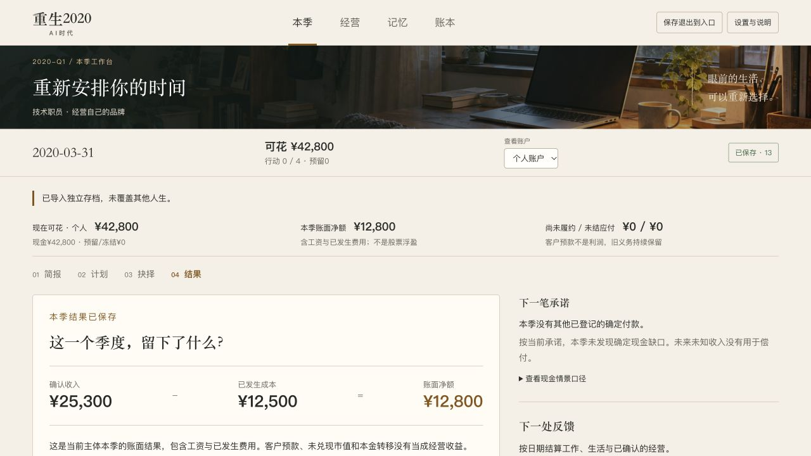

# D02｜正式前台重构与C-D02累计检查

基线0776c815b6a86d95a6aed7d0685d340f85b0da47；本地main，公开仓库GOD-OF-PPT/reborn-2020-ai-era。只完成D02，不进入T14。功能提交及提交后读回另记，不代表远端已推进。

## 实际实现

- 以D01原场景接入真实React：房间→背景/愿望→建议/种子→正常开局，四项主导航，季度简报/计划/抉择/结果。推进区占文档空间，不覆盖操作。三桌面首屏主决定可见，保存状态与现金/行动/主体常显。
- 全部既有页面迁移：模拟个股/订单与持仓、视频制作/发布/商单、课程班期/教学/退款/支持/更新、中转客户/服务/独立复核/更正/供应、生态合同/实际回款、独立架空股权、有限例行、记忆/新闻、两层账本和存档。当前责任优先，已知计量差额、未结应收、取消赔偿不能归档隐藏。准备、历史和专业表单可展开。
- 发布/邀请/退出草稿按真实实体ID隔离，退款与重报价排除已失效身份；失效员工必须重选，不默认换成本人。确认固定所审阅快照，转资本、占款、实际费用、收入和现金分别说明。工作工资/开业维护/真实员工工资使用现有公开目录，不改规则数值。
- 正常继续入口改为优先上次查看的兼容人生，不使用IndexedDB随机ID排列顺序。显示偏好/最后查看ID只在UI本机偏好中保存；失败仍可从存档库明确选择。
- 专业页面懒加载，复用原Controller/Session/expectedRevision/幂等与事务协议。唯一应用投影增量为公开维护/工资参数；无规则状态、随机、存档schema或依赖版本变更。静态动作迁移清单115种全部保留，动态行为另由实际测试验证。

## 实际检查

| 层级 | 实际结果与证据 |
|---|---|
| 类型/单测/构建 | 最终66文件424项通过；原408项、原时限及断言保留，新增16项责任可见性/确认资金/资源重选/继续身份检查。见[d02-final-run-results.json](d02-final-run-results.json)、[最终单测](d02-final-unit-output.txt)。 |
| 工具/内容 | 60项Python工具、实际生产内容和两背景初始化通过，见[累计检查](d02-frozen-run-results.json)。资料最终检查单列，不将先前检查串联冒充最终通过。 |
| 旧规则与X06 | 十二个采集入口串行0退出，全部使用新目录；[最终回归](d02-reviewed-run-results.json)。跨路线原入口拒绝旧源码哈希后，增加显式ROUTE_EVIDENCE_DIRECTORY，继续严格校验新报告和快照，不覆盖T13历史。 |
| 原生UI | [47项实际记录](d02-browser-native.json)，含初期6项及修复后的检查，阶段与限制明确。两背景正常首季、股票、视频/课程/中转/生态/股权接续、真实双标签只读/接管、失败候选/刷新/恢复/备份、键盘/显示和布局。不是47名玩家。 |
| 导出审核 | [25份导出逐字审核](d02-reviewed/native/d02-browser-replay-audit.json)，444条不同完整命令前缀实际评估；5份正常输入必须匹配原引擎命令前缀，9对重试/查看/接管/恢复/刷新逐字相同。无手改余额/日期/资格。 |
| 生产包 | 故障查询参数在实际生产包无效；导入75→真实新决策76→刷新读回相同字节。主入口473.94kB、独立browser-game441.36kB为构建尺寸，不能当首载总量或速度提升。全部[23个HTTP资源](d02-production-http.json)与本机构建逐字相等。 |
| 完整性 | [源码动作清单](d02-ui-migration-audit.json)、[来源/快照索引](d02-evidence-index.json)、[原字节核对](d02-integrity.json)。12组来源哈希重叠不相加；177次快照引用、171文件、151个原始SHA256不是171个业务结果。T04旧原生报告只作历史引用，未重新执行。 |

原时限串行全量424/424通过；没有关闭隔离、放宽超时、删除用例或用资料检查代替引擎/浏览器。中途类型错误、旧汇总源哈希拒绝、早期界面及选错继续存档的导出如实保留。部分浏览器工具调用超时后先读取真实提交，再决定下一步，没有重复已成功指令；工具传输时间不当作浏览器性能结论。

## 真实流程结果

技术正常新局从CreateRun逐项安排工作/手工首单/独立准备，首季现金42800元、最低25500元、本单成本500/收入1300/净额800；内容正常新局工作/规则学习/公开研究/跳过首单/模拟订单，实际撮合后首季现金21000元，两路径各4点。季中结果取实际截至日期，不偷换D01固定样例。

后期五条路线的2020前史来自正常引擎回放，原生从明确输入日期接续：视频62→64真实发布及反馈；课程73→85预售19980元受保护、两次不同阶段退款、实际教学/整改/七天逾期维护；中转96→103服务168条用量、独立复核9条非零更正、原账差额/停站旧余额7200.02元保留。中转个人全部204000元转公司后，个人现金0/行动0仍可有限停站；公司资金和保护未当成个人余额或利润。

生态70接受合同后实际head.put成功再abort，旧70/0合同仍显示、禁止叠加，候选71仅在原候选重试成功后发布；实际完成生产、提交/客户认可后取消支持的1200元赔偿和3600元应收明确保留。股权另从正常内容96实际支付20000元取得2500股/0.20%、无董事权、锁定至2027；恢复96及原备份97逐字一致，没有重复投资。没有新原生解锁退出或正向董事表决证据。

三桌面1280×720/1366×768/1920×1080、375×812和等效640×360无页面横向溢出；六经营入口及真实课程班期窄屏另验。1280主决定在scrollY0时底边619.90，推进区不遮挡。文本模式场景背景实际为none，减少动效、对话框内焦点/Escape返回与存档纯净对照通过。开发/生产所读取warn/error均0。真实200%与原生关闭警告确认工具仍未提供，等效视口不改称原生缩放。

## 审查、回滚和剩余责任

[杠精审查] 通过（D02限定范围）：逐页核对115种既有静态动作及实际经营责任，没有只改首页/颜色、用注释代替功能、以收款/任务结束清债、隐藏已知差额或用固定样例灌入引擎。修复继续身份、首屏/推进遮挡、无效资源、历史义务、草稿串项与确认语义后完成针对性及全量检查。原始输入/计划、旧planning/锁、T01—T13/D01证据、原场景/样稿保持原字节；最后主任务记录属于本轮允许修改的元数据。

REPEAT：2026-10-16的T09—T13与2026-10-17本轮均重复使用新目录采集、源哈希、正常前缀/原生导出审核和提交后防覆盖。扩展既有采集入口，新增本项目所需的正常UI输入前缀/审核脚本；未新建重叠Skill、子代理、自动化或外部资源。无需更新个人记忆。

回滚使用本任务提交的新还原/修复提交；不重写历史，不删浏览器本机档。规则/内容/schema10保持，最后查看偏好失效时可由完整库选择兼容档。未推送、未公开上线。为用户保留本机5199设计预览与5200生产预览，进程/cwd另有读回；测试临时标签清理，导出与本机备份保留。

后续顺序仍为T14历史分岔/AI危机→T15人物生活/年度与原生200%/关闭确认/加载预算→T16正常24季度/完整尾声→T17原PNG0/3、真人0人与全部Q/X/多种子平衡→T18最终候选。D02不自动关闭P/W/Q/X、完整游戏、美术最终验收或goal。
