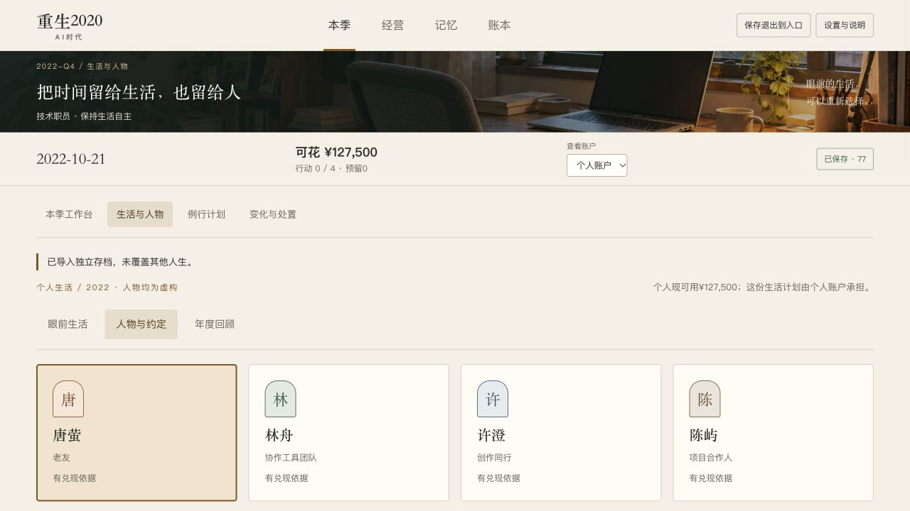
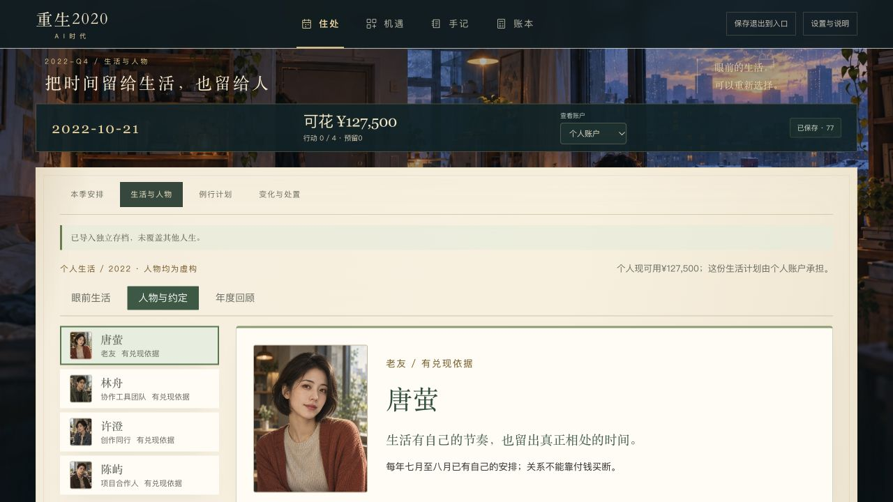
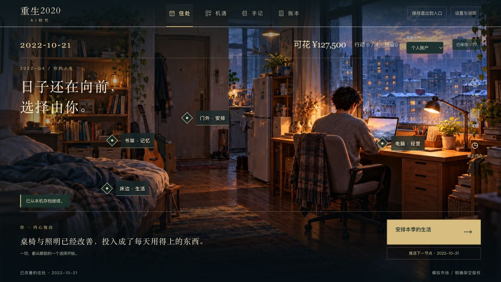

# A长日重启实际视觉复核

[相同原档对照](visual-comparisons.json)：正常技术人物前史77、2022-10-21、个人127500元/0行动、同一6b4e…原字节，1280×720。旧图为已保全原生基线像素，本C2没有重跑旧源；新图为当前固定生产5234，未合成/裁剪/缩放。

| 原生基线 | 当前电影版 |
|---|---|
|  |  |

默认主页面从季度工作台改成可探索住处，图中电脑/门/书架/床边是真实导航。主场景和人物构图先于表单；深入经营/账目仍保留完整规则与专业信息，不能为了游戏感漏掉债务、期限和权限。新人物展示只在公开known条件成立；C1已实际核对初始三个未知联系不显示头像；C2的UI/业务源逐字同C1，另实际复核人物77三桌面。

已关闭的实际问题包括背景被底色挡住、消息遮章标题、四人物挤出首屏；图片错误后的可读降级另已实际核验，原false/修复照片保留在C1。C2三桌面场景/四人物、文本/减少动效/重载与真实保存失败/原候选重试/完成日才换景都另采新证据。全部图与三原PNG缺失区分；当前用户只已确认A方向，未造真人试玩或整体美术发布验收。后续每阶段仍按../../art-review-checklist.md持续复核，移动专项最后M01。
