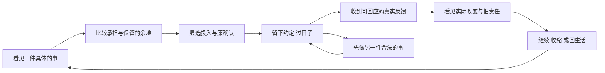

# 主线与系统美术优化方案｜从“处理业务”转为“经历一次选择”

2026-10-27。Game Studio采用Shared → UI / Foundations / Playtest路径。保留A「长日重启」、现有React/TypeScript/Vite与原规则；本轮是当前U4-B内部的设计复核，不新增实际任务，不代表新界面已实施或获玩家认可。所有页面兼容开发与测试保持0。

## 1. 判断：缺的是决定与后果的连续表达

主线不是五条财富路线的功能目录，而是“重回2020，用有限的钱与时间，选择接下来怎样生活”。五路线、工作、相处、休整都是可选择的手段；不要求全部通关、不默认创业，也不新增任务积分或收益倍率。

当前已做过首幕、同对象、跨季与真实账务等限定实施，不能因此推定玩家已读懂整局。用户反复指出“不清晰、像软件任务”已经是实际试玩负反馈，应现在处理；正式预登记样本仍0不等于没有发生试玩或问题尚不成立。此次[当前Chrome整幕](current-room.jpg)是R7构建、2025-04-09、第115次已保存提交的只读观察，未执行新游戏命令。它仍明确暴露以下问题：

| 当前看见的内容 | 体验断点 | 本次改法 |
| --- | --- | --- |
| 已经结束的一期，主按钮仍是“看看本期还留下什么，再决定下一步”。真正回今天与生活在下一层。 | 玩家面对结果，首先学到的仍是打开另一层阅读。 | 结果后的可行去向直接成为主层动作；旧责任另明确保留，新一期必须独立显选与原确认。 |
| 左侧有主/次阅读，右物件与其下方又有原票入口；回看身份也在多处重复。 | 相近动作争同一层级，难判断哪个是继续游戏。 | 同对象阅读入口归为一种职责，主物件与主念头共用同一决定；历史身份保一处明确标记，当前日期仍为主锚。 |
| 结果说明、账户保护、原约与多条纸签平铺；“已从本机存档继续”占着回响位置。 | 重要事实都在，却缺少先读什么的顺序；系统反馈与人生后果混在一起。 | 先呈实际改变，再呈仍需面对的责任与具体下一步；存档恢复属于保存状态，不能冒充一次新故事结果。 |
| 背景有电影氛围，但多状态仍依赖同一套左文右图与长标签。 | 物件较多承担配图，玩家仍需读完说明才知道能做什么。 | 用同镜头的纸件位置、展开/合起、回信与收据表达状态，配可读文字；空间变化和实际动作一起交付。 |
| `RelayRecordBook`把客户预付余额、供应剩余资产与待回应/正在等的原票放在一个筛选中。 | 正常留存也容易被误读为还要清空的任务；这是当前代码的呈现风险，尚非一次真人误认记录。 | 依据公开事实区分需回应、正在等、可选处理、留存依据；所有原行保留，正常资产不承担进度未清或离开的隐性门槛。 |

前两项分别可在`relay-journey.ts`的next分支、`RelaySceneChoice.tsx`的next面板与`OpeningMoment.tsx`的主层出口中追到。不是缺少原能力，而是原能力的出现顺序与决策意义需要调整。当前R7实图不代表后续N8—N11源增量已构建或已验证；type R19结束早于N11，不能为其作通过证明。

## 2. 一条主线，三层问题

人生愿望回答“我想保住什么”；年度/季度转折回答“刚发生的事，让我现在面临什么取舍”；这一幕只回答“眼前能亲手做哪一步”。不同时常驻三个大问题，也不按年份强行制造戏剧冲突。由已提交、公开的事实组织文案，资料不足就如实显示当前安排。

趣味来自有差别的真实取舍：本季工作占用与个人时间，视频投入与客户修改，班额与支持能力，服务承诺与供应预算，模拟投资与用钱时点。界面先让玩家比较确定代价、保留的余地和下一反馈；未知收益、未读批准、未完成复核不预告。不为了增加互动而添加免费点数、小游戏或每日重复点表。

## 3. 用同一段经历设计六幕

以下是连续体验规格，不是要求玩家照着固定剧本，也不是六张强制菜单。每片必须有一条同run连续实际经历，不能拼几个旧档作主线证明；同run还须是同一实际命令前缀与连续回执分支，不能仅因runId相同就串接恢复出的不同经营史。历史分支只补状态反例。

| 幕 | 玩家首先看见什么 | 亲手做什么 | 画面与信息如何变化 |
| --- | --- | --- | --- |
| 遇见 | 一句具体处境、一件焦点物件；开局回应已选委托/模拟投资/自由安排。 | 选择承担、暂缓或另一合法方向。 | 只照亮当前可决定的物件；原五路线仍可发现，未满足条件说明当下能准备什么。 |
| 取舍 | 谁的事、这一刻确定付出什么、何时反馈、保留什么余地。 | 按对象→资源/金额/日期选择，进入原预览与确认。 | 选择只改变草稿与近景；取消回到同一物件，草稿按原身份保留。 |
| 承诺 | 原确认中的主体、费用、AP、实际日期与旧义务。 | 明确确认；允许取消。 | 原保存成功才留约定联；保存中/未保存候选/冲突叠加保护态，旧业务物件保持。 |
| 过日子 | 明确等哪个人或哪件事、公开反馈日期；原费用和硬屏障照常。 | 等待或转去另一件事；有意义反馈发生时面对它。 | 日历与工具表达已安排/运行/等回应；不以每一日计量制造额外点击，不用假进度条。 |
| 回响 | 一项实际改变先出现；成本、现金、保护款和未完责任按性质解释。 | 回应客户/核对差额/明确收款，或只阅读既成结果。 | 实际完成才留成果，实收才留回执；亏损、拒绝、中断也有真实留痕，不能一律庆祝。 |
| 转向 | 这段已到哪、仍答应什么、今天还能选择什么。 | 直接继续同对象、显选新一期条件、回今天或生活。 | 结果保在桌上，不自动接新单或收款；当前日期、原来源与跨季旧约各自明确。 |

**当前115结果页的具体改稿：**保留“这一期，已经收好”的事实标题；来源只标一次“回看2025-Q1”，主时间仍为2025-04-09。主层直接提供“合上这一期，回到今天”；旁路提供“看看下一期需要哪些条件”，仅预看原条件、资源与旧责任，不直接续签或开新服务。下一期不合法时说明具体原因，仍可查看原条件，不能伪装可执行。原期完整票据保一个明确阅读入口，携原对象。

这不是只改两个按钮名字：当前焦点物件改为已合起的服务单与露出的实收联，点纸件与主念头都执行同一个“合上回看→Today”UI动作，提示原约定仍保留；不再一边指回今天、一边点大物件又打开原册。新一期条件显选后，才进入另一份明确的新承诺近景；日历/生活作为去向的空间提示，不再追加一列等权菜单。完成留痕、可点形状、主旁层级、同对象阅读与实际输入必须一起修改、一起看整幅图。

当前企业可花、客户未消费保护、供应资产保持原来源和口径。历史实收不是今天又赚一笔。任何未付、退款、未完支持/复核、独立风险与强制责任保独立可见摘要及原处理入口；不是把它们从画面中删掉。若仍有强制责任，先面对它并可返回原关注。只读可回今天/翻原账，不能写；候选/冲突保旧提交画面、目标及原retry，按原保护限制操作，不能借“今天”绕过权限。回今天只移阅读视角，不改主体书签、游戏档或原承诺。

“下一期条件”核当前公开资格、原合同、有效价格、资金与AP；谈妥但未生效的报价仍属未来条款。新承诺稿不默认复用旧客户、供应顺序、容量、预算或支持方式；旧期原稿保留，新稿仅在新期真正保存后分离为空稿。取消/分页/原册往返保同身份新草稿，不因普通等待或revision改变清稿，旧期始终能明确返回。

## 4. 一屏UI：决定、依据与保护各有位置

普通主层保一个决策焦点和至多两个不同旁路；原Clock可推进时计入旁路，强制责任不受普通预算限制。不把“继续”“查看结果”“看看下一步”写成需要重读同一摘要的多重入口。

| 层 | 可见职责 | 完整内容去处 |
| --- | --- | --- |
| 场景主层 | 当前处境/阶段；本次确定代价或实际结果；具体主动作；必要等待日与未完责任。 | 当前主体可花现金、真实四点状态、日期与保存各一份。危机/资金缺口/未保存入口持续可见。 |
| 决定近景 | 只处理当前取舍的对象、资源、日期、金额和已知限制。 | 多字段按原分页分步；前后/取消保同身份草稿。原确认完整保留，不替玩家默认预算、客户、供应或权限。 |
| 同对象阅读 | 查看本次原约、原款、报告、更正与逐笔来源。 | 原全部字段/能力按章节与页码可达；原引用和技术ID留在依据，不占主标题；不滚动、不裁切、不缩字藏操作。 |

“客户未消费保护”可辅以“这部分钱仍要留给客户”，“供应资产”可辅以“仍留在供应端，尚未取回”；原术语和数额在相邻说明/原账保留，不能把语气变轻当作免除责任。候选重试、只读原因、强制责任、资金缺口及局部未知事实必须在实际决定处可见，不能只保AX名称。

原票阅读筛选的四种意义只负责呈现：已到期欠款、退款缺口和需决定的风险继续明确回应；已承诺的任务/反馈标明正在等及公开日期；未委托复核、可选资产取回等明确为可选；已结与正常留存作为依据。客户预款仍是保护义务，正常留存不等于无责任；仅因正余额不能宣称已逾期或强迫退清。实际到期/承诺/资金保护事实优先，缺来源就说明未知，不按分类获得新权限或改变原命令门槛。保全部原行、原页码和显选目标，不能为了默认列表好看而静默换票。

## 5. 美术与TA：一套状态语言，五种路线手感

A长日重启保持冷青城市、暖灯、木材和纸白。场景首先让人认出“现在发生的事”，随后才阅读数字。背景、角色、前景物件、文字与光线采用同一镜头；不把软件面板换成羊皮纸边框后仍铺满屏幕。

本片先交三种可辨的整幕构图：**履约/等待**展开原工作联、让工具与原日期成为焦点；**原款已结但事实未核**将已收联收存、未核联独立展开，复核或离开均明确可选；**停止/收好**合拢原约，仅真实未完支持、复核、退款/欠款等另留有文字的责任签。三幅都保同一桌面和光向，以大轮廓、摆放、遮挡和接触影区分阶段，不靠小阶段签或极细SVG差别承担第一眼识别。不是新增三套风格，也不要求重做房间背景。

| 状态 | 物件与TA | 交互/声音约束 |
| --- | --- | --- |
| 可决定/显选 | 焦点物件边缘暖光、明确短动词；选中后纸页近景，主旁层级可辨。 | hover、键盘焦点、按下、禁用分别定义材质；物件与文字指向同一对象，不依赖全局hover偶然覆盖。 |
| 已安排/运行 | 约定联带日期，运行时展开相应工具；不是同一张纸只换一句状态。 | 选择与原确认节奏分开；不持续闪烁，不用动效代替实际进展。 |
| 等回应/需回应 | 收起的寄出联与新回信折签区分；等待写明对象/公开日期。 | 新反馈可以吸引一次注意，普通消息不抢原关注；无NPC事实不编人名或对白。 |
| 完成/实收 | 完成成果收好，另有真实收据；应收不能画成现金回执。 | 原保存成功才出现结果响应；失败不播成功，未赚钱不播金币声。 |
| 停止/受挫/责任 | 中性收起；仅实际未完支持、退款、欠款或风险加朱红责任签并配文字/形状。 | 亏损、客户拒绝、中断真实表现；0AP仍保原有限停止和原Clock。 |
| 只读/保存/未保存 | 业务物件与保护状态分层，完整旧事实仍可读。 | 禁写不等于禁止阅读；候选保持旧场景，原retry成功才发布新结果。 |

股票用资料与委托/交收回执；视频用作品、版本与客户回信；课程用教案、真实名单和阶段留页；服务用约定、工具、独立支持与逐票附联；生态/架空权益用合作书与不同权利凭据。五者共用状态语法，不能统一成五张利润卡。

**素材顺序：**先盘点现有原创kit，按本片实际状态重组透视、桌面支撑、接触影、遮挡与字号层级；完整组合看不清才列具体缺口。imagegen只为已明确用途制作同镜头/光向的前景或姿态，保原图/提示词/来源及衍生清单，文字/金额/操作保持DOM。先做一片连续状态再扩展，不先批量生成五套孤立海报；新图不能替代缺失原三PNG。

**可见反馈随片验证，成套声音沿原U9收口：**选择时局部响应，确认时留下约定，实际保存后再留成果；节奏值在该片自然窗口实看后确定。纸页/确认/真实结果/轻环境四类声音现在先定触发语义，原U9统一制作与接入有来源的资产、默认静音和开关；不以声音夸大实际收入。减少动效与纯文本沿同动作和完整事实；本轮没有新增图或音频，也未测试新的视听表现。

## 6. 实施顺序：先收好眼前这段，再扩展下一片

| 位置 | 下一步实际工作与退出条件 |
| --- | --- |
| 当前U4-B内部首先 | 依据本方案审定结果主层、同对象直接动作、等待反馈与六幕稿；逐字段登记删留移，包含未收起回响、0AP、待付与保护、历史和失效来源的完整组合。当前115的同动作合上回今天/预看新期仍是待实施设计，不能沿旧“next面板可到达”当完成。 |
| 当前U4-B内部随后 | 将整幕脚本、专用纸件/TA、原确认与状态一起接线；完成N8—N11等已写源但尚未新构建/实见的增量核验。源码变化后运行适用原门槛，再在当前自然Chrome按同对象连续经历看实际操作与画面。不能用本方案替新检查或用R7图替R8。 |
| U4-B关闭前 | 完整客户/供应/计量/跨期复核、更正/收退款、支持完整与中断、停止旧债、保存失败/只读/原retry及原R2/R3/C-S4-R逐项映射；最终完整Create与独立公开读回、原能力覆盖及选择性提交/保全仍须完成。账务正确与体验合格并列，缺一不勾。 |
| 第9项U5与C-UX09 | 用同样六幕交生态合同经历与实际生活去向，专用资产同时交；累计实核U0-R/U4-B/U5，保原U6责任转交。 |
| 后续原顺序 | U6→U7→U8→C-UX12；该检查完整接回原U4-B/U5/U6组合。U9后新体验累计完整接回原U7/U8/U9组合，再处理T17其余；M01只在用户明确恢复后启动，T18最后。 |

U0-R第7项已有本地限定成果，不重新计一次完成，不退回重开一个基础工程。当前第8项仍U4-B，以上只是其内部执行与体验门槛补充；没有新开并行实际task。不能把空间、清晰动作与基本人生转折全部延期到U9。

## 7. 验收：用玩家能看见的经历作主记录

每段连续记录“前一刻在意什么→选了什么/放下什么→真付出什么→等谁与哪日→实际改变什么→下一步能去哪”。同时保留同次完整画面、实际点击/键盘与原命令/存档身份；不要只提交功能清单或大量账务操作。

- **自主体验检查：**主标题、当前日期、焦点物件、主动作和反馈说同一件事；首次点击进入实际取舍或原确认，取消能回同对象；等待后结果直接可辨，结果后能直达具体工作/生活或同对象下一决定。实际鼠标与键盘可用，完整责任、Clock与未收起回响一起核。任一环节仍需开发者口头指路，就退回本片修缮，暂不扩下一路线。
- **规则与保存检查：**钱/日期/AP/资格、分账户/预款/资产/应收应付、原确认和草稿、候选失败/冲突/只读/原retry/重进仍按原合同；有意义模型/实际consumer回归、类型/构建、完整Create审核和独立读回各报各自范围。保原门槛与失败记录，不拼成一次全绿。
- **真人检查：**后续可安排时，让玩家无提示说明此刻目标、两种选择差别、确定代价、等谁、如何继续；记录犹豫、误点、像填表与愿意再试的具体时刻及美术意见。首轮有人理解失败就作为缺陷分析，不能用自动化通过替代。人数/时长沿既有招募目标，当前正式样本仍0，不造通过率。

本轮交付是方案、当前只读整幕和独立方案复核；未改产品源码，未新增经营命令、图/音频或产品测试。U4-B与整个goal保持ACTIVE；原P3正式62/22、原三PNG0/3、正式真人/美术认可、五路线24季新体验及全部旧未验责任继续保留。回滚按本片呈现层独立提交，保原档与旧证据，不改schema或重算历史；无push/deploy或新增外部资源。
