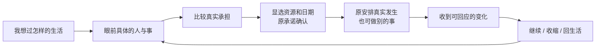

# 主线、交互与系统美术优化执行方案

2026-10-28。采用 Game Studio Shared → Game UI Frontend / Game Playtest，承接36号10.7的既有顺序及当前唯一任务C-UX09。沿A「长日重启」，保留React / TypeScript / Vite、DOM文字、SVG及原创位图。当前方案是既有目标的细化，不另建目标、不换引擎、不启动兼容性工作。

## 判断：把经营系统组织成可经历的人生

主线的问题是「当下的事情没有持续成为玩家的目的」。愿望、业务记录、日期和操作虽然存在，但进入、等待、跨季、结果和重进之间仍可能断开，玩家只好自己在功能目录里拼出下一步。目标应当是过怎样的生活，工作、五条财富路线、人物与历史分岔为这个目标提供取舍；不要求清空任务或每条路线都成功。

美术的问题是「画面没有随同一问题一起变化」。背景已有电影感，但主标题可能停在上一阶段，物件主要像资料入口，阶段、价格和来源反复铺陈；互动于是仍像处理表单。不能仅靠新背景、统一金边或完成特效解决。

当前自然Chrome提供了具体反例与改进依据：

- 原跨季住处安排仍在运行，但无UI书签的导入曾回到泛日历；实际完成后也曾丢失原结果。已在当前候选代码修复，并实际走原17→18、显选休整19→20与原文重进；这不是新的完整开局验收。
- 当前课程原97从Jan31一击等候，经8笔原AdvanceTime保存，到Mar14真正出现更新才停下。个人实际付出8000元、课程100元、原4名留存学员、398元保护及旧教学/退款责任同时保留。105原文重进逐字同。这里验证了等待与原账，不代表趣味性已被真人认可。
- 同次Mar14图仍使用「这一次，已经答应了学员」与泛化副题，当前更新及Mar21期限在下方才能发现；课程名和责任也重复出现。近景已有更具体的「工具变了，先照顾原来的学员」，主幕应与这一真实问题同步。这项视觉与叙事缺口仍待实施，不能用等待已跑通替代。

当前图：[等候前](../chrome-wait-r4/r4-01-class97-known-costs.png)、[实际更新后](../chrome-wait-r4/r4-02-class105-real-feedback.png)。这些是当前候选源码664的实见画面，不是设计效果图或正式美术认可。

## 整段体验合同

每一幕同时交付：当前问题、同一公开对象、可比较取舍、原费用/AP/日期、操作与取消、真实等待、实际结果、下一生活去向。物件与主念头共用同一原动作，不增加「开菜单→复述同一幕→再开菜单」的同义层。

人生愿望保持长线；当下主标题随实际阶段改变。新更新到来时先讲更新问题；拒绝后先讲已经付出的代价及补救/退出；已收齐后先讲实际改变及去向。历史回看明确原日期，回今天只改阅读位置。普通消息、翻账和时间推进不擅自换关注或续约。

## 一屏构图与阅读分工

|层|承担什么|处理方式|
|---|---|---|
|场景与前景物件|我在哪、眼前是哪件事、现在处于何阶段|保持同镜头和光向，物件有桌面支撑、接触影与遮挡；明确可点状态。|
|当前主念头|这次需要我决定什么|具体问题作标题，关键期限或等待对象紧接其后；不长期使用泛路线口号。|
|主要行动|亲手做什么，付出什么|同对象直接决定；先比较承担，再选择资源和日期；原确认与取消保留。|
|轻HUD与责任|当前日期、所选账户余地、可用/预留行动、必须面对的事|不合并主体或资金性质；责任、资金缺口、只读与保存恢复常可达。|
|物件留痕与回响|什么已经真实发生|已安排、开工、作品做好、亲手交出、客户回应、应收与实收分别表现。|
|随身册与原账|完整依据和全部原能力|同视口章节/页码，沿同对象定位，取消/翻页保稿；无页面或面板滚动。|

移除重复说明前必须登记字段去处。不能把账目裁掉、缩字、移到仅AX可读或靠颜色暗示；特别是关键期限、保护款、退款/支持责任和候选恢复，不受普通信息预算隐藏。

以当前课程为第一份迁移样本：

|真实内容|优化后的主要去处|完整来源|
|---|---|---|
|课程与Jan16班身份|场景眉题一次明确|同班原册持续定位。|
|Mar14当前更新、Mar21期限|主标题/第一层问题与原更新动作|原公开更新及同对象近景。|
|1/2已教学、4名留存、第二段已安排|教学物件的阶段留痕|原班期/教学日历。|
|995预款、199实际退款、398保护、398教学收入|分性质原票/必要责任，不画成四份收益|完整同账户账与原班记录。|
|原支持至Apr22、退款窗口至Apr29|独立旧约提示，不因更新清除|原支持/退款操作与原期限。|
|此次等候个人8000、课程100实际支付|保存成功后的可见首句与完整回响|各账户原流水及逐笔AdvanceTime。|
|返回生活或先做别的事|显选的场景去向|只改阅读；新投入继续独立确认。|

## 让选择形成游戏性

1. 开局的愿望接到不同的首幕处境，工作、首单、模拟投资与自由生活保持原选择，不把首单变成所有人共同必做。
2. 先比较具体承担。例如当前课程是核对这次更新，或沿原允许范围暂停新销售；旧班责任不会因停售消失。具体资源、费用和日期仍由原预览决定，不能编造未来评价或保证收益。
3. 等待只在真实可回应变化和原硬屏障停下。日常累计仍逐笔结算，减少重复点表；玩家可以停下，已发生的日子保留。界面不替玩家收款、续约、融资、交易或扩权。
4. 结果直接给下一次生活选择。继续同对象、收缩/退出、回到今天或生活各自说明真实去向；不固定把所有路线导向下一张经营菜单。
5. 人物与生活通过原邀请、原承诺及真实状态进入场景；不编造人名、未发生对白或未知回应来装饰气氛。有限行动和现金形成取舍，不增加免费筹码、假奖励或强制灾难。

## 美术、UI与TA一起交付

材质沿冷青城市、暖灯、木桌与纸白，朱红用于真实责任，暖金用于当前可决定。五路线各有物件语言：模拟委托/持仓凭据、作品包、教案/真实班期、服务原约/附联、生态制作册/回信与架空权益凭据。共用状态语法，避免五张同构管理卡。

|状态|画面与交互要求|
|---|---|
|可选择 / 悬停 / 键盘焦点|物件轮廓、局部受光和文字共同说明能做什么；与原动作权限一致。|
|已选 / 原确认|近景聚焦所选对象，明确承担；取消和返回保同身份草稿。|
|已安排 / 进行中|约定页和实际制作稿有不同形状，日期真实；不播完成庆祝。|
|做好 / 客户等待 / 已回应|作品包、寄出留痕和真实回信有区别；未知答复不提前出现。|
|实际结果 / 应收 / 实收 / 停止|按各自原款与阶段留痕；停止可中性，真正未完义务另签。|
|候选 / 保存失败 / 冲突 / 只读|保最后已保存物件和真实已发生部分，恢复入口明确；不把未保存结果画成完成。|

动效分为UI选择、原承诺、保存成功后的结果三个节奏，不执行规则；只在真正结果发生后展开回信或收好纸件。先确定各状态、来源及动作，再按缺口用imagegen制作同镜头透明素材；文字、金额和点击区域保持代码。保现有纯文本/减少动效及SVG回退。声音成套设计随原U9收口，不能把现在的可操作性和阶段辨认推迟到U9。

## 实施顺序与准入

|顺序|当前交付|完成门槛|
|---|---|---|
|当前C-UX09：先修连续性与等待|无UI书签时恢复同一公开对象、跨季原结果、来源日期、受控原时间等待及累计回响|正常/失效来源、候选/只读/原retry、实际原文、钱/AP/日期与当前Chrome成立；完整累计尚未完成。|
|仍在C-UX09：整幕表达修缮|先用当前课程更新修标题/主旁动作/字段迁移，再复核首幕、服务与生态，不另计任务|主标题、物件、真实阶段、原Clock、责任和去向讲同一件事；长回响未收起时也完整可操作。|
|C-UX09整体检查与收口|完整接回U0-R/U4-B/U5，复核原R2/R3/C-S4-R；不拼不同人生证明连续主线|至少一条当前同run从开局到工作/生活、跨季/今天；同run课程与运行服务正例、原账/权限/存储及原完整测试闭包；原红与未验分列。|
|U6 → U7 → U8 → C-UX12|架空权益、人物生活和六年衔接，每片同步交互动与系统美术|C-UX12完整接回原U4-B/U5/U6组合，含旧约/权限/退出/保存；不只验单独权益。|
|U9 → 新体验累计检查|五路线、人物与六年视听统一|完整接原U7/U8/U9组合，按当前源重验；不是T18。|
|T17其余 → M01 → T18|正式试玩、资产等余责及最终最大review|M01必须用户明确恢复，现不启动；T18最后，整个goal保持ACTIVE。|

每个既有任务仍独立实施和验证，每三个任务完整检查。上述C-UX09内部顺序不冒充三个任务已经完成。后片美术可以精修基本状态，不能把当前缺陷推到最后。

## 验证、风险与回滚

当前Type R19与Build R5均退出0，源码/资产闭包664前后同；Native本片累计新命令11、新Create0，R4贡献8笔真实时间保存，第二标签同档105只读可看但不可提交新更新。原配置5秒失败和新增8笔保存集成用30秒功能门槛分层保留，不称性能通过。

本片完整Create原文审核R20已实际退出0：7份分来源原文、2个正常创建、123条去重原命令均重放全字节相同；其中1份为导入输入，不算新的物理保存或Native创建。51HTTP与当前构建逐字同。此为原文与工程依据，不能替代画面或真人体验。

尚待：Native明确停止、部分保存失败/原retry、课程与服务同run合法正例、新源完整开局连续经历、完整当前累计及最终原文/账务审、选择性提交与保全。当前实现未提交，C-UX09未完成。

真人试玩另观察四件事：玩家能否无提示说出眼前目的、比较确定代价、辨认实际结果、选择下一生活去向。记录犹豫、误点、预期与实际差异；自动化、截图和账务正确均不能代替理解、趣味或美术认可。正式真人样本仍0，原三PNG原字节恢复仍0/3；P3正式62/22与原T17余责保留。

所有页面兼容开发和测试继续为0：不切尺寸、不做移动/缩放/跨浏览器或原生离页专项。无规则/schema/依赖/RNG/金额/权限改动；P3原26路径、旧原文与封存保留。回滚仅本片呈现/应用层编排提交，保原存档和已保存事实，不重算历史。无push/deploy、外部资源或新委派。

[杠精审查] 方案通过，实施未完成：具体反例、字段迁移、完整状态、交付顺序和未验责任均已列；没有把新背景、功能接线或当前8笔等待证明当作整作游戏性与美术认可。
