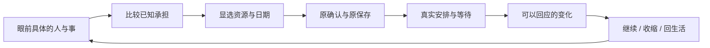

# 让经营成为人生：主线与整幕美术优化方案

2026-10-28。根据本次试玩反馈，采用 Game Studio 的 Shared → Game UI Frontend / Game Playtest 路径。沿 A「长日重启」电影叙事方向；保留现有 React / TypeScript / Vite、DOM 文字、SVG 与原创位图。本文是当前 C-UX09 内部的方案复核，不新增实施任务，不将方案交付记为游戏优化完成。所有页面兼容性开发与测试继续暂停。

**设计判断：让玩家先面对一个值得决定的问题，再亲手承担后果。主线、物件、操作、时间和结果必须共同讲述这件事。** 仅增加背景、纸张、金色边框，仍会让玩家感觉在处理软件任务。

[当前 Chrome 整幕](current-room-105.png) · [四幕交互分镜](storyboard.html) · [既有完整实施顺序](../../../../docs/36-mainline-and-art-reconstruction-plan.md#107-最新实施顺序与计数)。分镜是设计演示，不连接存档，不是产品截图或已通过的试玩证据。

## 1. 两个问题为什么会反复出现

| 层面 | 本次依据 | 需要改变的体验 |
| --- | --- | --- |
| 主线 | 当前 2023-03-14 原班105已恢复到更新问题；既有真实反例还包括导入后关注丢失、跨季结果退回准备、更新完成后重进换回样课。相关候选修缮已有，但完整累计未通过。 | 玩家关注一件事之后，进入、等待、结果、跨季和重进必须沿同一对象；下一步不能靠玩家从功能目录重新拼出来。 |
| 选择 | 当前画面的01是核对更新，02是翻原记录。阅读有用，但两者没有构成生活取舍。 | 主要行动面向真实改变，旁路面向另一种时间用途或暂不承诺；原账留为明确阅读入口。仅有一个合法改变时，不伪造第二种选择。 |
| 画面 | 当前有电影背景、更新纸件和真实阶段签；左侧仍是大段说明，人物背影不承担互动，纸件下多组文字与主幕重复。 | 让物件的形状、摆放与留痕表达阶段；主文讲问题与代价，责任签讲必须面对的事实，原册讲完整依据。 |
| 语言 | 当前正文实际出现“更新不创造新购买资格”“不能因新准备隐藏”，读起来像软件规则说明。 | 工程约束留在实现合同；玩家正文说清是否再次收费、答应了谁、还要做什么。数字、资格和责任不变，叙述以人生处境组织。 |
| 回响 | 当前回到住处时可见的回响是“推进至2023-03-14”，比真正发生的课程更新更泛。尚不能由一次观察断言所有返回路径都丢失回响。 | 首句讲本次已经发生的关键改变；日期作时间锚。等待、付费、支持中断、实收各有自己的结果表达。 |
| 趣味 | 账务正确、按钮可达和测试通过，尚未形成真人理解、趣味和美术认可。 | 检查玩家为何愿意继续、是否有可比较的承担，以及决定是否改变接下来的生活；不能只统计完成多少任务。 |

本次只在已有 Chrome 自然窗口合上自己的只读导出层、回到住处并观察，未推进日期或提交经营命令。状态前后仍105；不切尺寸、不测缩放。原223文件累计结果保留为失败，不能用文档交付消除：1503项中1444通过、24失败、35未执行；其中原完整课程工作区后来单独复核通过，不能合并冒称一次全绿。

## 2. 可借鉴的经验及边界

本次重新查阅公开一手材料；没有实机竞品试玩，也没有逆向判断其 TA 或 shader。

| 参考与原材料事实 | 对本作的设计推论 |
| --- | --- |
| [Citizen Sleeper 官方介绍](https://store.steampowered.com/app/1578650/Citizen_Sleeper/)用有限行动、时钟与个人驱动力连接自主故事。 | 每季4点应让“把时间留给谁、承担什么”直观可见。原日期和承诺形成期待；不引入其骰子或新增随机。 |
| [Suzerain 2.0 开发者公告](https://www.torporgames.com/press-releases-new/2023/07/31/torpor-games-fellow-traveller-unveil-suzerain-20-amendment-update)共同改进选择、后果、地图、UI与视听。 | 以完整经历为交付单位，叙事、构图、原动作和后果一起改；不把美术作为业务完成后的装饰。 |
| [80 Days 官方介绍](https://www.inklestudios.com/80days/)把明确的旅程目标与大量可选路径结合。 | 整局保留“想怎样重过六年”的方向，当下允许工作、五财富路线和生活等不同路径；不把主线变成必做路线清单。 |

这些是设计启发，不证明复制其表现就能改善本作。保持原作的时间跨度、生活选择、历史分岔和 AI 风险，既不强迫每条路线成功，也不强迫灾难。

## 3. 一条主线，三个尺度

**整局：我希望六年后怎样生活。年度：这一年机会与代价变了什么。本幕：此刻我要把钱与时间留给谁。** 愿望不变成完成条或奖励分；年度问题不代替实际事项。

每幕必须能用一句话回答：**“为了什么，现在决定什么；付出什么，什么时候再看。”** 这句话由同一已提交对象产生，不使用固定的路线口号覆盖完成、停止或历史阶段。

三种开局沿原合法选择分别开场：工作与首单看原委托；投资看原资料和模拟判断；自由安排先显选工作、生活或研究。不把委托强塞给投资/自由开局。强制责任可以打断当前事，但说明原因并保留原关注；普通通知不抢镜。

## 4. 先交四幕完整经历，再扩充表现

四幕设计有两个明确来源：当前R10的105实见问题，以及R7独立恢复105后真实106→108的更新费用与日期。两者具有同一原班身份，但存档分支不同；本稿不充当当前R10的一条连续实机证明。分镜中的确认页是设计表达，正式实现仍须完整复用原资源/日期选择与原确认。另需独立以当前源码完成一条 fresh 开局→结果→工作/生活→跨季/今天的连续经历，才能关闭当前准入。

| 幕 | 玩家看到和亲手做的事 | 画面与结果 | 不可混淆的边界 |
| --- | --- | --- | --- |
| ① 遇到问题：3月14日 | “旧课有更新，学员还在等。”当前最后1点行动，先核对更新，或看看生活安排。 | 原教案夹着更新页；已交出/已安排的教学仍分别可见。更新期限3月21日明确。 | ¥2,000、1点、7日是原更新基线；实际资源/开工日经玩家显选和原预览核定。生活查看不扣点，真正安排仍独立确认。 |
| ② 作出承诺 | 同一纸件近景比较资源、费用、开工与完成日，确认或返回调整。 | 镜头只聚焦一次，返回保同身份草稿；准备纸与原约附联同时可读。 | 计划预留与实际付费分开。取消确认无新命令；若占用最后1点，明确本季剩余安排的影响。 |
| ③ 真实发生 | 原保存后进入已安排或制作中；等待有明确对象，可停下，也可查看生活。 | 纸页出现实际开工留痕，等待前核已知费用，真实日期按原屏障推进。 | 不用逐日点击制造忙碌；不跳过费用、季度、交付或强制决定。停止保已保存日子，原候选重试不擅自续走剩余等候。 |
| ④ 回响与下一选择 | 实际完成后说明旧课更新已完成、已经花出的费用及原班仍需承担什么。可回原班，或显选回今天/生活。 | 更新页归入教案，当前阶段/标题/主动作一起变化；原支持、退款和教学留痕不消失。 | 更新不是新收入、招生或原班结清。回今天只改阅读位置；新生活安排仍经原确认。 |

课程同一更新只是第一份可执行样本。服务的停止/更正/收款，生态的拒绝/补救/支持中断，也必须按“问题—承担—发生—去向”组织，不能只替换课程名。

## 5. 同一屏如何像游戏

保当前电影场景和可探索物件，取消以系统分类为主的视觉组织。以下是内容优先级，不是新的尺寸/兼容矩阵。

| 区域 | 保留在眼前的信息 | 互动方式 |
| --- | --- | --- |
| 时间与余地 | 当前日期、明确主体的现金/可花、行动可用/预留；保存/只读/候选状态 | 一组轻HUD。完整账目同账户定位，不能把企业款画成个人余裕。 |
| 当前问题 | 一个具体标题、期限或下一反馈、一句已知取舍 | 主念头与物件直达同一原决定；普通主选1个、不同旁路至多2个。 |
| 眼前物件 | 本对象身份、阶段、实际留下的进展 | 教案、作品、来信、合同各有自己的形状；不是五张换图的管理卡。 |
| 必须面对的责任 | 真正到期/受保护款/未完承诺/资金缺口，以及更新或交付期限 | 持续可见并有同对象入口；超出普通信息预算时提供独立责任阅读页，不裁切、缩字或仅留AX。 |
| 阅读与探索 | 原账、随身册、日历、其他路线和人物生活 | 同视口分页/分步，完整能力保留；翻页、取消和看账保稿。 |

当前课程字段明确迁移，先登记再删重复文字：

| 原字段 | 主幕/物件的指定去处 | 完整依据 |
| --- | --- | --- |
| 课程名与2023-01-16班 | 原教案封签一次明确 | 同班原册 |
| 更新与3月21日期限 | 主问题与当前行动旁 | 原更新条目及原确认 |
| 留存4/5、教学1/2、第二段已安排 | 教学两段留痕及人数短签 | 原教学/班期日历 |
| 支持至4月22日、退款窗口至4月29日 | 持续责任行，常显 | 原支持/退款入口 |
| 累计预款995、实退199、保护398、教学收入398 | 一条分性质原款行，不能合成收益 | 同账户原款/原班记录 |
| 企业现金6,115.36、可花5,717.36、行动1/4 | 同一组主体HUD | 全部原账与预留明细 |
| 原报价、全部计量、条款、历史流水 | 同对象原册分页；涉及当前承担的款项回到原确认 | 原始完整记录 |

玩家文案与工程合同分开：

| 当前常见表达 | 玩家应读到的具体意思 |
| --- | --- |
| 更新不创造新购买资格 | 这次给已经买课的学员补上新内容，学费不再收一次。 |
| 原教学/支持/退款继续，不能因新准备隐藏 | 下一段课还要教，答疑和退款也按答应过的日期继续。 |
| 预览/提交、同revision、原Clock/原屏障 | 看看谁来做、哪天开始、钱从哪里出；确认这次安排。跨季或到期时具体说清为何停下。 |
| 推进至2023-03-14 | 按实际新增事实讲“课程里的工具变了”及已发生费用；日期独立保留。没有新事实就不编造对白或结果。 |
| Today只改阅读视角 | 回到今天，再想想。已经答应的事仍留在日历边。 |

“预收学费”“已收款”“可花”“应付”等会影响取舍的准确财务名称保留，不能全部改成含混的“收获”。候选/只读/权限也必须告诉玩家如何处理，只把实现术语换成具体后果与可操作提示。分镜已作这层文字演示；正式代码仍待按当前任务准入实施。

## 6. 美术、UI与TA作为一套状态系统

**画面语言。** 冷青城市与暮色承接时间，暖灯聚焦当前可决定的物件，木桌/纸张保真实接触与遮挡。背景负责空间，物件负责阶段，文字负责意思。人物只沿原身份与真实来往出现；不编造客户脸、未发生对白或未知答复。

**形与色。** 暖金表示当前可决定，纸白表示已知记录，朱红加文字/形状表示真实需回应责任，中性收起表示停止。不能以发灰撤销原允许动作，不能把停止且仍有旧款画成继续营业履约。

| 实际状态 | 物件/交互表达 | 触发来源 |
| --- | --- | --- |
| 可选、悬停、键盘焦点 | 同一纸边受光、明确动词；焦点轮廓独立可辨 | 原公开对象及原命令资格 |
| 已选、原确认 | 所选对象近景，资源/主体/日期/钱/AP齐全；返回保稿 | 本次显选与同revision原预览 |
| 已安排、进行中 | 日历约定与制作稿分形；未到开工不画已开工 | 原任务状态/实际日期 |
| 做好、寄出、等回应 | 成品、发送留痕、未揭回信各不同 | 原完成/提交/已公开反馈 |
| 实际结果、应收、实收 | 已保存留痕；收入、待收和可花分别标示 | 原公开记录与实际收款引用 |
| 业务失败、停止、旧约 | 呈真实后果及已耗代价；未完责任独立附联 | 已保存失败/停止结果，不保留假的成功场景 |
| 保存中、候选、冲突、只读 | 保最后已保存物件；明确处理入口及已保存部分 | 原存储状态，不据展示理由授予执行权限 |
| 历史、跨季未完、今天 | 原来源日与当前日期分层；旧约有续接身份 | 原来源/原对象；Today只改阅读视角 |

**节奏。** 选择受光、原承诺近景、保存后的结果展开分三个节奏。设计参考为短选择约100—150ms、聚焦约160—220ms、结果约280—420ms，均是待检查的设计值，非性能结论；不延迟命令、不自动翻走正文、不持续闪烁。减少动效/纯文本沿原设置。声音由原U9统一收口，当前状态辨认与操作不能等U9。

**素材生产。** 先用现有背景和原生SVG核动作与全状态，再按真实缺口补imagegen素材。金额、期限、可点击区域和状态签均保代码，不烘焙进图片。

本次分镜复用已有背景，以CSS纸形示意前景物件，没有制作或替换游戏资产。纸件与真实桌面的透视/支撑/遮挡、人物在场和全状态材质仍须在实装中逐态核验；此稿展示交互与阅读编排，不申报最终美术资产或整幕认可。

| 素材组 | 本轮设计要求 | 准入 |
| --- | --- | --- |
| 共用桌面/支撑 | 同镜头、光向、接触影；纸件不悬浮 | 当前整幕同时看文字、原Clock、阅读入口与长回响 |
| 五路线专用物件 | 模拟委托/持仓凭据、作品包、教案、服务附联、生态制作册；权益另有原凭据 | 准备/运行/等待/结果/停止全状态与真实对象映射齐全后才制图 |
| 人物与生活 | 沿已有四人物和真实个人安排改变在场方式及住处细节 | 不画未发生的改善，不用富豪场景奖励未到账估值 |
| 状态留痕/过场 | 原生轮廓、局部光、翻页和收起；少量必要透明补件 | 资产清单、提示词、版本/来源、回退及纯文本可用；不以素材已加载当美术通过 |

imagegen制作约束：原创写实电影插画，A长日重启，统一冷青暮色/暖灯/透视；透明物件按批准源图编辑，同一基准与落脚位置；无文字、数字、按钮、品牌、未知人物或夸张成功符号。图片生成不替代状态和交互设计。

## 7. 实施顺序及工程落点

不把旧功能重新开工，不再平铺新的系统页。**先完成当前C-UX09体验主干，再按原序扩展。**

| 顺序 | 具体交付与落点 | 独立验证/出口 |
| --- | --- | --- |
| 当前C-UX09内① 主线连续性 | `player-thread`/`scene-command-focus`/`scene-meaning`统一目的、阶段、对象、来源与去向。复核已写候选代码，修实际缺口。 | 新源三开局；至少一条同run连续走到工作/生活及跨季/今天。显选不窃换原主体或书签，重进同对象。 |
| 当前C-UX09内② 决定、等待与回响 | `OpeningMoment`与路线Action共用原动作；`public-wait`/`public-feedback`保原Clock和全部硬屏障；`wait-scene-result`表达已保存事实。 | 原费用/日期/AP/权限、取消、实际停止、部分失败、原retry与物理旧新；不自动收款/续约/扩权。 |
| 当前C-UX09内③ 整幕与状态美术 | 以当前课程四幕为样本，落实上述字段迁移；再核U0-R首幕、U4-B服务和U5生态；`CourseTeachingPaper`与各路线物件同步。 | 主标题、物件、责任、主旁动作、原Clock和长回响在同次整幅图一致；当前窗口实际操作成立。 |
| C-UX09收口 | 完整接回U0-R/U4-B/U5和原R2/R3/C-S4-R；处理真实累计失败，不放宽原门槛。 | 同run未完课程+运行服务合法正例；原文/财务/存储/来源/完整能力映射。实际通过与仍未验分列，选择性提交保全后才关当前checkpoint。 |
| U6→U7→U8→C-UX12 | 架空权益、人物生活、六年连续性，每片带完整整幕；不延期基本交互和美术。 | C-UX12完整接回原U4-B/U5/U6组合与旧约/权限/退出/保存。 |
| U9→新体验累计 | 五路线/人物/六年视听统一 | 完整接回U7/U8/U9；不是T18。 |
| 原T17余项→M01→T18 | 真人、资产等原责任与最终最大review | M01须用户明确恢复；目前兼容工作0。T18最后，整体goal仍未完成。 |

上面①②③是当前单一checkpoint的内部顺序，不冒充已完成三个实施任务。若以后再拆实际任务，继续每三项累计检查。当前原有未提交源码及P3的26路径独立保留；本方案不改规则/schema/RNG/依赖/金额/权限，不以大重写处理体验问题。

## 8. 怎样知道改好了

工程准入和玩家体验分别记录：

- **实际行为：** 发现→比较→原确认→付费/真实等待→结果→下一去向→重进，同一run持续。正常、拒绝、来不及、业务失败、停止、只读和候选均有真实去处；不能只验理想成功。
- **实际画面：** 当前自然Chrome检查当前标题、期限、物件、关键款、责任、主旁动作与原Clock；点击与画面同源。没有裁切、缩字、页面/面板滚动或仅AX保留。此项不启动尺寸、缩放、移动、跨浏览器或原生离页专项。
- **实际规则/存储：** 原金额、分账户、AP预留/已用、日期屏障、来源、权限及原子保存前后保持；修表现不重算历史。保原配置及所有旧失败，不用单独重跑结果覆盖原批次身份。
- **正式真人：** 按原T17试玩安排记录玩家能否无提示说出当前目的、为何作此选择、确定代价、正在等什么、结果改变什么以及下一步想做什么；记录犹豫、误点和预期差异。真人尚未安排，理解/趣味/美术认可仍0，当前不由自动化代替。

主要风险是把主线做成强制任务、用简短文案隐藏责任、自动等待越过决定、用动画假播完成、主幕与原动作分叉。对应保护是显选关注与自由退出、字段去处逐项核、公开相邻事实和原屏障、保存后结果、同一身份共用绑定。

自动恢复还要核“恢复的对象是否仍是眼前的问题”，不能只验证ID有效。当前只读SSR诊断中，原降级主幕指向未收好的服务账期，自动恢复却指向客户记录；未到期应收的具体期限和本期责任需要继续追踪。原累计的两项断言失败在此未被判作旧测试过期，也未更改测试消红。精确客户身份本身不能证明服务主线连续；玩家显选客户资料与默认恢复未完服务须分别成立。

回滚以呈现/应用层编排提交为单位，保原档、候选与所有已保存事实，不撤销玩家历史；文档方案可单独撤回。正式三张原PNG仍0/3恢复、P3正式62/22、T17余项及暂停M01/T18责任不关闭。

[杠精审查] 方案覆盖主线、可比较取舍、连续分镜、全状态美术、UI/TA、字段/原动作迁移及完整原执行顺序；没有将功能可达或绿测视为好玩。尚未实施的视觉方案、真实累计失败和正式真人缺口均明确保留，不能据此宣布C-UX09或整个游戏完成。
